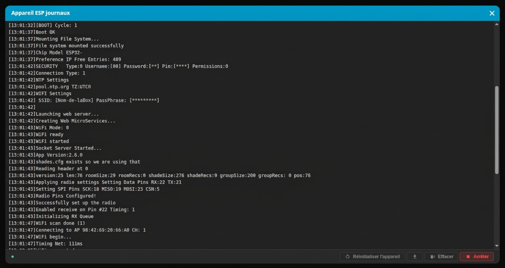
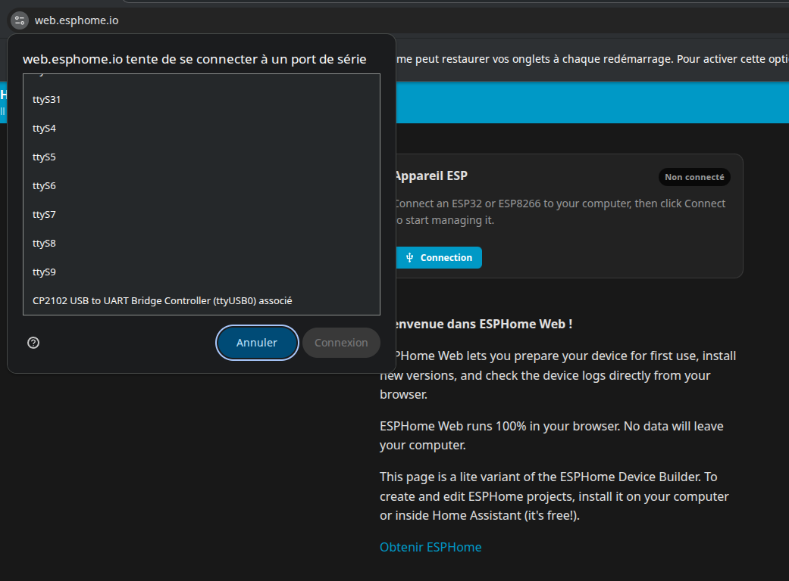

<!-- Page produite par docs/import-wiki-v2.py à partir de
     wiki-mix/Journaux-du-port-serie.md. Toute retouche ici sera écrasée : corriger le
     wiki, redéposer la source, puis relancer le script. -->

# Journaux du port série



Pendant qu'il fonctionne, l'appareil écrit un commentaire continu de ce qu'il fait sur le
**câble USB** : ce qu'il monte, à quel réseau il se connecte, ce que la radio reçoit, et —
surtout — ce qui s'est passé juste avant un plantage. Ce flux s'appelle le **port série**,
ou *moniteur série*.

C'est le seul témoin qui parle encore quand l'interface web ne répond plus. Cette page
explique comment le lire **sans rien installer**, depuis une simple page web, puis donne
les outils habituels pour ceux qui en ont déjà.

## Quand en a-t-on besoin

Jamais au quotidien. On y vient dans quatre situations :

- l'appareil **ne démarre pas**, ou redémarre en boucle ;
- il ne **rejoint pas le réseau**, ou n'obtient aucune adresse IP ;
- il **plante au hasard** et on cherche ce qui précède la coupure ;
- on vous demande un journal pour **accompagner un signalement de bug**.

!!! note "Note"

    Pour les problèmes de radio uniquement — un moteur qui ne répond pas, une télécommande
    qui n'est pas reconnue — l'interface a déjà sa propre vue, le **Journal Radio**, bien
    plus lisible. Le port série n'apporte quelque chose que si l'appareil lui-même va mal.

## Ce qu'il vous faut

| Élément | Pourquoi | Piège courant |
|---|---|---|
| Un **ordinateur** | la lecture se fait par le câble | impossible depuis un téléphone |
| Un **câble USB de données** | il doit transporter un signal, pas seulement du courant | beaucoup de câbles ne font que charger : **première cause d'échec** |
| Le **pilote USB-série** de la carte | c'est lui qui fait apparaître le port | CP2102 ou CH340 selon le modèle |
| Un **navigateur compatible** | Chrome, Edge, Brave, Opera, ou Firefox à partir de la version 151 | Safari ne sait pas parler au port série |

Rien d'autre : pas de compte, pas de logiciel à installer.

!!! note "Note"

    La **vitesse** de communication est de **115 200 bauds**. C'est celle du firmware, et
    c'est celle que la page utilise d'office — vous n'avez rien à régler. Retenez-la quand
    même : avec un autre outil, une mauvaise vitesse ne donne pas une erreur, elle donne des
    **caractères illisibles**.

---

## La méthode simple : web.esphome.io

!!! important "Important"

    **Pourquoi une page d'ESPHome, qui est un autre firmware ?** Parce que sa console série
    est **générique** : elle ouvre le port USB et affiche ce qui en sort, quel que soit le
    firmware qui tourne en face. Nous n'allons **pas** installer ESPHome, seulement emprunter
    sa fenêtre de lecture.

!!! danger "Attention"

    Dans cette page, **deux boutons sont à ne jamais toucher** :

    | Bouton | Ce qu'il fait réellement |
    |---|---|
    | **Préparation pour la première utilisation** (bouton bleu, icône fusée) | efface la puce et y installe ESPHome |
    | **Installer** (icône flèche vers le haut) | écrit un autre firmware à la place du vôtre |

    Dans les deux cas, ESPSomfy-RTS, votre configuration **et vos appairages** disparaissent.
    Nous n'utiliserons que le bouton **Journaux**.

### 1. Brancher l'appareil

Reliez-le à l'ordinateur par le câble USB. Il peut rester alimenté et fonctionner
normalement : lire le port série ne l'interrompt pas.

### 2. Ouvrir la page et se connecter

Allez sur **[web.esphome.io](https://web.esphome.io)**. Une carte intitulée **Appareil
ESP** s'affiche, avec la mention **Non connecté** et un bouton **Connection**.

!!! note "Note"

    La page se traduit d'après la langue de votre navigateur. Les libellés cités ici sont
    ceux de la version française ; en anglais, lisez *Connect*, *Logs*, *Install*,
    *Prepare for first use*.

Cliquez dessus. Une petite fenêtre s'ouvre, qui liste les ports série de votre ordinateur.
Cette fenêtre vient **du navigateur**, pas du site : c'est lui qui vous demande
l'autorisation d'accéder au matériel. Choisissez votre appareil, puis **Connecter**.



!!! tip "Astuce"

    **Aucun port dans la liste ?** Quatre causes, par ordre de fréquence :

    1. le câble ne porte que l'alimentation — essayez-en un autre, c'est le cas le plus fréquent ;
    2. le pilote USB-série n'est pas installé (la page propose elle-même les liens CP2102, CH340, CH9102) ;
    3. le navigateur ne gère pas le port série (Safari, ou un Firefox antérieur à 151) ;
    4. l'appareil a été branché **après** l'ouverture de la fenêtre — fermez-la et recommencez.

### 3. Ouvrir les journaux

Une fois connecté, la carte passe au vert et affiche **Connecté**. Une rangée de boutons
remplace le bouton de connexion : un grand bouton bleu, puis trois petites icônes, puis la
déconnexion.

Celui qu'il vous faut est **la deuxième de ces trois icônes, celle en forme de page de
texte**. Son infobulle, au survol, dit **Journaux** — survolez-la pour en être sûr plutôt
que de compter les positions. C'est le seul bouton de cette carte dont vous avez besoin.

### 4. Lire

Une fenêtre noire s'ouvre, affiche d'abord *« En attente du port série… »*, puis les lignes
arrivent au fil de l'eau, horodatées.

Comme l'appareil tournait déjà, vous tombez **au milieu** de son discours. Pour voir le
démarrage depuis la toute première ligne — c'est presque toujours là que se trouve la
réponse — cliquez sur **Réinitialiser l'appareil** : il redémarre sans être débranché, et
vous assistez à son amorçage complet.

Quatre commandes, en haut à droite de la fenêtre :

| Commande | Effet |
|---|---|
| **Réinitialiser l'appareil** | le redémarre pour voir le démarrage depuis le début |
| **Télécharger les journaux** | enregistre tout ce qui est affiché dans un fichier texte |
| **Effacer** | vide l'affichage, sans toucher à l'appareil |
| **Arrêter** / **Démarrer** | met la lecture en pause, puis la reprend |

Pour joindre un journal à un signalement, le bon geste est : **Réinitialiser l'appareil**,
laisser tourner jusqu'à reproduire le problème, puis **Télécharger les journaux**.

### 5. Refermer

Cliquez sur **Déconnecter** quand vous avez fini.

!!! warning "Avertissement"

    **Le port série ne se partage pas.** Tant que cette console est ouverte, aucun autre
    outil ne peut lire le port — et surtout, **aucune installation de firmware n'est
    possible**. Un installateur qui répond « port occupé » cherche presque toujours à vous
    dire qu'une console est restée ouverte dans un autre onglet.

---

## Quand rien ne s'affiche

| Ce que vous voyez | Cause la plus probable | Que faire |
|---|---|---|
| Aucun port proposé | câble d'alimentation seule, ou pilote manquant | changer de câble, puis installer le pilote |
| « Impossible d'ouvrir le port série » | une autre console, un IDE ou un installateur tient déjà le port | fermer l'autre fenêtre, débrancher/rebrancher au besoin |
| La fenêtre reste vide | l'appareil ne parle que lorsqu'il a quelque chose à dire | cliquer **Réinitialiser l'appareil** : un démarrage, lui, parle toujours |
| Des caractères illisibles | mauvaise vitesse, ou carte restée en mode d'écriture | vérifier 115 200 bauds ; débrancher puis rebrancher l'appareil |
| Du texte, puis plus rien, alors que l'appareil tourne | la lecture a été mise en pause | cliquer **Démarrer** |

---

## Pour les utilisateurs avancés

Tous les outils ci-dessous lisent exactement le même flux. Le choix est affaire
d'habitude — à une exception près : **un seul programme à la fois** peut ouvrir le port.

### VS Code

Deux chemins, selon ce que vous avez installé :

- **Extension PlatformIO** — l'icône de prise dans la barre d'état ouvre le moniteur sur le
    port détecté. La vitesse est lue dans `platformio.ini` (`monitor_speed = 115200`), donc
    rien à régler. En ligne de commande : `pio device monitor -b 115200` (et `pio device list`
    pour connaître le nom du port) ;
- **Extension Serial Monitor** (éditée par Microsoft) — un panneau à côté du terminal :
    choisir le port, mettre **115200**, puis *Start Monitoring*. Plus léger si vous ne
    compilez pas le firmware vous-même.

### IDE Arduino

**Outils → Port** pour choisir l'appareil, puis **Outils → Moniteur série**. Dans la
fenêtre, réglez la vitesse en bas à droite sur **115200 bauds**. C'est le réflexe à avoir :
par défaut l'IDE propose 9 600, qui ne produit que du charabia.

### En ligne de commande

| Système | Commande |
|---|---|
| Linux | `tio -b 115200 /dev/ttyUSB0` (quitter : `Ctrl+T` puis `q`) |
| Linux | `screen /dev/ttyUSB0 115200` (quitter : `Ctrl+A` puis `K`) |
| Linux | `minicom -D /dev/ttyUSB0 -b 115200` |
| macOS | `screen /dev/cu.usbserial-0001 115200` |
| Windows | **PuTTY**, en mode *Serial* : `COM3`, vitesse `115200` |
| Partout | `pio device monitor -b 115200` si PlatformIO est installé |

**Sous Linux**, si le port existe mais que l'accès est refusé, c'est une question de
droits : votre compte doit appartenir au groupe propriétaire du port — `dialout` sur
Debian et Ubuntu, `uucp` sur Arch.

```bash
sudo usermod -aG dialout $USER
```

Il faut **fermer la session et la rouvrir** pour que ce changement prenne effet.

!!! tip "Astuce"

    **Pour conserver un journal dans un fichier**, préférez la fonction d'enregistrement de
    l'outil (`tio -l`, ou le bouton **Télécharger** des consoles web) à une redirection du
    terminal : plusieurs moniteurs — dont celui de PlatformIO — **refusent de fonctionner**
    dès que leur sortie n'est plus un vrai terminal, et vous perdez précisément la trace que
    vous vouliez garder.

---

## Avant de publier un journal

Un journal est du texte brut, et il décrit votre installation. **Aucun mot de passe n'y
figure** — le firmware les remplace par des astérisques — mais on y trouve :

- le **nom de votre réseau Wi-Fi**, et ceux des réseaux voisins ;
- les **adresses IP et MAC** de votre installation ;
- les **adresses radio** de vos équipements et télécommandes.

Rien de dangereux en soi, mais relisez le fichier avant de le joindre à un message public,
et remplacez ce que vous ne souhaitez pas publier. Un journal partiellement caviardé reste
parfaitement exploitable pour un diagnostic.

!!! note "Note"

    Tout cela se passe **entre votre navigateur et le câble USB**. Ni la page d'ESPHome ni
    celle du projet n'envoient quoi que ce soit sur un serveur : rien ne quitte votre
    ordinateur tant que vous ne publiez pas le fichier vous-même.

