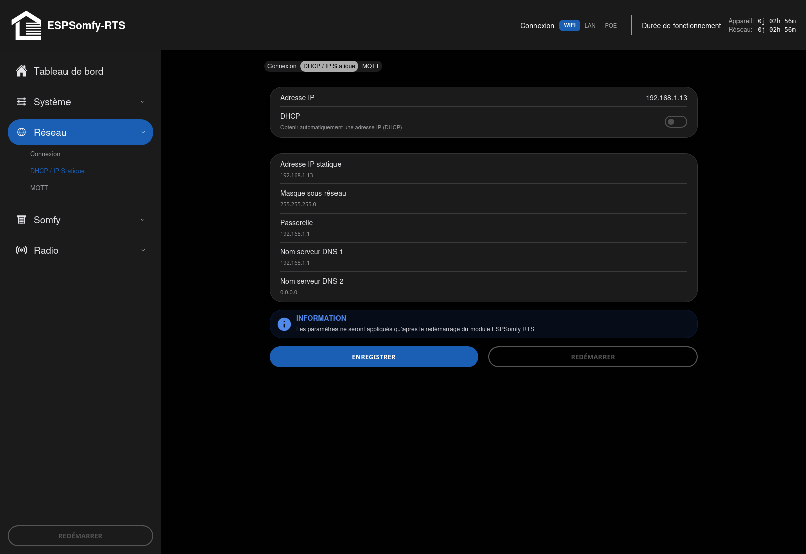

<!-- Page produite par docs/import-wiki-v2.py à partir de
     wiki-v2-source/DHCP-et-IP-Statique.md. Toute retouche ici sera écrasée : corriger le
     wiki, redéposer la source, puis relancer le script. -->

# DHCP et IP statique

Ce sous-onglet gère l'**adresse IP** de l'appareil sur votre réseau : celle que vous taperez dans
votre navigateur, et celle que Home Assistant utilisera. Il se trouve dans l'onglet **Réseau**,
deuxième sous-onglet, à côté de [Connexion](connexion.md) et de
[MQTT](../integrations/mqtt.md).

!!! note "Note"

    Cette page ne sert qu'à **fixer** l'adresse. Si l'appareil n'est pas encore sur votre réseau,
    commencez par [Connexion](connexion.md), qui couvre le Wi-Fi, l'Ethernet et
    le dépannage de la connexion.

---

# Ce que vous voyez à l'écran

De haut en bas :

* **`Adresse IP`** — en lecture seule, l'adresse actuellement utilisée par l'appareil.
* **`DHCP`** — *« Obtenir automatiquement une adresse IP (DHCP) »*. **Activé par défaut** : c'est
    votre box qui attribue l'adresse.
* **Les champs d'adressage manuel**, qui n'apparaissent que si vous **désactivez** DHCP :
    `Adresse IP statique`, `Masque sous-réseau`, `Passerelle`, `Nom serveur DNS 1` et `DNS 2`.
* **Les boutons `ENREGISTRER` et `REDÉMARRER`**, précédés d'un rappel : *« Les paramètres ne
    seront appliqués qu'après le redémarrage du module ESPSomfy RTS »*.

!!! important "Important"

    Contrairement aux autres réglages de l'interface, un changement d'adressage **ne prend effet
    qu'après redémarrage**. Enregistrez, puis utilisez le bouton `REDÉMARRER` juste à côté.

---

# Pourquoi fixer l'adresse ?

Par défaut, c'est votre box qui attribue une adresse à l'appareil, et **rien ne garantit qu'elle
reste la même**. Après une coupure de courant ou un redémarrage de la box, l'appareil peut très
bien récupérer une autre adresse. Conséquence : votre favori de navigateur ne répond plus, et une
intégration Home Assistant configurée par IP se retrouve déconnectée.

Deux méthodes permettent de régler ce problème. **Elles ne se valent pas** — la première est
largement préférable.

## La bonne méthode : la réservation DHCP

La méthode la plus fiable n'est **pas** dans cette interface : elle consiste à créer une
**réservation DHCP** (appelée aussi *bail statique* ou *IP fixe* selon les box) dans les
paramètres de votre routeur, à partir de l'
[adresse MAC](connexion.md#1-le-bloc-dinformations-en-haut) de l'appareil. Vous laissez
alors `DHCP` activé dans ESPSomfy-RTS, et c'est la box qui lui resservira toujours la même
adresse.

**Pourquoi c'est mieux ?** Parce que c'est votre box qui tient la comptabilité des adresses de
votre réseau. En lui laissant la main, vous évitez tout risque de conflit d'adresses, et
l'appareil reste joignable même si le service mDNS (`.local`) tarde à se propager.

!!! tip "Astuce"

    **Où trouver l'adresse MAC ?** Dans le bloc d'informations en haut du sous-onglet
    [Connexion](connexion.md#1-le-bloc-dinformations-en-haut).

!!! note "Note"

    Une réservation ne vaut que pour **une** adresse MAC. Or le Wi-Fi et l'Ethernet sont deux
    interfaces distinctes, avec chacune la sienne : si vous utilisez l'Ethernet, ou le
    `Secours Wi-Fi`, il vous faut **une réservation par interface** — voir
    [L'adresse IP n'est plus la même](connexion.md#d-ladresse-ip-nest-plus-la-même).

## L'IP statique (utilisateurs avancés)

Si vous préférez gérer l'adressage à la main, désactivez le commutateur `DHCP`, renseignez les
cinq champs, puis `ENREGISTRER` et `REDÉMARRER`.

| Champ | Ce qu'il faut y mettre |
|---|---|
| `Adresse IP statique` | Une adresse libre de votre réseau, **hors de la plage distribuée par votre box** pour éviter qu'elle ne soit attribuée deux fois. |
| `Masque sous-réseau` | Presque toujours `255.255.255.0` sur un réseau domestique. |
| `Passerelle` | L'adresse de votre box (souvent `192.168.1.1` ou `192.168.0.1`). |
| `Nom serveur DNS 1` | En général l'adresse de votre box, identique à la passerelle. |
| `Nom serveur DNS 2` | Facultatif — un DNS de secours. |

!!! danger "Attention"

    **Une erreur ici rend l'appareil invisible sur votre réseau.** Si vous n'êtes pas certain de la
    plage d'adresses de votre sous-réseau, de votre passerelle et de vos DNS, ne touchez pas à ces
    réglages : restez en `DHCP` et faites une réservation sur votre box.

!!! tip "Astuce"

    **Si vous vous retrouvez enfermé dehors :** après un échec de connexion prolongé, l'appareil
    réactive de lui-même son point d'accès `ESPSomfyRTS`, sur lequel vous pourrez vous reconnecter à
    `http://192.168.4.1` pour corriger l'adressage. S'il reste injoignable, voir
    [Factory Reset](../maintenance/factory-reset.md).

