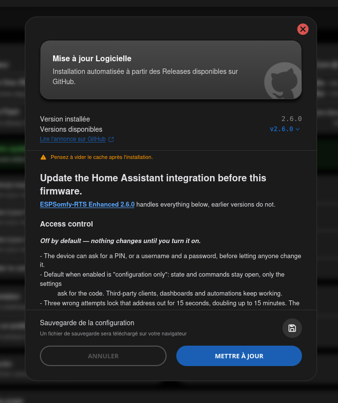
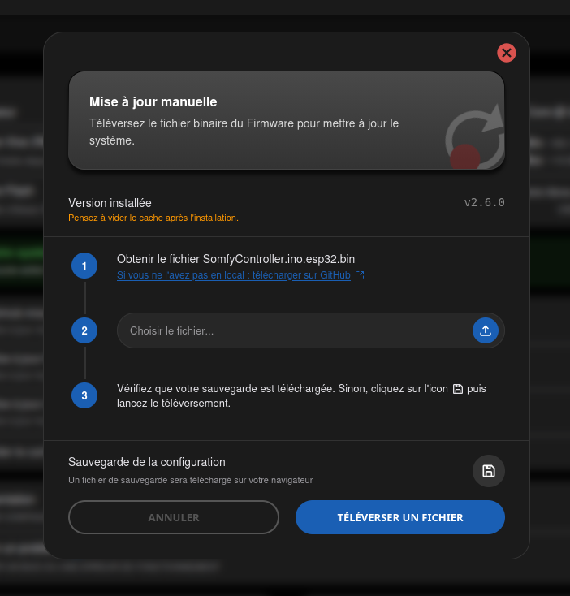

<!-- Page produite par docs/import-wiki-v2.py à partir de
     wiki-v2-source/Mettre-à-jour.md. Toute retouche ici sera écrasée : corriger le
     wiki, redéposer la source, puis relancer le script. -->

# Mettre à jour

Cette page détaille les **trois fenêtres de mise à jour** du sous-onglet **Firmware**, et les
fichiers qu'elles consomment. Pour la visite de l'onglet lui-même — relevé d'état, bandeau de
statut, sauvegarde et restauration — voir [Firmware](firmware.md).

---

## 1. Deux moitiés, trois fenêtres

L'appareil tient en deux morceaux, dans deux partitions distinctes :

* le **firmware**, le cœur du système : la radio, le réseau, MQTT, le serveur web ;
* **LittleFS**, la partition de fichiers : l'interface web que vous avez sous les yeux, et les
    fichiers de langue.

Les trois fenêtres se distinguent par les moitiés qu'elles écrivent.

| Fenêtre | Écrit | Source du fichier |
| --- | --- | --- |
| `GitHub mise à jour` | les **deux** | téléchargé par l'appareil depuis GitHub |
| `Mise à jour Firmware` | le firmware seul | un `.bin` depuis votre ordinateur |
| `Mise à jour LittleFS` | LittleFS seul | un `.bin` depuis votre ordinateur |

!!! tip "Astuce"

    Dans la très grande majorité des cas, `GitHub mise à jour` est la bonne réponse : c'est la
    seule qui garde les deux moitiés en phase. Les deux autres servent à rattraper une moitié
    abîmée, à installer une version que vous avez compilée vous-même, ou à essayer un correctif
    avant sa publication.

## 2. Les fichiers d'une release

Une *release* publie **treize fichiers**, en trois familles. Les tailles ci-dessous sont celles
de la v2.6.0, à titre d'ordre de grandeur.

### Le firmware, une variante par modèle d'ESP32

| Fichier | Pour |
| --- | --- |
| `SomfyController.ino.esp32.bin` | ESP32 classique, sans PSRAM |
| `SomfyController.ino.esp32wrover.bin` | ESP32 avec PSRAM (WROVER) |
| `SomfyController.ino.esp32s2.bin` | ESP32-S2 |
| `SomfyController.ino.esp32s3_4mb.bin` | ESP32-S3, flash de 4 Mo |
| `SomfyController.ino.esp32s3_8mb.bin` | ESP32-S3, flash de 8 Mo |
| `SomfyController.ino.esp32c3.bin` | ESP32-C3 |

Environ 1,1 à 1,3 Mo chacun. **C'est le fichier que réclame la fenêtre Mise à jour Firmware.**

### L'interface, un seul fichier pour tous les ESP32

| Fichier | Pour |
| --- | --- |
| `SomfyController.littlefs.bin` | tous les ESP32, sans distinction |

Environ 1,4 Mo. Il ne porte **pas** de nom de modèle, et ce n'est pas un oubli : cette partition ne
contient que des fichiers — pages, scripts, images, langues — et aucun code compilé pour un
processeur donné. C'est aussi pourquoi la fenêtre LittleFS ne vous demande pas quel modèle vous
avez. **C'est le fichier que réclame la fenêtre Mise à jour LittleFS.**

### L'image complète, pour une installation par USB

| Fichier | Pour |
| --- | --- |
| `SomfyController.onboard.<modèle>.bin.zip` | une variante par modèle, les six mêmes que ci-dessus |

Environ 0,9 Mo compressé. Cette image contient **tout** : le chargeur d'amorçage, la **table de
partition**, le firmware et LittleFS. C'est la seule qui remplace la table de partition, et donc
la seule voie pour une première installation ou pour franchir le passage entre les v2.x.x et la v3
(voir plus bas).

!!! note "Note"

    L'appareil ignore complètement ces archives : aucune mise à jour à distance ne les emploie.
    Elles ne servent qu'à un flashage par USB depuis un ordinateur.

## 3. GitHub mise à jour

La fenêtre affiche la version installée, la liste des versions disponibles, et la note de version
de celle que vous sélectionnez. Un lien **Lire l'annonce sur GitHub** renvoie vers la page de la
*release*. Prenez l'habitude de les lire avant de lancer quoi que ce soit : c'est là que sont
signalés les changements qui demandent une action de votre part. Au besoin, passez-les dans un
traducteur.

### L'appareil choisit son fichier lui-même

Vous ne désignez pas de fichier : l'appareil lit le modèle de son ESP32 et en déduit le nom.

| ESP32 détecté | Critère | Fichier retenu |
| --- | --- | --- |
| ESP32-S3 | flash ≥ 8 Mo | `esp32s3_8mb` |
| ESP32-S3 | sinon | `esp32s3_4mb` |
| ESP32-S2 | — | `esp32s2` |
| ESP32-C3 | — | `esp32c3` |
| ESP32 | PSRAM présente | `esp32wrover` |
| ESP32 | pas de PSRAM | `esp32` |

Puis, le firmware installé, il enchaîne sur `SomfyController.littlefs.bin`. **Votre configuration
est écrite sur la flash entre les deux**, ce qui explique qu'une mise à jour la conserve.

La barre de progression suit donc deux téléchargements à la suite. **Ne coupez pas
l'alimentation.** À la fin, l'appareil redémarre.

### Ce que contient la liste

| Type | Étiquette | Ce que c'est |
| --- | --- | --- |
| **Stable** | `vX.Y.Z` | Version publiée, testée, destinée à l'usage quotidien. C'est aujourd'hui le seul type publié. |
| **Pré-version** | `vX.Y.Z` suivi de `- Pre` | Version marquée *pre-release* sur GitHub. La sélectionner affiche un avertissement en rouge. |

### Pourquoi une version peut manquer dans la liste

La liste n'est pas celle des *releases* brutes de GitHub. Pour chaque version, l'appareil lit la
**liste des noms de fichiers** publiés et en déduit les modèles couverts. Deux filtres s'appliquent
ensuite.

* **Le firmware de votre ESP32 doit être publié dans cette version.** Si son nom n'y figure pas, la
    version ne vous est pas proposée — et c'est heureux.
* **Seules les cinq dernières *releases* sont consultées.** L'appareil n'en demande pas plus à
    GitHub : une version plus ancienne que ces cinq-là n'apparaîtra jamais, quel que soit votre
    ESP32.

### Le passage entre les v2.x.x et la v3

Si la version sélectionnée change de numéro majeur, le bouton `Mettre à jour` se **désactive**
et un message rouge explique pourquoi :

> Passage à la v3.0.0 impossible en raison d'un changement majeur de la table de partition.
> Flashage manuel par USB obligatoire via l'image 'onboard'.

Le blocage vaut **dans les deux sens** : une v3.x.x, et toutes les versions à venir, ne pourront
pas redescendre en v2.x.x par cette fenêtre. La raison est dans
[Les fichiers d'une release](#2-les-fichiers-dune-release) — seule l'image `onboard` porte la
table de partition, et elle ne s'installe que par USB.

### Avant de lancer

!!! important "Important"

    La fenêtre propose un bouton `Sauvegarde de la configuration`, qui télécharge un fichier
    `.backup` dans votre navigateur. Prenez-le. Une mise à jour conserve normalement la
    configuration, mais c'est la seule précaution qui ne coûte rien.

## 4. Mise à jour Firmware

Installe un `SomfyController.ino.<modèle>.bin` que vous avez déjà sur votre ordinateur. **Le cœur du
système seul** : l'interface web n'est pas touchée.

La fenêtre contrôle le **nom** du fichier avant de l'envoyer. Un nom qui ne contient pas `.ino.`
ou qui ne finit pas par `.bin` est refusé, avec le message *Ce fichier n'est pas un fichier
binaire de firmware valide.* Vous ne pouvez donc pas vous tromper de moitié.

!!! warning "Avertissement"

    Ce contrôle porte sur le nom, **pas sur le modèle**. Un binaire destiné à un autre ESP32 porte un
    nom parfaitement valide et sera accepté : l'appareil devient alors muet et il faut le reflasher
    par USB. Vérifiez vous-même que la fin du nom correspond à la ligne **Puce** du relevé d'état.

## 5. Mise à jour LittleFS

Installe `SomfyController.littlefs.bin`. **L'interface web seule** : utile pour réparer un
affichage abîmé sans toucher au firmware. Même contrôle du nom, avec le message *Ce fichier n'est
pas un fichier binaire LittleFS valide.*

!!! note "Note"

    Cette partition porte aussi les fichiers de langue : un remplacement de LittleFS les réinstalle
    tous. Un flashage complet par USB, lui, les efface — la langue choisie peut sembler revenue à
    l'anglais le temps qu'ils soient retéléchargés.

## 6. Après une mise à jour

Videz le cache du navigateur — le bouton `Vider le cache` de l'onglet [Firmware](firmware.md), ou le cache
de votre navigateur lui-même si l'affichage reste bizarre. Sans cela, le navigateur peut continuer
de servir l'ancienne interface par-dessus le nouveau firmware.

---

## Étape suivante

* [Firmware](firmware.md) — l'onglet complet : état de l'appareil, sauvegarde et restauration.
* [Anatomie Fichier de Sauvegarde](../maintenance/anatomie-sauvegarde.md) — ce que contient un `.backup`, champ par champ.
* [Factory Reset](../maintenance/factory-reset.md) — revenir à zéro quand plus rien ne répond.

