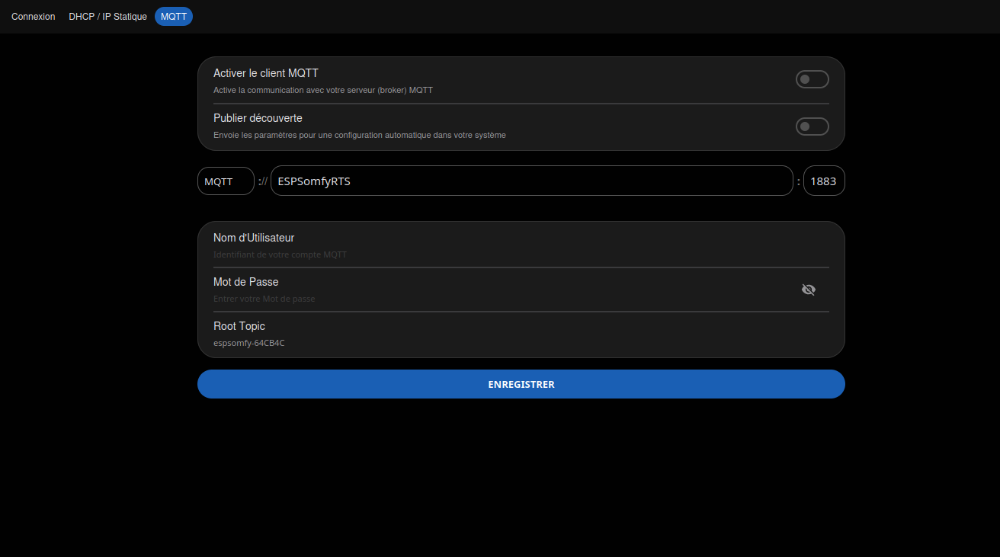
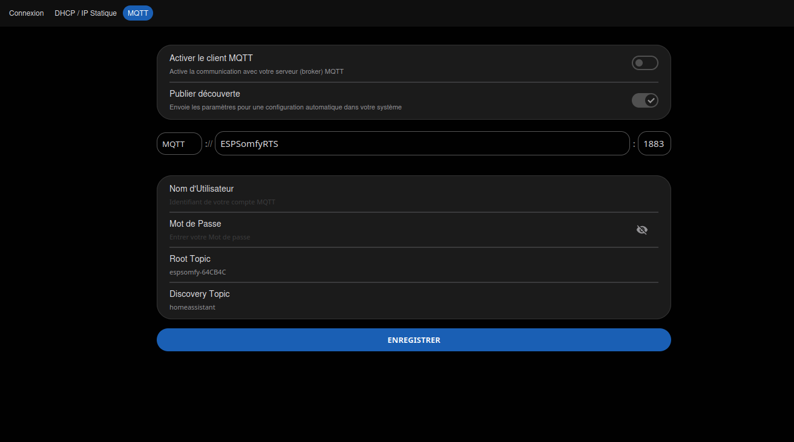

<!-- Page produite par docs/import-wiki-v2.py à partir de
     wiki-v2-source/MQTT.md. Toute retouche ici sera écrasée : corriger le
     wiki, redéposer la source, puis relancer le script. -->

# MQTT

Cette page décrit **ce qui circule sur MQTT** une fois le courtier connecté : les sujets que
l'appareil publie, ceux auxquels il s'abonne pour recevoir vos commandes, et l'auto-découverte.
Le **paramétrage** du courtier (adresse, port, identifiants) se fait dans l'interface, onglet
**Réseau → MQTT**.

!!! tip "Astuce"

    Vous cherchez plutôt l'API HTTP ou Home Assistant ? Voir
    [Intégrations](index.md#interface-rest-api) et [Home Assistant](../../commun/home-assistant.md).

ESPSomfy-RTS publie des attributs sur votre broker MQTT et s'abonne à des sujets (topics) qui vous permettent de contrôler les volets. Pour activer votre broker, connectez-le dans les pages de configuration sous la section MQTT. Cela lancera le rapport d'état des volets vers votre broker sous le sujet que vous avez assigné.

# Sujets publiés (Published Topics)
ESPSomfy RTS publie les informations relatives aux volets et aux groupes configurés dans une arborescence hiérarchique de sujets. Tous les sujets ESPSomfy RTS sont publiés sous un sujet racine (root topic) que vous définissez dans la configuration.
Au démarrage, tous les sujets sont publiés, mais par la suite, ESPSomfy RTS ne publiera des données que lorsqu'un changement survient. Vous pouvez ainsi vous abonner au sujet et recevoir des mises à jour en temps réel. Bien qu'une liste complète des sujets disponibles soit fournie ci-dessous, il est fortement recommandé d'utiliser un outil tel que **MQTT Explorer** lors de vos développements. Cela vous évitera de nombreuses heures d'essais et d'erreurs.

## 1. Informations Système (Lecture seule)

| Sujet MQTT (Topic) | Description |
| :--- | :--- |
| `[root topic]/status` | **Testament (LWT)** du client MQTT. `online` si l'appareil est connecté, `offline` s'il est déconnecté. |
| `[root topic]/mac` | **Adresse MAC** de l'adaptateur réseau de l'appareil. |
| `[root topic]/ipAddress` | **Adresse IP** assignée à l'appareil ESPSomfy RTS. |
| `[root topic]/host` | **Nom d'hôte** (Hostname) assigné à l'appareil. |
| `[root topic]/firmware` | **Version du firmware** actuellement installée. |
| `[root topic]/serverId` | **Identifiant unique** dérivé de l'ID du puce ESP32. |

## 2. État des Équipements (Shades - Lecture seule)

### Identification et Configuration
| Sujet MQTT (Topic) | Description |
| :--- | :--- |
| `[root topic]/shades/[shadeId]/shadeId` | L'ID numérique du volet. |
| `[root topic]/shades/[shadeId]/name` | Le nom défini pour le volet. |
| `[root topic]/shades/[shadeId]/remoteAddress` | L'adresse radio assignée au volet. |
| `[root topic]/shades/[shadeId]/shadeType` | **Type de volet** :   `0` = Store enrouleur, `1` = Store vénitien, `2` = Rideau (gauche), `3` = Store banne, `4` = Volet, `5` = Garage (1 bouton), `6` = Garage (3 boutons), `7` = Rideau (droit), `8` = Rideau (central), `9` = Contact sec, `10` = Contact sec (2 bouton), `11` = Portail (gauche), `12` = Portail (centre), `13` = Portail (droit), `14` = Portail 1 bouton (gauche), `15` = Portail 1 bouton (centre), `16` = Portail 1 bouton (droit) |

| `[root topic]/shades/[shadeId]/tiltType` | **Type d'inclinaison** (si store) :   `0` = Aucun, `1` = Moteur inclinaison, `2`= Inclinaison intégrée, `3` = Inclinaison seule. |
| `[root topic]/shades/[shadeId]/flipCommands` | Indique si les commandes sont inversées (Haut=Bas). `true` ou `false`. |
| `[root topic]/shades/[shadeId]/flipPosition` | Indique si 100% signifie ouvert ou fermé. `true` ou `false`. |

### Mouvement et Position
| Sujet MQTT (Topic) | Description |
| :--- | :--- |
| `[root topic]/shades/[shadeId]/position` | Position actuelle de levage en pourcentage (0-100%). |
| `[root topic]/shades/[shadeId]/tiltPosition` | Position actuelle d'inclinaison en pourcentage (0-100%). |
| `[root topic]/shades/[shadeId]/direction` | **Direction actuelle** : `-1` (Monte), `0` (Arrêté), `1` (Descend). |
| `[root topic]/shades/[shadeId]/target` | Position de levage cible que le volet cherche à atteindre. |
| `[root topic]/shades/[shadeId]/tiltTarget` | Position d'inclinaison cible que le volet cherche à atteindre. |
| `[root topic]/shades/[shadeId]/lastRollingCode` | Dernier code tournant utilisé pour la dernière commande envoyée. |
| `[root topic]/shades/[shadeId]/mypos` | Position favorite actuelle (levage). `-1` si non défini. |
| `[root topic]/shades/[shadeId]/myTiltPos` | Position favorite actuelle (inclinaison). `-1` si non défini. |

### Capteurs
| Sujet MQTT (Topic) | Description |
| :--- | :--- |
| `[root topic]/shades/[shadeId]/sunSensor` | Indique l'existence d'un capteur solaire (`true`/`false`). |
| `[root topic]/shades/[shadeId]/sunFlag` | Indique si le capteur solaire est activé ou non (`0` ou `1`). |
| `[root topic]/shades/[shadeId]/sunny` | Indique si le volet considère qu'il y a du soleil (`0` ou `1`). |
| `[root topic]/shades/[shadeId]/windy` | Indique si le volet considère qu'il y a du vent ou non (`0` ou `1`). |

## 3. État des Groupes (Groups - Lecture seule)

| Sujet MQTT (Topic) | Description |
| :--- | :--- |
| `[root topic]/groups/[groupId]/groupId` | L'identifiant du groupe. |
| `[root topic]/groups/[groupId]/name` | Le nom défini pour le groupe. |
| `[root topic]/groups/[groupId]/remoteAddress` | L'adresse radio assignée au groupe. |
| `[root topic]/groups/[groupId]/direction` | Direction du mouvement des membres : `-1` (Montent), `0` (Arrêtés), `1` (Descendent). |
| `[root topic]/groups/[groupId]/lastRollingCode` | Dernier code tournant utilisé pour le groupe. |
| `[root topic]/groups/[groupId]/sunSensor` | Existence d'un capteur solaire pour au moins un membre du groupe (`true`/`false`). |
| `[root topic]/groups/[groupId]/sunFlag` | Capteur solaire activé pour au moins un membre du groupe (`0` ou `1`). |
| `[root topic]/groups/[groupId]/sunny` | Indique si le groupe considère qu'il fait soleil (`0` ou `1`). |
| `[root topic]/groups/[groupId]/windy` | Indique si le groupe considère qu'il y a du vent (`0` ou `1`). |

---
# Sujets souscrits (Subscribed Topics)
ESPSomfy-RTS s'abonne aux sujets de votre broker MQTT. Ces sujets reçoivent une réponse immédiate ; veuillez donc ne pas définir d'indicateur de rétention ni de QoS supérieure à 0 pour ceux-ci. Dans le cas contraire, lors de sa connexion au broker, ESPSomfy-RTS renverra ces commandes, ce qui entraînera des dysfonctionnements. De même, ne publiez pas sur les sujets qu'ESPSomfy-RTS publie. Ces sujets sont en lecture seule : vous devez uniquement vous y abonner. Publier des données sur ces sujets vous causera d'importants problèmes.

!!! danger "Attention"

    L'utilisation d'un flag retain ou d'un QoS élevé provoquerait le renvoi automatique des commandes lors de chaque reconnexion de l'ESPSomfy RTS au broker, entraînant des comportements imprévisibles.

### Contrôle Individuel
| Sujet MQTT (Topic) | Valeur (Payload) | Action |
| :--- | :--- | :--- |
| `[root topic]/shades/[shadeId]/direction/set` | `-1`, `0`, `1` | Déplace le volet dans la direction : -1 (Haut), 1 (Bas), 0 (Stop ou Toggle). |
| `[root topic]/shades/[shadeId]/target/set` | `0` à `100` | Déplace à X % (0 = Ouvert, 100 = Fermé). |
| `[root topic]/shades/[shadeId]/tiltTarget/set` | `0` à `100` | Incline à X % (0 = Ouvert, 100 = Fermé). |
| `[root topic]/shades/[shadeId]/mypos/set` | `0` à `100` | Définit la position "My" ou l'efface si la valeur est identique à l'actuelle. |
| `[root topic]/shades/[shadeId]/myTiltPos/set` | `0` à `100` | Définit l'inclinaison "My" ou l'efface si la valeur est identique. |
| `[root topic]/shades/[shadeId]/position/set` | `0` à `100` | **Synchronise** la position actuelle (sans mouvement moteur). |
| `[root topic]/shades/[shadeId]/tiltPosition/set` | `0` à `100` | **Synchronise** l'inclinaison actuelle (sans mouvement moteur). |
| `[root topic]/shades/[shadeId]/sunFlag/set` | `0`, `1` | Active (1) ou Désactive (0) le capteur solaire. |
| `[root topic]/shades/[shadeId]/sunny/set` | `0`, `1` | Définit l'état du capteur sur Ensoleillé (1) ou Non (0). |
| `[root topic]/shades/[shadeId]/windy/set` | `0`, `1` | Définit l'état du capteur sur Venteux (1) ou Calme (0). |

### Contrôle de Groupe
| Sujet MQTT (Topic) | Valeur (Payload) | Action |
| :--- | :--- | :--- |
| `[root topic]/groups/[groupId]/direction/set` | `-1`, `0`, `1` | Déplace tous les membres du groupe, : -1 (Haut), 1 (Bas), 0 (Stop ou Toggle). |
| `[root topic]/groups/[groupId]/sunFlag/set` | `0`, `1` | Active/Désactive la fonction soleil pour le groupe. |
| `[root topic]/groups/[groupId]/sunny/set` | `0`, `1` | Définit l'état soleil pour tous les moteurs du groupe. |
| `[root topic]/groups/[groupId]/windy/set` | `0`, `1` | Définit l'état vent pour tous les moteurs du groupe. |

# Auto-Découverte MQTT (Auto Discovery)
ESPSomfy RTS prend en charge l'auto-découverte MQTT. Cependant, si vous utilisez **Home Assistant**, il est fortement recommandé d'utiliser l'intégration dédiée [ESPSomfy-RTS-enhanced](https://github.com/xkain/ESPSomfy-RTS-enhanced). Le plugin offre bien plus de fonctionnalités, notamment une meilleure gestion des capteurs. Pour les autres plateformes supportant l'auto-découverte MQTT, cette option permet une mise en route très rapide.

### Configuration

1. Accédez à la section **Réseau** de l'interface de configuration.
2. Cochez l'option **Publier découverte**.
3. Renseignez le **sujet racine de découverte** (root discovery topic) dans le champ prévu à cet effet.

---

**Pages liées :** [Intégrations](index.md) pour l'API REST et les WebSockets ·
[Home Assistant](../../commun/home-assistant.md) pour l'intégration dédiée.

