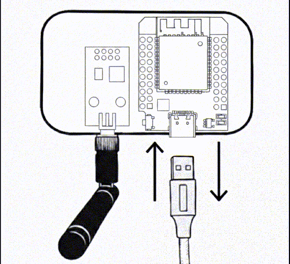

# Factory Reset

## Troubleshooting & Factory Reset

Si vous perdez l'accès à l'interface web (erreur de configuration réseau ou mot de passe oublié) ou si l'appareil se comporte de manière erratique, vous pouvez effectuer une réinitialisation pour restaurer l'appareil à son état "out-of-the-box".

!!! tip "Astuce"

    Utilisez ces procédures en dernier recours, si le bouton "Restore" dans l'interface web n'est plus accessible.

!!! important "Important"

    **Aucune LED témoin sur les versions v2.x.x.** Quelle que soit votre carte, et quel que soit le
    boîtier, aucun voyant ne vous guidera : la procédure se fait **à l'aveugle**, en comptant les
    secondes. Le GPIO 02 a été libéré pour élargir la compatibilité entre les déclinaisons d'ESP32,
    le témoin led sera réintroduit pour la v3.0.0.

    **Le firmware ne change pas :** après un reset, vous restez sur la version que vous aviez.

# La réinitialisation par cycles d'alimentation

Deux paliers, pour ne pas perdre inutilement vos équipements, vos pièces et le reste.

**La fenêtre est de 5 secondes.** À chaque branchement, l'appareil attend cinq secondes avant de
démarrer pour de bon. Débrancher pendant ce délai compte un cycle. Laisser passer les cinq
secondes ne fait pas que rater le cycle : **le compteur repart de zéro**, et il faut tout
reprendre au début.

<table>
  <tr>
    <td width="60%" valign="top">
      <strong>Procédures de Power Cycle (v2.5.1+) :</strong>
      <ol>
        <li>
          <strong>Réinitialisation Réseau & Sécurité (3 Cycles) :</strong>
          Débranchez puis rebranchez 3 fois, chaque fois dans les cinq secondes. 
           <em>Résultat : Wi-Fi effacé et sécurité désactivée. Vos équipements et MQTT sont conservés.  L'appareil redémarrera en mode Access Point (SSID: ESPSomfyRTS).</em>
        </li>
         
        <li>
          <strong>Factory Reset Complet (6 Cycles) :</strong>
          Continuez au même rythme jusqu'au 6ème branchement.
           <em>Résultat : Retour à l'état "out-of-the-box". Toutes les configurations sont perdues. L'appareil redémarrera en mode Access Point (SSID: ESPSomfyRTS).</em>
        </li>
      </ol>
    </td>
    <td width="40%" align="center" valign="middle">
    
       
      <em>Animation de la séquence de reset. <b>La LED bleue qu'elle montre n'existe pas sur les
      versions v2.x.x</b> : ne retenez que le rythme.</em>
    </td>
  </tr>
</table>

### Le minutage, cycle par cycle

| Après un branchement | Ce qu'il faut faire |
| :--- | :--- |
| **Les 5 premières secondes** | Débranchez pour compter un cycle. |
| **Au-delà de 5 secondes** | Trop tard : l'appareil démarre et le compteur revient à zéro. |
| **Au 3ème ou au 6ème cycle** | Ne débranchez plus. Laissez l'appareil terminer et redémarrer seul. |

!!! tip "Astuce"

    Une fois l'accès retrouvé (http://192.168.4.1), pensez à effectuer une sauvegarde de votre configuration. Cela vous évitera de devoir réappairer vos équipements en cas de futur reset complet.

!!! important "Important"

    **Disponibilité :** ce système à deux paliers existe depuis la **v2.5.1**. Les versions
    antérieures ne proposent pas cette réinitialisation manuelle.

