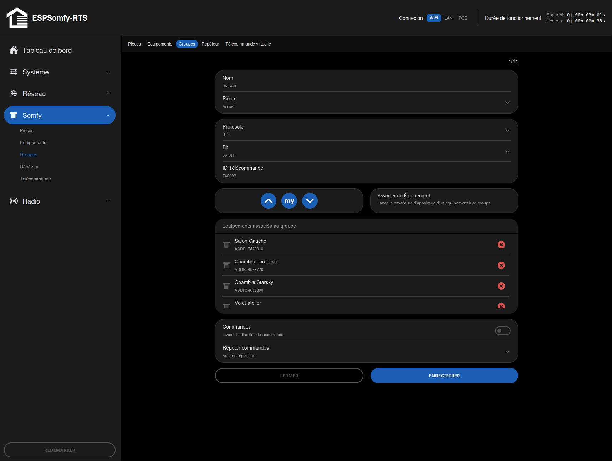
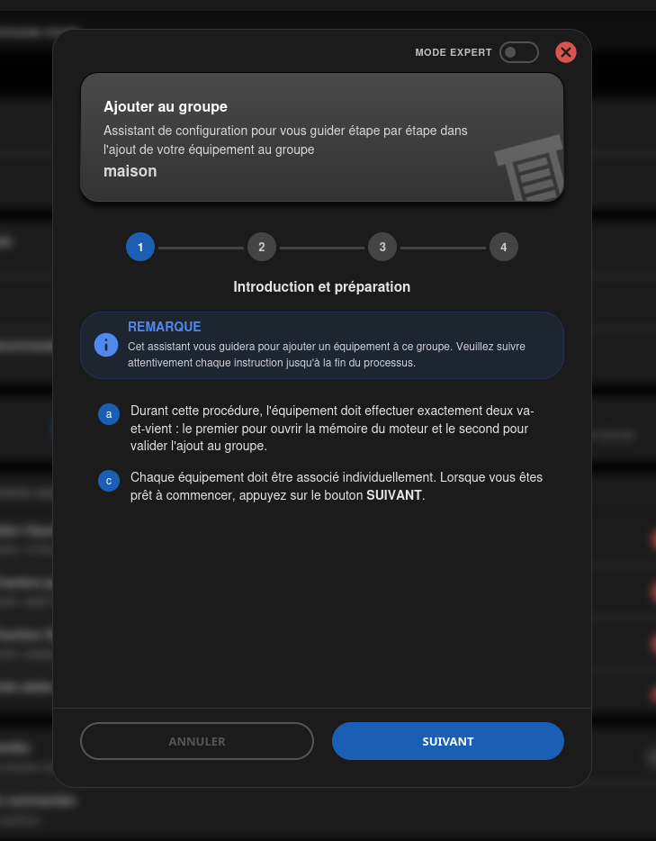
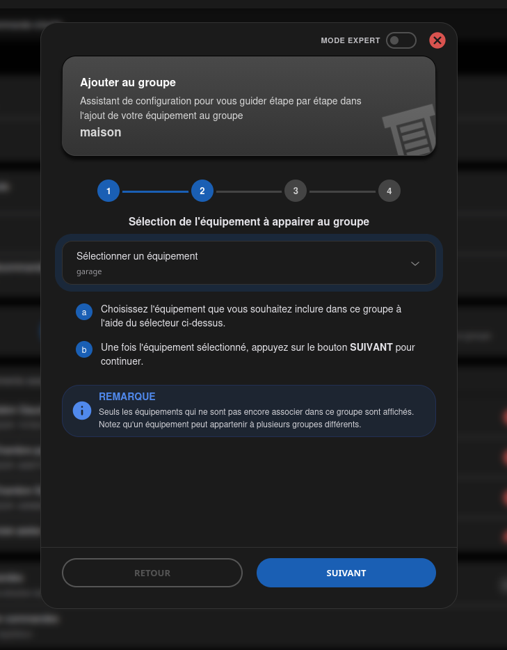
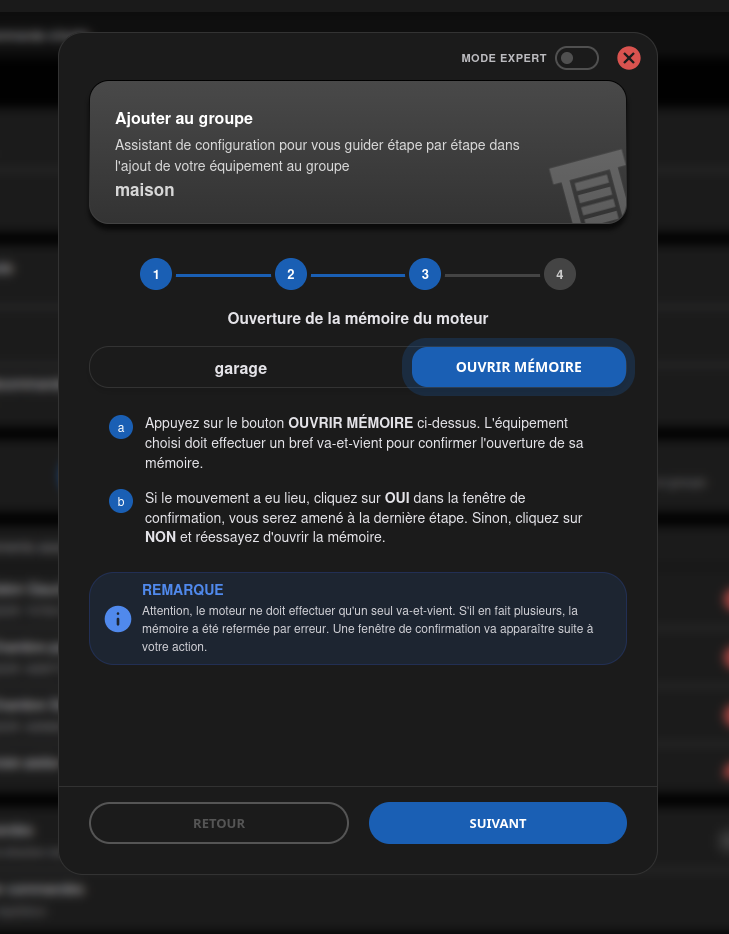
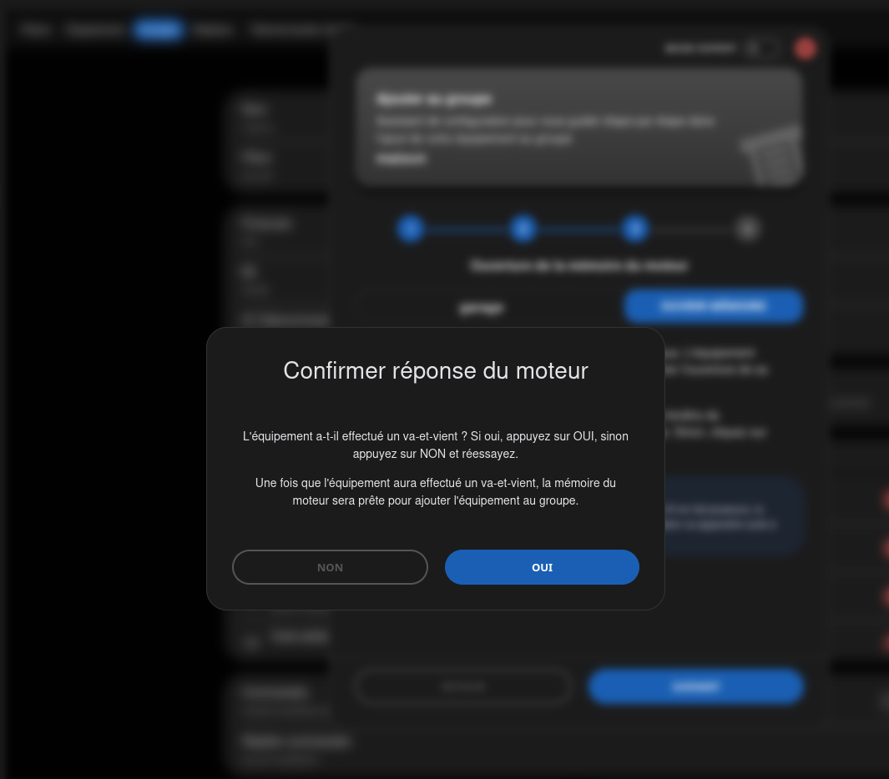
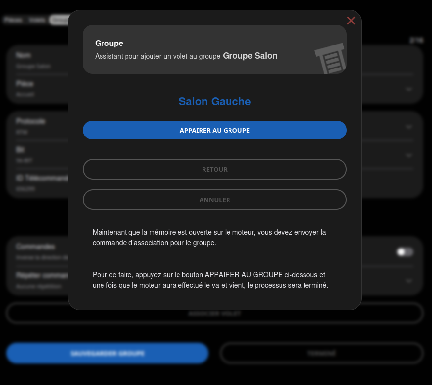
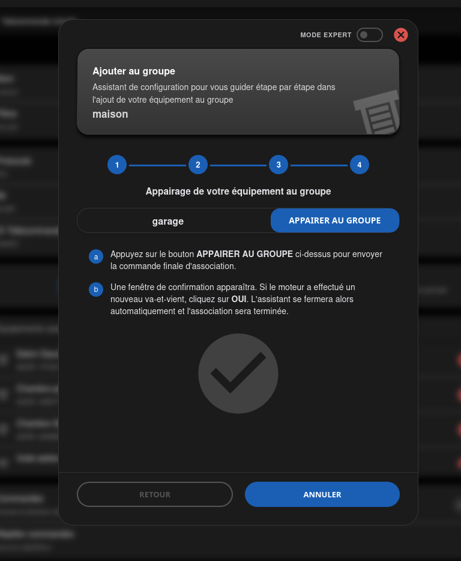
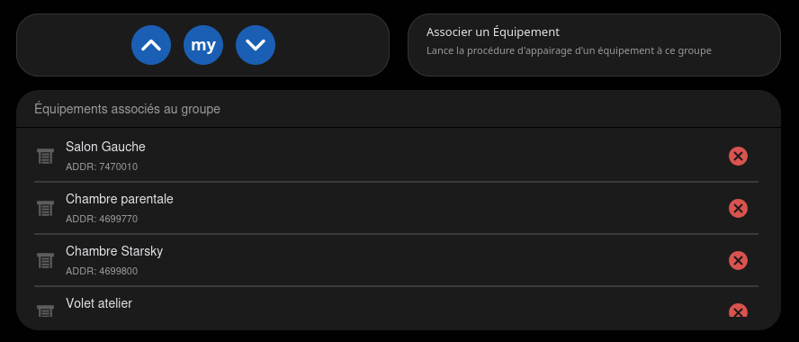
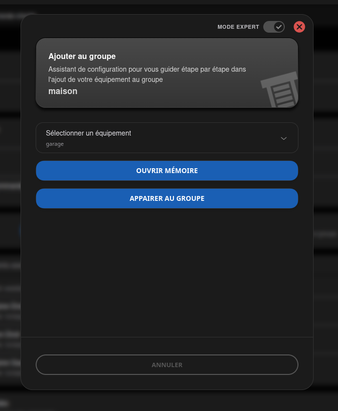

<!-- Page produite par docs/import-wiki-v2.py à partir de
     wiki-v2-source/GROUPES-(Groups).md. Toute retouche ici sera écrasée : corriger le
     wiki, redéposer la source, puis relancer le script. -->

# Groupes (Groups)

Un groupe commande plusieurs équipements **en une seule émission radio**, sur une adresse qui lui
est propre. Ce n'est pas une boucle qui envoie l'ordre à chacun l'un après l'autre : les moteurs
reçoivent la même trame au même instant et démarrent ensemble.

---

## 1. Ce qu'un groupe fait, et ce qu'il ne fait pas

Un groupe possède sa propre **adresse de télécommande**, exactement comme une télécommande
physique. Chaque moteur membre enregistre cette adresse dans sa mémoire ; ensuite, une seule trame
les atteint tous.

| | |
| --- | --- |
| **Nombre de groupes** | 14 au maximum |
| **Équipements par groupe** | 30, soit la totalité de vos équipements |
| **Commandes disponibles** | **Monter**, **My**, **Descendre** |
| **Position en pourcentage** | non |

!!! note "Note"

    **Pourquoi pas de pourcentage ?** Atteindre une position intermédiaire suppose de chronométrer
    la course du moteur, puis de l'arrêter. Les moteurs d'un groupe n'ont ni la même course ni la
    même vitesse : un arrêt commun les laisserait à des hauteurs différentes. Le groupe s'en tient
    donc aux trois ordres qui ne dépendent d'aucun minutage.

Après l'émission, l'appareil met à jour la position de **chaque membre** dans son suivi interne,
sans émettre quoi que ce soit de plus. C'est ce qui fait bouger les cartes des équipements
concernés sur le [Tableau de bord](../tableau-de-bord.md) alors qu'une seule trame est partie.

!!! tip "Astuce"

    L'économie radio n'est pas un détail. Dix équipements commandés individuellement, c'est dix
    trames et leurs répétitions sur la même fréquence, avec le risque que certaines se télescopent.
    Un groupe, c'est une trame.

## 2. Créer un groupe

1. **Accès** : `Somfy` > `Groupes`.
2. **Ajout** : `AJOUTER GROUPE` ouvre un panneau vierge. Donnez un nom au groupe, puis `CRÉER`.

Une fois le groupe créé, `CRÉER` devient `ENREGISTRER` pour vos modifications ultérieures. Le
bouton `FERMER`, à côté, revient à la liste **sans rien enregistrer**.

### Ce qui n'apparaît qu'après la création

!!! important "Important"

    **Tant que le groupe n'est pas créé, deux choses ne s'affichent pas du tout** — ni grisées, ni
    inactives : **absentes de la page**.

    * la zone de visualisation et ses trois boutons **Monter**, **My** et **Descendre** ;
    * le bouton `ASSOCIER UN ÉQUIPEMENT`.
    

    Elles apparaissent au premier enregistrement. Avant lui, le groupe n'a ni adresse ni membre :
    il n'y a rien à commander et rien à quoi s'associer.

Comme un groupe sans membre ne sert à rien, `ASSOCIER UN ÉQUIPEMENT` se met à **pulser** doucement
dès qu'il apparaît : c'est l'interface qui vous désigne la seule étape qui reste. Le halo s'éteint
au premier équipement associé.

## 3. Les paramètres

### Identification

* **Nom** — jusqu'à 20 caractères, n'importe quel caractère imprimable.
* **Pièce** — range le groupe dans une pièce, **Accueil** par défaut. C'est ce qui alimente le
    filtre du [Tableau de bord](../tableau-de-bord.md) — voir [Pièces (Rooms)](pieces.md).

### Radio

* **Protocole** — **RTS** (standard), **RTW** (marque ASA Motors en Europe) ou **RTV** (variante
    calée sur 433,92 MHz).
* **Bits** — **56-bit** ou **80-bit**. Les moteurs à molette d'orientation utilisent souvent le
    80-bit.
* **ID Télécommande** — l'adresse 24 bits propre au groupe, celle que les moteurs retiendront.

!!! note "Note"

    **Protocole** et **Bits** reprennent par défaut ce que vous avez choisi dans
    [Configurer la Radio](../radio/configurer.md). Si vous y avez réglé RTW et 80-bit, un nouveau groupe arrive en RTW
    80-bit.

!!! warning "Avertissement"

    **L'adresse du groupe ne doit jamais changer après la première association.** C'est elle que la
    mémoire de chaque moteur a retenue : la modifier revient à perdre le lien avec tous les membres
    à la fois. Elle doit par ailleurs être **unique** — parmi vos groupes, vos équipements et les
    télécommandes physiques à portée.

### Comportement

* **Commandes (Inverser)** — si le groupe descend quand vous demandez de monter.
* **Répéter commandes** — de **aucune répétition** à **7 fois**, une répétition par défaut.

!!! tip "Astuce"

    **Inverser les commandes est un pansement.** Si un moteur descend quand on lui dit de monter,
    c'est son propre sens qui est à corriger, sur le moteur. La case existe pour les cas où ce n'est
    pas possible.

!!! important "Important"

    **N'augmentez la répétition que si vous en avez besoin** — typiquement un moteur à batterie, lent
    à se réveiller. Pendant qu'il émet, l'appareil n'écoute pas : chaque répétition inutile est du
    temps d'écoute perdu.

### La zone de visualisation

Trois boutons pour essayer le groupe sans quitter la page de configuration, ce qui évite les
allers-retours avec le tableau de bord.

Ils restent **grisés** tant qu'aucun équipement n'est associé : sans membre, la trame ne ferait
rien bouger.

## 4. Associer un équipement

L'adresse du groupe doit entrer dans la mémoire de chaque moteur. C'est une opération radio, à
refaire pour chaque membre.

!!! important "Important"

    **Le va-et-vient est votre seul indicateur.** Le moteur ne renvoie aucune confirmation : la seule
    preuve qu'une étape a réussi est le bref mouvement d'aller-retour, le « jog ».

### La procédure pas à pas

1. **Lancez l'assistant** avec `ASSOCIER UN ÉQUIPEMENT`.

    

2. **Choisissez l'équipement**, puis `SUIVANT`.

    

3. **Ouvrez la mémoire du moteur** : sur la télécommande individuelle de cet équipement, maintenez
    le bouton `PROG` au dos jusqu'au va-et-vient du moteur.

    

4. **Confirmez** que le mouvement a bien eu lieu.

    

5. **Validez** avec `APPAIRER AU GROUPE`. Le moteur effectue un second va-et-vient : il vient
    d'enregistrer l'adresse.

    

6. **Confirmez** une dernière fois.

    

L'équipement apparaît dans la liste des membres, et les boutons de visualisation s'activent.

!!! note "Note"

    **Si le moteur ne bouge pas, ne confirmez pas.** Répondez `NON` à la demande de confirmation :
    l'assistant reste où il est, et vous pouvez rouvrir la mémoire du moteur puis réessayer. Son mode
    programmation s'était simplement refermé trop vite. La portée n'est presque jamais en cause —
    150 à 200 mètres sans obstacle.

### Le mode expert

Un commutateur **Mode Expert** en haut de l'assistant supprime les étapes intermédiaires et
regroupe tout sur une seule page : la liste de choix de l'équipement, `OUVRIR MÉMOIRE`,
`APPAIRER AU GROUPE` et `ANNULER`. Les titres d'étape, les encadrés d'explication et les boutons
`SUIVANT` et `RETOUR` disparaissent. Utile quand on enchaîne plusieurs membres et qu'on connaît
déjà le principe du jog.

L'assistant de retrait a le même commutateur ; il n'y laisse que `OUVRIR MÉMOIRE` et
`DÉSAPPAIRER DU GROUPE`.

!!! note "Note"

    C'est le **même réglage** que dans l'assistant d'appairage d'un équipement : l'activer d'un côté
    l'active de l'autre. Il vaut pour la session de navigation en cours, et l'interface revient au
    mode guidé au rechargement de la page.

!!! danger "Attention"

    **Le mode expert ne raccourcit que les explications, pas la procédure.** L'ordre reste le même —
    ouvrir la mémoire du moteur, attendre le va-et-vient, puis appairer — et rien n'est automatisé.
    Sans les étapes pour vous retenir, il est plus facile de valider un appairage qui n'a pas eu
    lieu.

## 5. Retirer un équipement

La **croix rouge** en face d'un membre, dans la liste des équipements associés. L'assistant
redéroule la même procédure radio en sens inverse, et se valide avec `DÉSAPPAIRER DU GROUPE`.

!!! important "Important"

    **Ce retrait n'est pas qu'un réglage.** L'adresse du groupe est écrite dans la mémoire du moteur,
    pas dans l'appareil : sans cette procédure, le moteur continuerait de répondre aux commandes du
    groupe même après avoir disparu de la liste. Ne supprimez donc pas un groupe avant d'en avoir
    retiré ses membres — sinon il faudra recréer un groupe à la même adresse pour les détacher.

---

## Étape suivante

* [EQUIPEMENTS](equipements.md) — créer un équipement et l'appairer à son moteur.
* [Tableau de bord](../tableau-de-bord.md) — la carte de groupe, et le filtre par pièce.
* [Pièces (Rooms)](pieces.md) — ranger groupes et équipements.

