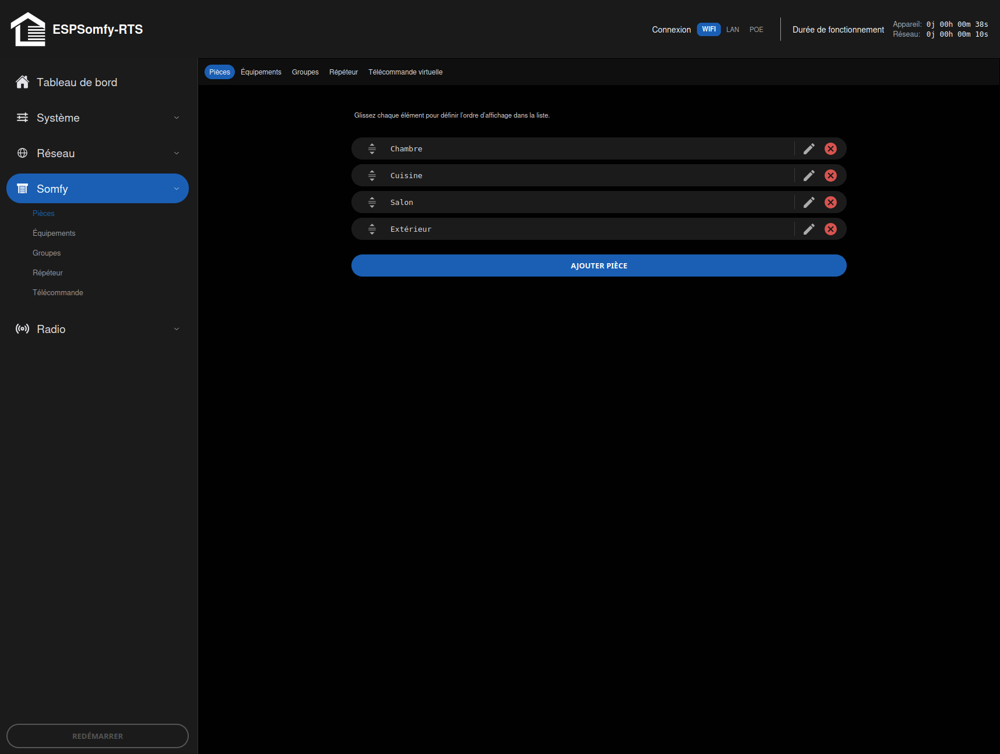
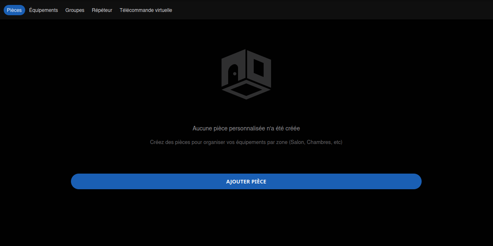
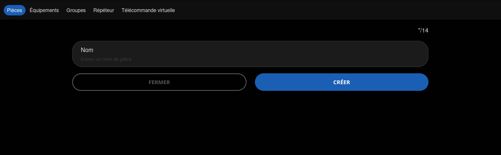

<!-- Page produite par docs/import-wiki-v2.py à partir de
     wiki-v2-source/Pièces-(Rooms).md. Toute retouche ici sera écrasée : corriger le
     wiki, redéposer la source, puis relancer le script. -->

# Pièces (Rooms)

L'onglet **Pièces** est l'outil d'organisation principal de l'ESPSomfy-RTS. Il vous permet de segmenter vos moteurs par zones ou thématiques pour une navigation fluide.

### Pourquoi organiser votre installation ?

Si vous possédez de nombreux volets, l'affichage sur une seule page peut vite devenir confus. Créer des pièces offre plusieurs avantages :

* **Clarté de l'interface** : Sur l'écran d'accueil, une barre de sélection des pièces apparaît. En choisissant "Cuisine", seuls les volets de cette zone s'afficheront.
* **Optimisation des noms** : Les noms des moteurs sont limités à **20 caractères**. 
    * *Exemple* : En assignant un moteur à la pièce `Cuisine`, vous pouvez simplement le nommer `Gauche` au lieu de `Volet Cuisine Gauche`.
* **Filtrage intelligent** : Les groupes (commandes centralisées) peuvent également être assignés à des pièces spécifiques pour simplifier la gestion.

### Caractéristiques techniques

* **Capacité** : Vous pouvez créer jusqu'à **14 pièces**.
* **Gestion de l'accueil** : Tous les volets non assignés à une pièce spécifique sont regroupés par défaut dans la pièce principale nommée **Accueil**.
* **Flexibilité** : Chaque nom de pièce dispose de son propre quota de **20 caractères**.

### Comment configurer vos pièces ?

1. Rendez-vous dans l'onglet **Somfy** > **Pièces**.

    

2. Cliquez sur le bouton `AJOUTER PIÈCE`, entrez le nom souhaité, puis validez en cliquant à nouveau sur `AJOUTER PIÈCE`.

    

3. Une fois créées, ces pièces seront disponibles dans les menus déroulants lors de la configuration de vos **Volets** ou de vos **Groupes**.

!!! note "Note"

    Une fois la pièce créée, le bouton `AJOUTER PIÈCE` devient `SAUVEGARDER PIÈCE`. Cela vous permet de modifier le nom à tout moment. Une fois l'édition terminée, votre nouvelle pièce apparaît dans la liste.

!!! tip "Astuce"

    **Astuce d'organisation :** Vous pouvez réorganiser l'ordre d'affichage de vos pièces très facilement grâce à un système de **Glisser/Déposer** directement dans la liste.

