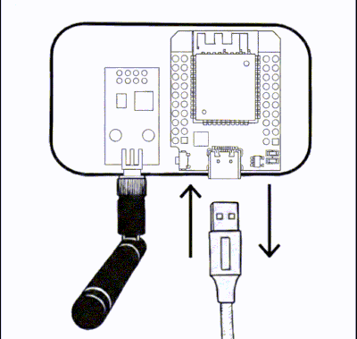

# Firmware de secours

Le firmware de secours est un second programme, rangé à part dans l'appareil. Il ne pilote aucun
équipement, mais il sait **installer un firmware** et **réinitialiser des réglages**, et il reste
disponible même quand le firmware principal est abîmé, effacé ou incapable de démarrer.

---

{ .on-glb }

## Pourquoi il existe

Le firmware principal ne s'écrit jamais lui-même. Chaque mise à jour passe par le firmware de
secours : l'appareil y redémarre, reçoit l'image, l'écrit, puis redémarre sur le nouveau firmware.
Votre configuration (réseau, sécurité, équipements, plannings) n'est pas touchée.

Si quelque chose tourne mal (envoi coupé, image refusée, nouveau firmware qui plante au démarrage),
l'appareil revient sur le firmware de secours au lieu de rester sans rien. Et quand c'est la
configuration qui pose problème (Wi-Fi erroné, code PIN oublié, réglage qui bloque l'interface), le
même firmware permet d'effacer précisément ce qu'il faut, sans dépendre du firmware principal.

Il est différent du **point d'accès de secours** habituel, celui qui s'ouvre quand l'appareil n'a
pas ou plus de Wi-Fi : voir [la comparaison plus bas](#point-d-acces).

## 1. Quand l'appareil y passe { #quand }

| Cas | Ce qui se passe |
| :--- | :--- |
| **Mise à jour** (en ligne ou par fichier) | l'interface fait passer l'appareil sur le firmware de secours, envoie l'image, puis le ramène sur le nouveau firmware ; vous n'avez rien à faire |
| **Bouton** `Redémarrer sur le firmware de secours` | page **Appareil › Système**, onglet **Mises à jour**, tuile **Installation manuelle** ; sa page s'ouvre ensuite d'elle-même |
| **Trois coupures d'alimentation** | pour un appareil dont l'interface ne répond plus ; voir [la section suivante](#trois-coupures) |
| **Nouveau firmware qui plante** | s'il plante avant d'avoir fonctionné 60 secondes, l'appareil revient seul sur le firmware de secours |
| **Stockage illisible** | si le système de fichiers ne se monte plus, même après un formatage, l'appareil y bascule seul |

## 2. Trois coupures d'alimentation { #trois-coupures }

Débranchez et rebranchez l'appareil **trois fois de suite**, chaque coupure dans les 5 secondes qui
suivent le démarrage précédent. C'est un geste physique, pas un bouton à maintenir.

  
   
  <em>Les trois coupures doivent s'enchaîner rapidement, chacune dans la fenêtre de 5 secondes qui suit le redémarrage précédent.</em>

| Démarrage | LED |
| :--- | :--- |
| 1er et 2e | **allumée fixe** pendant les 5 secondes |
| 3e | **clignotement rapide** pendant 1,5 seconde : c'est bon, l'appareil redémarre sur le firmware de secours |

Le compteur repart de zéro dès que l'appareil reste alimenté plus de 5 secondes. Ensuite, sur les
[boîtiers officiels](../../materiel/boitiers-officiels.md), la LED **clignote lentement** tant que
l'appareil est sur le firmware de secours. Sur une carte générique, elle reste éteinte : sa broche
est un réglage, que le firmware de secours ne reprend pas pour ne pas risquer de gêner l'Ethernet.

Sur les [boîtiers officiels](../../materiel/boitiers-officiels.md), la LED est déjà câblée et
reconnue. Sur une carte générique, indiquez sa broche et sa polarité dans
[Témoin LED de statut](led-de-statut.md) pour voir le même signal.

!!! note "Sans firmware de secours"

    S'il est absent ou abîmé, les trois coupures ne mènent nulle part : l'appareil démarre
    normalement. La tuile **Espace des firmwares** le signale et propose de le réinstaller,
    voir [Version et mise à jour](#mettre-a-jour).

## 3. Comment s'y connecter { #comment-s-y-connecter }

Le firmware de secours reprend la configuration de l'appareil : même réseau Wi-Fi ou Ethernet, même
adresse, même nom (par exemple `http://espsomfyrts.local`), même code PIN ou mot de passe.

Après les **trois coupures**, il ouvre **en plus** un réseau Wi-Fi **ouvert**, nommé
**`ESPSomfy-RESCUE`**, à l'adresse `192.168.4.1`. Un portail captif propose généralement d'ouvrir la
page sur votre téléphone.

Si l'appareil n'a **pas de réseau** et que vous y êtes arrivé par le bouton, il rouvre **son point
d'accès habituel**, avec le même nom et le même mot de passe ; l'appareil répond à `192.168.4.1`.

!!! tip "Retour automatique"

    Sans aucune activité pendant **10 minutes**, l'appareil revient seul sur son firmware
    principal, s'il est intact. Une entrée involontaire ne le laisse donc pas hors service.

## 4. La page { #la-page }

La page s'ouvre sur une question, **Que voulez-vous faire ?**, et l'en-tête rappelle la version du
firmware de secours, le nom de l'appareil et son adresse.

| Élément | Rôle |
| :--- | :--- |
| **Firmware installé** | la version du firmware principal, ou **Aucun firmware valide** |
| `Installer un firmware` | ouvre l'écran d'installation, voir [la section suivante](#installer) |
| `Réinitialiser` | ouvre l'écran de réinitialisation, voir [Réinitialiser](#reinitialiser) |
| `Revenir au firmware` | quitte le firmware de secours sans rien changer ; grisé s'il n'y a aucun firmware valide |

## 5. Installer un firmware { #installer }

| Élément | Rôle |
| :--- | :--- |
| **Le fichier qui correspond à votre appareil** | le nom du fichier à choisir, la partie propre à votre carte en couleur, comme dans [Reconnaître le bon fichier](mises-a-jour.md#mise-a-jour-manuelle-fichier-local) |
| **Code PIN** ou **mot de passe** | présent seulement si la sécurité est activée |
| Zone de dépôt | cliquez, ou glissez-y le fichier `.bin` |
| `Installer` | envoie le fichier ; l'appareil redémarre et la page recharge l'interface habituelle |

L'appareil refuse un fichier bâti pour une autre puce, pour une autre table de partitions, ou
abîmé. Dans ce cas, le firmware déjà en place n'est pas forcément conservé : installez le bon
fichier.

!!! warning "Pas de fichier `_rescue_` sur cette page"

    Cette page attend le **firmware principal** (`_ota_`). Un fichier `_rescue_` n'y est reconnu
    qu'une fois écrit à la place du firmware : il est refusé, et l'appareil reste sur le firmware
    de secours jusqu'à l'envoi du bon fichier. Pour remplacer le firmware de secours, passez par
    l'interface, voir [Version et mise à jour](#mettre-a-jour).

## 6. Réinitialiser { #reinitialiser }

Cochez ce qu'il faut effacer, puis `Réinitialiser et redémarrer`. **Rien n'est effacé avant la
confirmation.** L'appareil revient ensuite sur son firmware principal.

| Case | Ce qui est effacé |
| :--- | :--- |
| **Réseau** | Wi-Fi, adresse IP, Ethernet, et le mot de passe du [point d'accès](../../../aide/point-d-acces.md), qui redevient ouvert |
| **Sécurité** | code PIN, identifiant et mot de passe |
| **Radio** | module, broches, fréquence, puissance |
| **Réglages système** | MQTT, heure, nom de l'appareil et toutes les préférences, y compris celles du [témoin LED](led-de-statut.md) |
| **Équipements, groupes et pièces** | avec les plannings, les répéteurs et les télécommandes écoutées |
| **Langues téléchargées** | la langue d'origine reste ; efface aussi un stockage devenu illisible |
| **Tout effacer** | retour à l'état d'usine, codes tournants compris : vos moteurs devront être réappairés |

!!! important "Sans code : après les trois coupures seulement"

    Si la sécurité est activée, le firmware de secours demande le code PIN ou le mot de passe, comme
    la page **Système**. Il ne s'en passe qu'après les **trois coupures**, depuis le réseau
    **`ESPSomfy-RESCUE`** : c'est ainsi qu'on réinitialise un code oublié, et le geste physique
    garantit que vous êtes devant l'appareil.

!!! tip "Avant d'effacer"

    Si l'appareil fonctionne encore, faites une [sauvegarde](index.md#backup) : équipements,
    groupes et plannings ne reviennent qu'avec elle.

## 7. Version et mise à jour { #mettre-a-jour }

Le firmware de secours a sa propre version, **v1.0** pour la première. La tuile **Espace des
firmwares** (onglet **État du système**) l'affiche avec la place qu'il occupe ; sa page la rappelle
dans son en-tête.

Il n'est pas dans le fichier du firmware principal : il se met à jour à part.

* **Automatiquement**, après une [mise à jour en ligne](mises-a-jour.md#mise-a-jour-en-ligne) :
    si la version installée apporte un autre firmware de secours, l'interface l'envoie à la fin
    (« Mise à jour du firmware de secours… »). En cas d'échec, le message de réussite le signale et
    l'ancien reste en place : il fonctionne toujours.
* **À la main**, avec `Installer depuis un fichier` : choisissez le fichier
    `ESPSomfyRTS_vX.X.X_rescue_<carte>.bin` de la release. L'interface le reconnaît et demande
    confirmation. Le firmware principal n'est pas touché ; l'appareil redémarre ensuite.
* **S'il est absent ou abîmé**, la tuile **Espace des firmwares** affiche **Absent ou invalide**
    et un bouton `Réinstaller`, qui l'envoie depuis les versions publiées.

## 8. Quand faut-il passer par l'USB { #usb }

Le firmware de secours se suffit à lui-même, sauf dans deux cas :

* **Passage de la v2.x à la v3** : l'organisation de la mémoire change, voir [la migration](../../migration.md) ;
* **Firmware de secours absent ou abîmé, et firmware principal qui ne démarre plus**. Tant que le
  firmware principal fonctionne, le bouton `Réinstaller` suffit, voir
  [Version et mise à jour](#mettre-a-jour).

Dans ces deux cas, utilisez l'[installateur web](../../../outils/installateur-web.md).

!!! important "Boîtier Wi-Fi & Ethernet"

    Maintenez le **bouton poussoir** situé sous le boîtier enfoncé avant de cliquer sur
    `Installer` dans l'installateur web. Relâchez-le une fois l'effacement terminé et l'écriture
    commencée. À la fin, débranchez puis rebranchez le boîtier pour qu'il quitte le mode flash.

## 9. Si vous veniez de la v2 { #v2 }

Le firmware de secours remplace le [Factory Reset](../../../v2/maintenance/factory-reset.md) de la
v2.x, qui effaçait **sans rien montrer ni choisir**.

| | v2.x : Factory Reset | v3.x : firmware de secours |
| :--- | :--- | :--- |
| **Le geste** | 3 ou 6 coupures d'alimentation | **3 coupures** d'alimentation |
| **Après les coupures** | efface le réseau et la sécurité, **sans demander** | ouvre une page où **vous choisissez** ce qu'il faut effacer |
| **Retour à l'état d'usine** | 6 coupures : effacement complet **à l'aveugle** | la case **Tout effacer**, volontaire et confirmée |
| **Pour tout laisser intact** | impossible une fois lancé | `Revenir au firmware` ne change rien |
| **Réinstaller le firmware** | par USB | depuis la même page |

## 10. Différence avec le point d'accès de secours { #point-d-acces }

Voir aussi la page [Point d'accès de secours](../../../aide/point-d-acces.md).

| | Point d'accès de secours | Firmware de secours |
| :--- | :--- | :--- |
| **Nom du réseau** | nom d'hôte de votre appareil (`ESPSomfyRTS` par défaut) | `ESPSomfy-RESCUE` après les trois coupures |
| **Mot de passe** | celui que vous avez configuré | aucun |
| **Se déclenche quand** | l'appareil ne peut pas rejoindre le Wi-Fi ou l'Ethernet configuré | trois coupures d'alimentation, le bouton de l'interface, ou un firmware principal en échec |
| **Ce qui tourne** | l'interface complète, normale | une page à part, sans radio ni MQTT |
| **À quoi ça sert** | reconfigurer le réseau | installer un firmware, réinitialiser des réglages |

## Étape suivante

* [Mises à jour du firmware](mises-a-jour.md)
* [Sauvegarder et restaurer](index.md#backup)
* [Installateur web](../../../outils/installateur-web.md)
