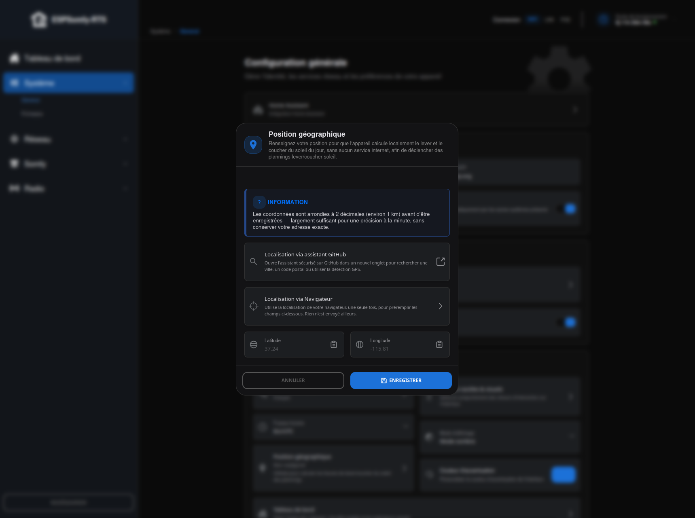

# Position géographique

Fournit à l'appareil les **coordonnées GPS de votre domicile**, pour qu'il calcule
localement le lever et le coucher du soleil.

## Pourquoi il existe

ESPSomfy-RTS sait déclencher une [programmation](../somfy/equipements/plannification.md) « au lever du soleil » ou
« au coucher du soleil » plutôt qu'à une heure fixe — un équipement qui suit la saison sans
qu'on y touche. Mais ces deux instants ne se calculent pas à partir de l'heure : ils
dépendent de **l'endroit où vous êtes**, et varient de plus d'une heure entre le nord et le
sud d'un même pays.

L'appareil a donc besoin d'une latitude et d'une longitude. Il n'a aucun moyen de les
deviner : pas de GPS, pas de service de géolocalisation embarqué, et l'adresse IP d'un
réseau domestique ne dit pas grand-chose.

**Vous n'en avez besoin qu'une fois**, sauf déménagement. Et vous n'en avez pas besoin du
tout si vous ne programmez qu'à heure fixe.

Une précision suffit largement : quelques centaines de mètres décalent le lever du soleil de
moins d'une seconde. Le nom de votre commune fait parfaitement l'affaire, inutile de
chercher votre rue.

## Où la régler

**Général → Position géographique** ouvre la fenêtre de réglage, directement dans
l'interface de l'appareil. Le badge affiche **Non configurée** tant que rien n'est
enregistré, ou les coordonnées elles-mêmes (ex : *48.86, 2.35*) une fois une position
appliquée.

!!! note "Note"

    **Vie privée :** les coordonnées sont arrondies à 2 décimales (environ 1 km) avant d'être
    enregistrées — largement suffisant pour une précision de calcul à la minute, sans
    conserver votre adresse exacte.

Trois façons de remplir les champs **Latitude** / **Longitude**, de la plus simple à la plus
manuelle :

### 1. Localisation via assistant GitHub

Ouvre, dans un nouvel onglet, l'assistant décrit en détail sur sa propre page —
[Géolocalisation](../../outils/geolocalisation.md). C'est l'option proposée en premier : contrairement à la
page de l'appareil, cet assistant est servi en HTTPS, donc la détection GPS du navigateur y
fonctionne de façon fiable, tout comme la recherche par ville.

Une fois la position choisie dans cet onglet, elle revient **automatiquement** remplir les
champs de la fenêtre restée ouverte sur l'appareil, et l'onglet de l'assistant se referme de
lui-même — rien à copier-coller.

### 2. Localisation via Navigateur

Utilise la géolocalisation de votre propre navigateur, une seule fois, pour préremplir les
champs directement sur place — rien n'est envoyé ailleurs. Ce bouton n'apparaît que si la
page de l'appareil elle-même est chargée dans un contexte sécurisé (HTTPS, ou `localhost`) :
sur l'immense majorité des installations, l'interface de l'appareil est servie en HTTP simple
sur le réseau local, et la géolocalisation du navigateur n'y fonctionne pas — c'est
précisément pour ce cas que l'assistant externe (option 1) existe.

### 3. Saisie manuelle

Les champs Latitude/Longitude acceptent aussi une saisie ou un collage direct. Collez les
deux valeurs d'un coup au format `latitude, longitude` : elles se répartissent
automatiquement dans les deux champs, séparateur virgule ou point accepté pour chacune. Une
icône presse-papiers dans chaque champ tente une lecture directe (même contrainte HTTPS que
l'option 2) ; à défaut, elle place simplement le focus dans le champ pour un collage manuel
(`Ctrl+V`, ou appui long puis « Coller » sur mobile).

## Enregistrer

**Appliquer** enregistre la position. **Effacer** la retire (l'appareil repasse à l'état non
configuré, et toute programmation au lever/coucher du soleil reste inactive tant qu'aucune
position n'est renseignée).

## Messages d'erreur

| Message | Ce qu'il veut dire |
|---|---|
| *Votre navigateur ne prend pas en charge la géolocalisation* | le navigateur n'a pas l'interface requise |
| *Accès à la position refusé ou indisponible. Saisissez les coordonnées manuellement* | vous avez refusé l'autorisation, ou le système n'a pas su localiser la machine |
| *La latitude doit être comprise entre -90 et 90* / *La longitude doit être comprise entre -180 et 180* | une valeur hors plage a été saisie à la main — revérifié côté appareil en plus du navigateur |
| *Lecture automatique du presse-papiers indisponible ici* | collez avec `Ctrl+V`, ou appui long puis « Coller » sur mobile |

## Procédures liées

- [Géolocalisation](../../outils/geolocalisation.md) — l'assistant externe ouvert par **Localisation via
    assistant GitHub**, documenté en détail sur sa propre page.

