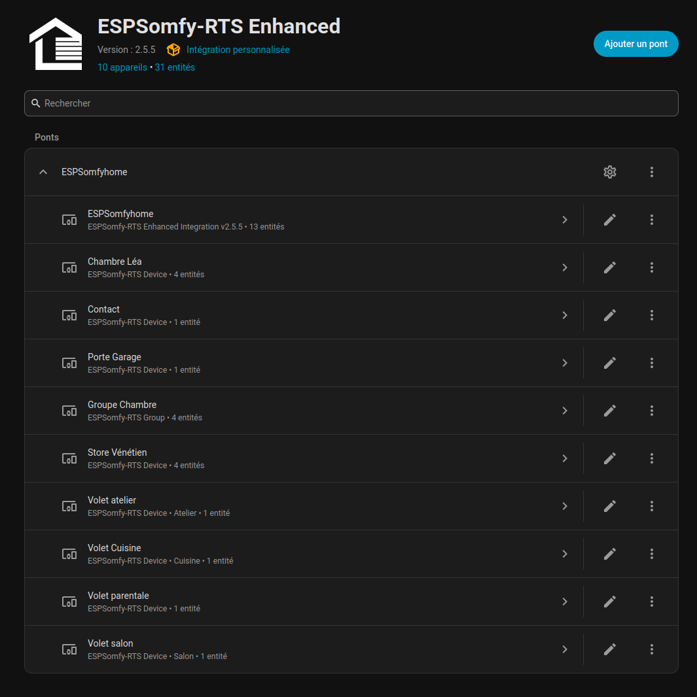
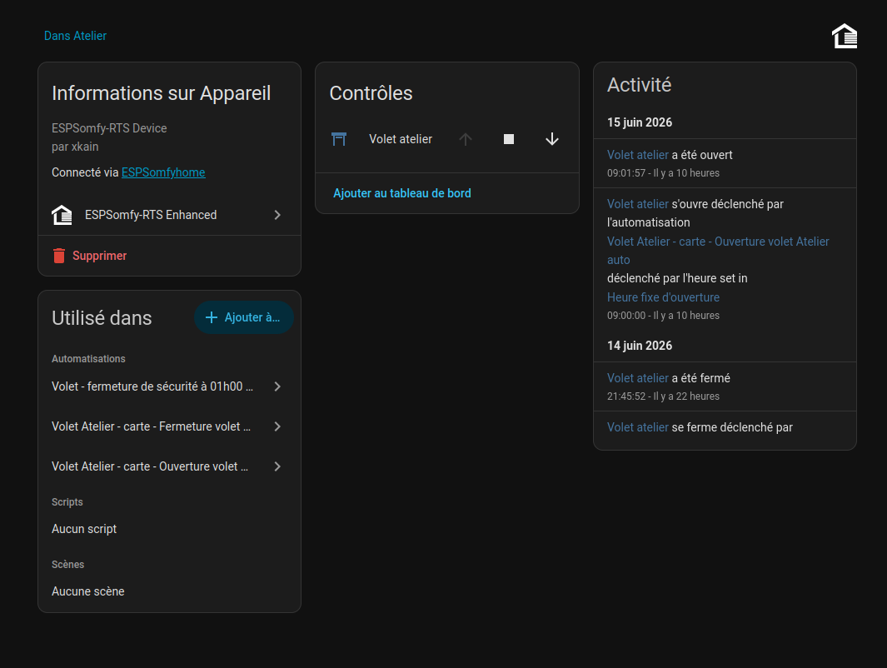

# Intégrations

## Options de connectivité disponibles

Le but premier d'ESPSomfy-RTS n'est pas seulement de proposer une interface utilisateur, mais de servir de plateforme d'intégration pour vos volets vers d'autres systèmes.

* **Commandes REST** : Utilisation des commandes HTTP (GET, POST, PUT).
* **Websockets** : Notifications en temps réel lors des mouvements.
* **[MQTT](mqtt.md)** : Connexion bidirectionnelle pour le contrôle et le retour d'état — documentée sur sa propre page.
* **Home Assistant** : Intégration native "clés en main" (raison d'être principale du projet).


## Interface REST (API)

L'interface REST permet le contrôle à distance via votre réseau. Le firmware écoute sur
**quatre ports** différents, chacun avec un rôle précis :

| Port | Rôle |
|---|---|
| **80** | Le serveur complet : l'interface web elle-même **et** l'intégralité de l'API — y compris toute la configuration (pièces, équipements, groupes, plannings, réseau, sécurité, radio, langues…). |
| **8081** | Un **sous-ensemble volontairement restreint**, pensé pour une intégration tierce (le code cite nommément Home Assistant) qui n'a besoin ni de l'interface embarquée ni des écrans de configuration. C'est ce sous-ensemble que cette page documente en détail ci-dessous. |
| **8082** | Réservé aux opérations de mise à jour (téléchargement de firmware) — un serveur synchrone séparé, sans rapport avec le reste de l'API. |
| **8080** | Le canal WebSocket temps réel qui notifie l'interface des mouvements — pas du REST, mais le même rôle que `/shades` en continu plutôt qu'à la demande. |

!!! note "Note"

    Tout ce qui est documenté ci-dessous fonctionne aussi bien sur le port 80 que sur le port
    8081, les deux portant la même URL. Le port 80 propose en plus énormément d'autres points
    de terminaison (toute la configuration) qui ne sont pas couverts par cette page : ce sont
    ceux qu'utilise l'interface web elle-même, pas une surface pensée pour rester stable pour
    une intégration externe.

### Authentification

Si la sécurité est activée, un en-tête HTTP `apikey` est exigé — obtenu via `GET|PUT|POST
/login` (voir plus bas). Ce n'est pas un jeton statique : c'est un HMAC-SHA256 calculé à
partir de vos identifiants **et de votre adresse IP source**, avec un secret propre à
l'appareil (généré une fois, jamais transmis). Concrètement : **ce jeton n'est valable que
depuis la même adresse IP** qui l'a obtenu — un changement d'IP (DHCP, VPN, proxy) en
nécessite un nouveau.

Deux niveaux de permission distincts existent, pas un seul :

* Les commandes de mouvement (`/shadeCommand`, `/groupCommand`, `/tiltCommand`,
    `/setPositions`, `/setSensor`) sont de niveau **« usage »**.
* La configuration (créer/modifier/supprimer un équipement, une pièce, un planning…) exige
    le niveau **« configuration »**.

Si le réglage de sécurité **« Autoriser uniquement les réglages »** (mode « Config Only »)
est actif, le niveau « usage » ne demande **aucune clé du tout** — seule la configuration
reste protégée. Par ailleurs, `/shades`, `/groups` et `/controller` masquent
`remoteAddress`, `lastRollingCode` et `linkedRemotes` à tout appelant qui n'est pas
authentifié au niveau configuration ; `/discovery`, lui, les masque **toujours**, quel que
soit le niveau d'authentification.

!!! important "Important"

    Si vous activez la sécurité, un outil comme **Postman** ou **curl** devient nécessaire
    pour fournir l'en-tête `apikey` — un navigateur seul ne suffit plus pour les commandes
    protégées.

---

## Tester vos volets immédiatement (Méthode GET)

Sans sécurité activée, vous pouvez tester vos volets en tapant simplement une adresse dans
votre navigateur web.

### Exemple avec votre configuration actuelle :

* **Exemple Adresse IP** : `192.168.1.13`
* **Port** : `8081`
* **ID du volet** : `1`

| Action souhaitée | URL à copier dans votre navigateur |
| :--- | :--- |
| **Monter** | `http://192.168.1.13:8081/shadeCommand?shadeId=1&command=up` |
| **Descendre** | `http://192.168.1.13:8081/shadeCommand?shadeId=1&command=down` |
| **Arrêter (Stop)** | `http://192.168.1.13:8081/shadeCommand?shadeId=1&command=stop` |

---

## GET /controller

Retourne la configuration complète du contrôleur : limites, réglages radio, état de la
mise à jour, et une référence de tous vos équipements/groupes/pièces/plannings.

| Paramètre | Retour | Méthode | Port | URL d'exemple |
| :--- | :--- | :--- | :--- | :--- |
| Aucun | JSON | **GET** | `80` ou `8081` | `http://192.168.1.13/controller` |

Voir `GET /shades` et `GET /groups` pour le détail des objets qu'il contient.

<details markdown="1">
<summary>Exemple de retour</summary>

```json
{
  "maxRooms": 16,
  "maxShades": 32,
  "maxGroups": 16,
  "maxGroupedShades": 32,
  "maxLinkedRemotes": 7,
  "maxSchedules": 32,
  "startingAddress": 656296,
  "transceiver": {
    "config": {
      "type": 56,
      "TXPin": 13,
      "RXPin": 12,
      "SCKPin": 18,
      "MOSIPin": 23,
      "MISOPin": 19,
      "CSNPin": 5,
      "rxBandwidth": 99.97000122,
      "frequency": 433.4200134,
      "txPower": 10,
      "proto": 0,
      "enabled": true,
      "radioInit": true,
      "radioBoardType": 0
    }
  },
  "version": {
    "available": false,
    "status": 0,
    "error": 0,
    "cancelled": false,
    "checkForUpdate": true,
    "inetAvailable": true,
    "fwVersion": { "name": "v3.0.0", "major": 3, "minor": 0, "build": 0, "suffix": "" },
    "appVersion": { "name": "3.0.0", "major": 3, "minor": 0, "build": 0, "suffix": "" },
    "latest": { "name": "v3.0.0", "major": 3, "minor": 0, "build": 0, "suffix": "" }
  },
  "rooms": [],
  "shades": [],
  "groups": [],
  "repeaters": [],
  "schedules": []
}
```
</details>

!!! note "Note"

    Le champ `deviation`, présent dans d'anciennes versions, n'existe plus dans cette sortie —
    voir [Configurer la Radio](../radio/index.md#pourquoi-la-déviation-de-fréquence-a-disparu-en-v300)
    pour l'explication complète.

---

## GET /discovery

Une version allégée de `/controller`, pensée pour qu'une intégration tierce identifie
l'appareil sans télécharger toute sa configuration radio.

| Paramètre | Retour | Méthode | Port | URL d'exemple |
| :--- | :--- | :--- | :--- | :--- |
| Aucun | JSON | **GET** | `80` ou `8081` | `http://192.168.1.13:8081/discovery` |

* `authType` — type d'authentification requis : `0` aucune, `1` code PIN, `2` nom
    d'utilisateur/mot de passe.
* `permissions` — masque de bits : `0x00` tout protégé, `0x01` seule la configuration l'est
    (mode « Config Only »).
* `connType` — `"Wifi"`, `"Ethernet"`, ou `"Unknown"` (point d'accès / pas encore connecté).
    C'est la connexion **réellement active**, pas la préférence configurée : un appareil réglé
    en « Ethernet préféré » mais actuellement replié sur le Wi-Fi renverra `"Wifi"`.
* `memory` — `max`/`free`/`min`/`total` (octets de tas) et `largest` (plus grand bloc
    contigu disponible — un indicateur de fragmentation mémoire, absent des versions
    antérieures).

<details markdown="1">
<summary>Exemple de retour</summary>

```json
{
  "serverId": "49E4AC",
  "version": "v3.0.0",
  "latest": "v3.0.0",
  "model": "ESPSomfyRTS",
  "hostname": "ESPSomfyRTS",
  "authType": 0,
  "permissions": 0,
  "chipModel": "",
  "connType": "Wifi",
  "checkForUpdate": true,
  "memory": { "max": 110580, "free": 164008, "min": 110924, "total": 266040, "largest": 98304 },
  "rooms": [],
  "shades": [],
  "groups": []
}
```
</details>

!!! note "Note"

    Sur `/discovery`, `shades` et `groups` masquent toujours `remoteAddress`,
    `lastRollingCode` et `linkedRemotes`, même authentifié — c'est volontaire et ne dépend
    d'aucun réglage.

---

## GET|PUT|POST /groupCommand

Envoie une commande à tous les volets d'un groupe simultanément.

### Paramètres

* `groupId` — identifiant du groupe **[1-14]** (0 et 15 sont réservés en interne, jamais
    attribués).
* `command` — voir la liste complète des commandes sous `/shadeCommand` ci-dessous ; les
    mêmes alias s'appliquent.
* `repeat` — nombre de répétitions. `repeat=0` est ici respecté explicitement (contrairement
    à `/shadeCommand`, voir plus bas) : 1 trame est envoyée, sans répétition.
* `stepSize` — comme pour `/shadeCommand` (équipements 80 bits).

`GET /groupCommand?groupId=1&command=up` — ouvre tous les volets du groupe.

### Retour
Référence JSON du groupe.

---

## GET /groups

Tableau des groupes configurés.

<details markdown="1">
<summary>Exemple de retour</summary>

```json
[
  {
    "groupId": 1,
    "roomId": 0,
    "name": "Rez-de-chaussée",
    "remoteAddress": 515023,
    "lastRollingCode": 120,
    "bitLength": 56,
    "proto": 0,
    "sunSensor": false,
    "flipCommands": false,
    "ledFeedback": false,
    "flags": 0,
    "repeats": 0,
    "sortOrder": 1,
    "linkedShades": [
      { "shadeId": 1, "roomId": 0, "name": "Volet Salon", "shadeType": 4, "proto": 0, "bitLength": 56 }
    ]
  }
]
```
</details>

Depuis v3.0.0, `linkedShades` contient les objets allégés des équipements membres (pas
seulement leurs identifiants) — mêmes champs que la forme masquée de `GET /shades`.

---

## GET|PUT|POST /login

Échange vos identifiants contre une clé `apikey` à fournir dans l'en-tête des requêtes
suivantes.

### Paramètres

* `pin` — si l'authentification est par code PIN.
* `username` / `password` — si l'authentification est par identifiant.

`GET /login?pin=1234`

### Retour

* `type` — type d'authentification utilisé.
* `success` — `true`/`false`.
* `msg` — message lisible.
* `apiKey` — HMAC-SHA256 hexadécimal (64 caractères), à renvoyer tel quel dans l'en-tête
    `apikey` de chaque requête protégée suivante.

<details markdown="1">
<summary>Exemple de retour</summary>

```json
{
  "type": 1,
  "success": true,
  "msg": "Login successful",
  "apiKey": "9b92ba08950cd40451eeb41d8e137e3c35bc6dc6ed0b695f7a4724cfc0ba702f"
}
```
</details>

!!! warning "Avertissement"

    **Protection anti-force brute** : 3 tentatives libres par adresse IP, puis un verrouillage
    qui double à chaque échec (15 secondes → jusqu'à 15 minutes), avec une réponse HTTP `429`
    précisant soit le nombre de tentatives restantes, soit le délai d'attente (`retryAfter`).
    Le compteur se réinitialise après 15 minutes sans nouvelle tentative. Une réponse `503`
    signale que l'appareil manque temporairement de mémoire pour calculer le jeton — réessayez.

---

## GET|PUT|POST /shadeCommand

Envoie une commande à un équipement identifié.

### Paramètres

* `shadeId` — identifiant **[1-30]** (0 et 31/32 sont réservés en interne).
* `command` — l'une des valeurs suivantes (insensibles à la casse) : `My`, `Up`, `MyUp`,
    `Down`, `MyDown`, `UpDown`, `MyUpDown`, `Prog`, `SunFlag`, `StepUp`, `StepDown`, `Flag`,
    `Sensor`, `Toggle`, `Favorite`, `Stop`. Des préfixes courts existent pour la plupart
    (`u`→Up, `d`→Down, `m`→My, `p`→Prog, `mu`→MyUp, `md`→MyDown, `ud`→UpDown,
    `mud`→MyUpDown, `su`→StepUp, `sd`→StepDown, `f`→Flag, `s`→SunFlag, `t`→Toggle,
    `fav`→Favorite) — mais **pas `Stop`**, qui n'a pas d'alias court : tapez-le en entier.
* `target` — pourcentage cible **[0-100]**, alternative à `command`.
* `repeat` — nombre de répétitions supplémentaires (1 trame de base + `repeat` trames).
* `stepSize` — **[1-127]**, pour les commandes d'étape sur équipements 80 bits.

`GET /shadeCommand?shadeId=1&command=up` — ouvre complètement.
`GET /shadeCommand?shadeId=1&target=50` — déplace à 50%.

!!! danger "Attention"

    Une commande non reconnue ne génère **aucune erreur** : elle retombe silencieusement sur
    `My`. Vérifiez l'orthographe de vos intégrations plutôt que de vous fier à un message
    d'erreur qui ne viendra pas.

!!! note "Note"

    `repeat=0` envoyé explicitement n'est **pas** respecté ici : l'appareil retombe sur le
    nombre de répétitions mémorisé pour cet équipement (1 par défaut). Pour forcer une seule
    trame sans répétition via l'API, utilisez `/groupCommand` ou `/repeatCommand`, qui eux
    respectent `repeat=0` explicitement — une incohérence entre routes, à garder en tête.

### Retour
Référence JSON de l'équipement.

---

## GET /shades

Tableau de tous les équipements configurés.

* `shadeType` **[0-16]** : `0` Store enrouleur, `1` Store vénitien, `2` Rideau (gauche),
    `3` Store banne, `4` Volet, `5` Garage (1 bouton), `6` Garage (3 boutons), `7` Rideau
    (droit), `8` Rideau (central), `9`/`10` Contact sec, `11`-`13` Portail (gauche/centre/
    droit), `14`-`16` Portail 1 bouton (gauche/centre/droit).
* `tiltType` **[0-4]** : `0` Aucun, `1` Moteur d'inclinaison séparé, `2` Mécanisme intégré,
    `3` Inclinaison uniquement, `4` Mode Europe *(nouveau, absent des versions antérieures)*.
* `direction` **[-1/0/1]** : monte / arrêté / descend. `tiltDirection` **[-1/0/1]** : sens
    horaire / arrêté / antihoraire — une sémantique différente de `direction`, à ne pas
    confondre.
* `flags` (masque de bits) : `0x01` SunFlag activé, `0x02` capteur de soleil présent,
    `0x04` mode démo, `0x10` il y a du vent, `0x20` il y a du soleil, `0x80` position My
    simulée *(ces deux derniers bits sont nouveaux par rapport aux versions antérieures)*.
* `tiltTimeUp` / `tiltTimeDown` — remplacent l'ancien champ unique `tiltTime` : les durées
    de montée et de descente de l'inclinaison peuvent désormais différer.
* `linkedRemotes` — tableau des télécommandes liées.

<details markdown="1">
<summary>Exemple de retour</summary>

```json
[
  {
    "shadeId": 4,
    "roomId": 0,
    "name": "Volet Salon",
    "remoteAddress": 515025,
    "upTime": 10000,
    "downTime": 10000,
    "paired": true,
    "lastRollingCode": 4,
    "position": 32,
    "tiltType": 0,
    "tiltPosition": 0,
    "tiltDirection": 0,
    "tiltTimeUp": 7000,
    "tiltTimeDown": 7000,
    "stepSize": 100,
    "tiltTarget": 0,
    "target": 32,
    "myPos": -1,
    "myTiltPos": -1,
    "direction": 0,
    "shadeType": 0,
    "bitLength": 56,
    "proto": 0,
    "flags": 0,
    "flipCommands": false,
    "flipPosition": false,
    "inGroup": false,
    "sunSensor": false,
    "repeats": 0,
    "sortOrder": 1,
    "linkedRemotes": [
      { "remoteAddress": 4886595, "lastRollingCode": 14415 }
    ]
  }
]
```
</details>

---

## GET|PUT|POST /tiltCommand

Incline les lames d'un équipement capable d'inclinaison.

### Paramètres

* `shadeId` — **[1-30]**.
* `command` — recommandé : `My`, `Up`, `Down`, `StepUp`, `StepDown` (les mêmes alias que
    `/shadeCommand` sont techniquement acceptés mais sans effet pertinent sur l'inclinaison).
* `target` — cible **[0-100]**, alternative à `command`.

!!! note "Note"

    Contrairement à `/shadeCommand`, cette route n'accepte ni `repeat` ni `stepSize` — tout
    paramètre de ce type envoyé ici est simplement ignoré.

### Retour
Référence JSON de l'équipement.

---

## GET|PUT|POST /setPositions

Recale la position **enregistrée** d'un équipement **sans émettre aucune trame radio** —
utile si un capteur externe (fin de course, contact magnétique) vous dit où le volet se
trouve réellement, pour resynchroniser l'affichage sans bouger le moteur.

### Paramètres

* `shadeId`, `position` **[0-100]**, `tiltPosition` **[0-100]** — `tiltPosition` n'a d'effet
    que si l'équipement a un type d'inclinaison différent de « Aucun ».

`GET /setPositions?shadeId=1&position=50`

!!! warning "Avertissement"

    Le nom du paramètre est bien **`position`** — pas `liftPosition`, qui ne fait rien
    (ignoré silencieusement s'il est envoyé par erreur).

### Retour
Référence JSON de l'équipement.

---

## GET|PUT|POST /setSensor

Simule un capteur Sunis (soleil) ou Eolis (vent) pour un équipement ou un groupe. Ne
déclenche pas de mouvement immédiat : l'appareil mémorise l'état transmis, et c'est sa
boucle interne qui décide ensuite de bouger, après les délais suivants — à condition que le
réglage « Sun Flag » soit actif sur l'équipement concerné :

| Condition | Délai avant réaction |
|---|---|
| Vent détecté → rétractation | **2 secondes** de vent continu |
| Fin du vent → nouveau déploiement possible | **12 minutes** de calme continu |
| Soleil détecté → déploiement | **2 minutes** de soleil continu |
| Fin du soleil → rétractation | **20 minutes** sans soleil |

### Paramètres

* `shadeId` **OU** `groupId`, `sunny` (0/1), `windy` (0/1), `repeat`.

`GET /setSensor?shadeId=1&windy=1` — signale du vent à l'équipement 1.

### Retour
Référence JSON de l'équipement ou du groupe ciblé.

---

## Autres points de terminaison disponibles sur le port 8081

Ces routes existent et sont, elles aussi, disponibles sur le port 8081 comme les
précédentes, mais ne sont pas détaillées ici (structures plus proches de la configuration
interne, moins stables dans le temps) :

| Route | Rôle |
|---|---|
| `GET /rooms`, `GET /room` | Liste des pièces, ou une pièce précise |
| `GET /schedules`, `GET /schedule`, `POST /saveSchedule` | Lecture et écriture des plannings |
| `GET /shade`, `GET /group` | Un équipement ou un groupe précis (plutôt que le tableau complet) |
| `POST /repeatCommand` | Commande adressée à un répéteur radio |
| `POST /backup` | Génère un fichier de sauvegarde (identique au bouton **Sauvegarder**) |
| `POST /downloadFirmware`, `POST /reboot` | Déclenche une mise à jour, ou un redémarrage |

!!! note "Note"

    Le port 80 expose en plus la totalité de l'API interne qu'utilise l'interface web elle-même
    (création/modification/suppression de pièces, équipements, groupes, plannings, réglages
    réseau, sécurité, radio, langues…). Elle n'est pas couverte par cette page : contrairement
    au sous-ensemble du port 8081, rien ne garantit sa stabilité d'une version à l'autre.

---

## MQTT

Documentation déplacée sur sa propre page : voir [MQTT](mqtt.md).

---
## Home Assistant

L'intégration de **ESPSomfy-RTS** dans **Home Assistant** n'est pas seulement une option, c'est l'aboutissement logique de votre installation. Si ESPSomfy-RTS est le "cerveau" qui parle à vos moteurs, Home Assistant est le "chef d'orchestre" qui donne vie à votre maison.





## Pourquoi est-ce une combinaison gagnante ?

L'utilisation de l'intégration dédiée (via le **Marketplace**, anciennement HACS) transforme radicalement votre expérience utilisateur :

* **Gestion Native des "Covers" :** Vos volets sont reconnus comme des entités standards (objets "Cover"). Cela vous permet de les piloter à la voix via **Alexa, Google Assistant ou Siri**, de les intégrer à des interfaces tactiles élégantes ou de les commander depuis l'application mobile, que vous soyez dans votre salon ou à l'autre bout du monde.
* **Exemple d'automatisations Avancées :** Ne vous contentez plus d'un simple bouton. Créez une maison qui anticipe vos besoins :
    * *Arrivée à la maison :* Le portail et le garage s'ouvrent automatiquement dès que votre smartphone est détecté à 100 mètres de la maison.
    * *Simulation de Présence :* Durant vos vacances, Home Assistant anime vos volets de façon aléatoire pour simuler une activité réelle et dissuader toute intrusion.
    * *Rythme Circadien :* Programmez un réveil doux avec une ouverture progressive 10 minutes avant votre lever, et une fermeture automatique précise au coucher du soleil.
* **Synchronisation Parfaite :** Contrairement à une télécommande classique qui envoie un signal "dans le vide", cette intégration remonte l'état des volets en temps réel. De plus, chaque groupe créé dans ESPSomfy-RTS est instantanément importé dans Home Assistant avec toutes ses commandes associées.
* **Indépendance Totale du Cloud :** Tout le système fonctionne en réseau local. Pas de dépendance aux serveurs Somfy, pas de coupure en cas de panne internet et une latence quasi nulle. Vos volets répondent au doigt et à l'œil.

Une fois vos automatisations configurées pour répondre à vos scénarios de vie, vous n'aurez plus jamais besoin de chercher une télécommande. C'est un véritable **"game changer"** pour le confort de votre foyer, la technologie s'efface pour laisser place à un quotidien parfaitement fluide.


## Installation via le Marketplace (anciennement HACS)

!!! note "Note"

    À partir de Home Assistant **2026.11**, HACS est intégré à Home Assistant et devient le **Marketplace** (**Paramètres → Marketplace**). Rien n'est à télécharger : le catalogue et les dépôts personnalisés sont les mêmes. Avant cette version, passez encore par HACS.

Si vous êtes un utilisateur de Home Assistant, oubliez les configurations manuelles fastidieuses ci-dessus. Rendez-vous sur le dépôt de l'intégration pour une installation simplifiée en quelques clics :

| Ressource | Lien de téléchargement |
| :--- | :--- |
| **Dépôt Intégration** | [ESPSomfy-RTS enhanced pour Home Assistant](https://github.com/xkain/ESPSomfy-RTS-enhanced) |

<br />

<a href="https://my.home-assistant.io/redirect/hacs_repository/?owner=xkain&repository=ESPSomfy-RTS-enhanced">
  
</a>

---

## ⚠️ Compatibilité avec l'intégration de rstrouse (`ESPSomfy-RTS-HA`)

Si vous utilisez actuellement l'intégration originale de rstrouse ([ESPSomfy-RTS-HA](https://github.com/rstrouse/ESPSomfy-RTS-HA)), le système fonctionnera globalement. **Cependant, un problème critique de suivi des versions se pose.**

Les notes de version du firmware ne s'afficheront pas dans Home Assistant lorsqu'une mise à jour sera disponible. 

!!! important "Important"

    **Pourquoi c'est critique ?** <br>
    Depuis la **v3.0.0**, le firmware nécessite une [mise à jour manuelle](../firmware/mises-a-jour.md#mise-à-jour-manuelle-fichier-local) (deux fichiers distincts à téléverser). Sans les notes de version visibles, vous risquez de lancer une mise à jour automatique qui échouera.

!!! tip "Astuce"

    Si vous mettez à jour depuis une version **v2.5.3 à v2.5.8**, un défaut de ces versions
    empêchait la fiche de découverte MQTT d'atteindre Home Assistant lorsqu'un *root topic*
    était configuré — corrigé en v3.0.0. Après la mise à jour, **redémarrez Home Assistant**
    une fois : HA garde en mémoire l'échec de découverte précédent et ne retente pas de
    lui-même tant qu'il n'a pas relu les fiches depuis le courtier.

### Solution : Corriger le bouton "Lire l'annonce de la version"

Pour que l'intégration originale pointe vers le bon dépôt et affiche correctement les notes de mise à jour, vous devez modifier manuellement un fichier de l'intégration.

1. Ouvrez le fichier suivant sur votre serveur Home Assistant :
    `/config/custom_components/espsomfy_rts/update.py`
2. Repérez la fonction `release_url` aux alentours de la **ligne 155**.
3. Remplacez le bloc de code existant :

```python
@property
def release_url(self) -> str | None:
    """URL to the full release notes of the latest version available."""
    if (version := self.latest_version) is None:
        return None
    return f"https://github.com/rstouse/ESPSomfy-RTS/releases/tag/{version}"
```

par 

```python
@property
def release_url(self) -> str | None:
    """URL to the full release notes of the latest version available."""
    if (version := self.latest_version) is None:
        return None
    return f"https://github.com/xkain/ESPSomfy-RTS/releases/tag/{version}"
```

et redemarrer Home Assistant


