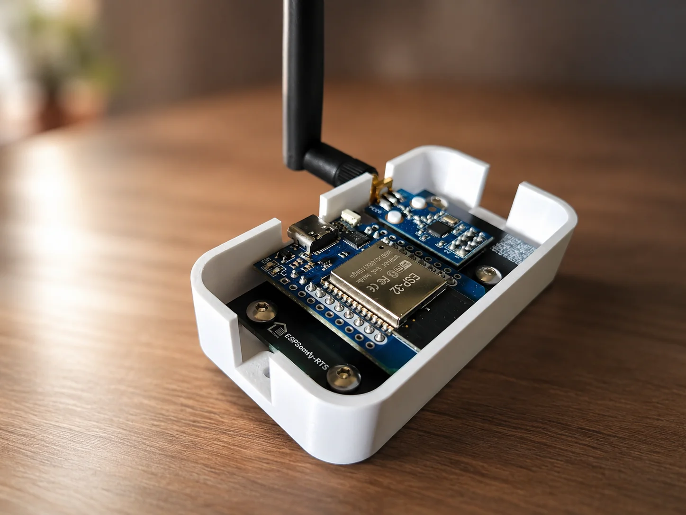
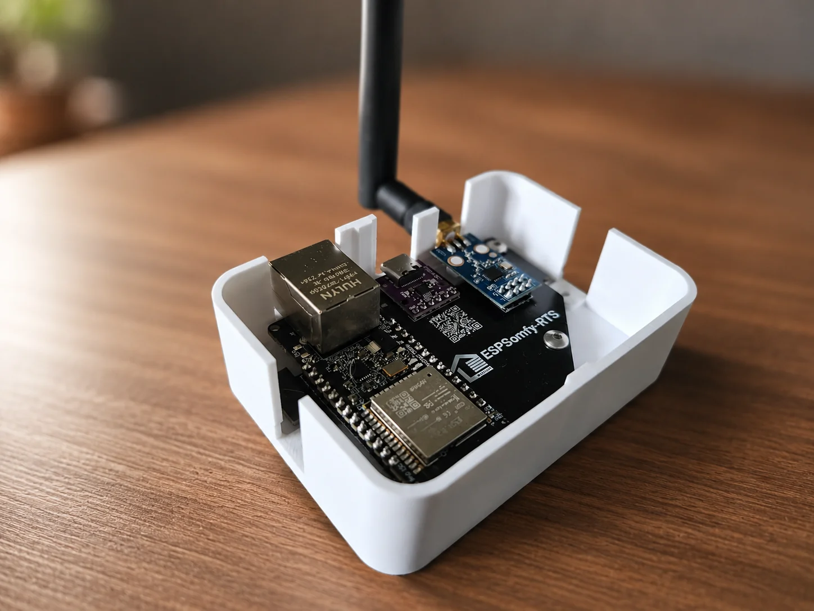

# Boîtiers officiels

## À qui s'adresse cette page ?

**Utilisateurs ciblés :** Cette page d'aide s'adresse **exclusivement** aux personnes ayant acheté l'un de [mes boîtiers officiels](https://www.leboncoin.fr/profile/77a39e2a-ddb5-44c8-828a-954652c46ee7) pré-assemblés.

## 📦 Spécifications du Matériel

<table border="0" style="width: 100%; border-collapse: collapse; border-style: hidden; table-layout: fixed;">
  <tr>
    <td style="width: 50%; vertical-align: bottom; padding-right: 15px; border-style: hidden;">
      <h3>Édition Wi-Fi</h3>
    </td>
    <td style="width: 50%; vertical-align: bottom; padding-left: 15px; border-style: hidden;">
      <h3>Édition Ethernet & Wi-Fi</h3>
    </td>
  </tr>
  <tr>
    <td style="vertical-align: top; padding-right: 15px; border-style: hidden; padding-top: 10px;">
      
    </td>
    <td style="vertical-align: top; padding-left: 15px; border-style: hidden; padding-top: 10px;">
      
    </td>
  </tr>
  <tr>
    <td style="vertical-align: top; padding-right: 15px; border-style: hidden; padding-top: 15px;">
      <ul>
        <li>ESP32 D1 Mini</li>
        <li>E07-M1101D-SMA (CC1101)</li>
        <li>Pont USB-série CP2102, présent sur la carte D1 Mini</li>
        <li>Antenne 3dBi (amovible)</li>
        <li>PCB développé sur mesure</li>
        <li>Assignation GPIO : <a href="../../commun/composants.md#esp32-d1-mini">Voir détails</a></li>
        <li>💾 <b>Flash ultra-simple :</b> Se branche et se flashe directement en USB-C sans manipulation requise.</li>
      </ul>
    </td>
    <td style="vertical-align: top; padding-left: 15px; border-style: hidden; padding-top: 15px;">
      <ul>
        <li>ESP32 WT32-ETH01</li>
        <li>E07-M1101D-SMA (CC1101)</li>
        <li>Pont USB-série CH340N SOP8 : un module séparé, soudé sur le PCB, le WT32-ETH01 n'ayant pas d'USB</li>
        <li>Antenne 3dBi (amovible)</li>
        <li>PCB développé sur mesure</li>
        <li>Assignation GPIO : <a href="../../commun/composants.md#wt32-eth01">Voir détails</a></li>
        <li>💾 <b>Flash matériel :</b> Équipé d'un bouton-poussoir discret en face inférieure pour basculer en mode flash au branchement USB-C.</li>
      </ul>
    </td>
  </tr>
</table>

!!! note "Note"

    Utilisez de **préférence** un chargeur de téléphone standard pour l’alimentation (évitez les chargeurs de moins de 1A). Pour les boîtiers Ethernet & Wi-Fi (comme le WT32-ETH01), utilisez un chargeur stable et de bonne qualité d'au moins 1,5A. Ce composant supporte très mal les micro-coupures et sous-tensions, au risque d'être dégradé de manière permanente, l'utilisation d'un petit onduleur pourrait facilement vous éviter ce genre de problème.  
    Vous pouvez également brancher sur n’importe quel appareil disposant d’un port USB (ex : Box / TV / PC).

## ✅ Prêt à l'emploi

Les deux éditions sortent **entièrement préconfigurées et testées** avant expédition — Depuis la v3.0.0 il n'y a plus d'assistant de préconfiguration à lancer après coup, ni de réglage régional à corriger. Tout est natif pour votre boîtier, l'interface est donc simplifié pour vous.

- Interface **français**
- Fuseau horaire réglé sur **Europe/Paris**
- Broches GPIO de la radio **déjà assignées** pour votre boîtier
- Édition Ethernet & Wi-Fi : vous n'avez plus besoin de choisir le type de carte (GPIO) pour activer la connexion Ethernet.
- Voyant LED d'état intégré : bleu pour l'édition Wi-Fi - vert pour l'édition Ethernet & Wi-Fi

Vous pouvez directement passer à la [configuration de vos équipements](../somfy/equipements/index.md).

### 💡 Connexion réseau pour l'édition Ethernet & Wi-Fi

Au premier démarrage, l'assistant de connexion propose un choix entre deux modes : **Wi-Fi**, ou **Ethernet + Secours Wi-Fi**.

Le dernier est recommandé : en cas de déconnexion ou de problème sur le câble Ethernet, le boîtier bascule automatiquement après uncertain temps sur votre réseau Wi-Fi pour garantir la continuité du service. En le choisissant, l'assistant vous demande directement vos identifiants Wi-Fi..

### En cas de besoin de remise à zéro

Le boîtier dispose d'un [mode Récupération](../recuperation.md)) dédié : trois
coupures d'alimentation volontaires ouvrent un point d'accès de réparation indépendant, où
vous choisissez précisément quoi réinitialiser (réseau, équipements, codes tournants,
jusqu'à la réinitialisation d'usine complète) — rien n'est effacé sans confirmation. Même
dans ce dernier cas, vos réglages régionaux (langue, fuseau horaire) et l'assignation des
GPIO radio reviennent automatiquement aux bonnes valeurs : le firmware de ces boîtiers les
embarque déjà comme réglages par défaut, il n'y a rien à ressaisir.

Avant toute réinitialisation d'usine complète, pensez à faire une
[sauvegarde](../../outils/installateur-web.md#avant-dinstaller-sauvegardez) pour pouvoir restaurer votre
configuration ensuite.

---

## Un grand merci pour votre soutien !

Avant toute chose, je tenais à vous remercier d'avoir acheté l'un de mes boîtiers officiels. En faisant ce choix, **vous soutenez directement mon travail de développement**.

C'est grâce à votre confiance et à votre contribution que je peux passer du temps à faire avancer ce projet. **Merci à vous !**

