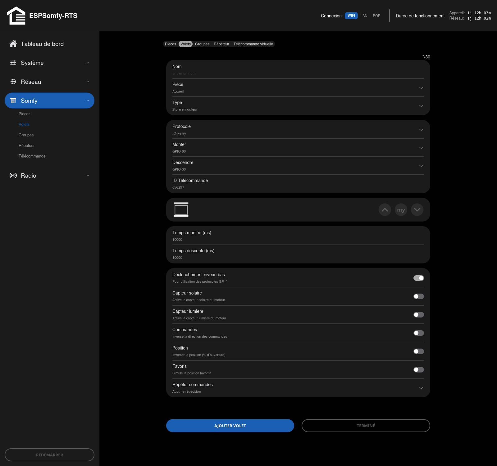
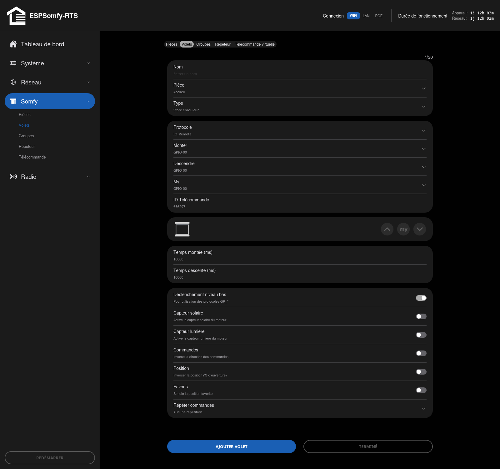

# Contrôle des moteurs avec GPIO

ESPSomfy-RTS permet de piloter des moteurs via les broches GPIO, que ce soit en utilisant des relais externes ou en modifiant une télécommande existante ("dissected remote"). Cette configuration vous permet de mélanger des moteurs radio avec des moteurs filaires contrôlés par relais ou déclenchés depuis une télécommande non supportée. Vous pouvez utiliser n'importe quelle broche de sortie libre sur votre ESP32 pour commander la montée ou la descente.

## Protocole IO-Relay
En plus des protocoles radio, ESPSomfy-RTS supporte deux protocoles GPIO distincts. Si vous avez acheté des moteurs "nus" sans contrôleur, vous pouvez simplement les déclencher à l'aide d'une paire de relais.

!!! important "Important"

    Ne confondez pas `IO-Relay` avec le protocole **Somfy io-homecontrol** (souvent appelé
    juste « IO »). Ce sont deux choses sans rapport : io-homecontrol est un protocole radio
    bidirectionnel propriétaire de Somfy, qu'**ESPSomfy-RTS ne pilote pas** — seul le
    protocole RTS, unidirectionnel, est supporté. `IO-Relay` est un nom de protocole interne
    à ESPSomfy-RTS pour piloter des moteurs par relais GPIO, sans lien avec io-homecontrol.

## Fonctionnement
En sélectionnant IO-Relay comme protocole de moteur, ESPSomfy RTS alimentera la broche sélectionnée pour le haut ou le bas selon la direction souhaitée. Lorsque la position cible est atteinte, la broche est automatiquement mise hors tension.

* **Logique de mouvement** : L'ESP32 active (pull high) la broche de montée pour bouger vers le haut et la broche de descente pour le bas. Au repos, les deux broches sont désactivées (pull low).
* **Identique au Radio** : Dans cette configuration, les moteurs fonctionnent comme s'ils étaient pilotés par radio. Toutes les fonctions, comme la touche "My", fonctionnent parfaitement. Même le positionnement est supporté !
* **Interopérabilité** : Si vous avez un canal libre sur une télécommande radio, vous pouvez même le lier pour déplacer ce moteur non-radio. Vous pouvez également lier ce moteur à un capteur de soleil ou de vent.

## Configuration

Sélectionnez le protocole IO-Relay pour l'équipement (Shade). Deux menus déroulants apparaîtront pour choisir les broches des relais Haut et Bas.

* **Timing** : N'oubliez pas de régler vos temps de course afin que le moteur sache quand s'arrêter, surtout si vous n'avez pas de commutateurs de fin de course.
* **Interrupteur** : pour un simple On/Off plutôt qu'un équipement motorisé, choisissez le
    type **Interrupteur (1 bouton)** ou **Interrupteur (2 boutons)** — une seule broche
    (bascule) pour le premier, les broches Haut et Bas pour le second. Un réglage **Mode de
    sortie** choisit alors si la broche reste activée (**maintenu**) ou se relâche d'elle-même
    après un délai réglable (**impulsion**, 50 à 10 000 ms). Un réglage **Vocabulaire d'état**
    permet d'afficher autre chose que On/Off (Allumé/Éteint, Ouvert/Fermé, Actif/Inactif) selon
    ce que l'interrupteur commande réellement.

!!! note "Note"

    Ce type d'équipement n'est pas réservé au protocole IO-Relay : il fonctionne aussi en RTS
    radio, en liant un canal de télécommande comme pour tout autre équipement.

   

!!! note "Note"

    Seule une broche est activée à la fois pour garantir qu'aucune commande contradictoire ne parvienne au moteur. La durée d'activation est déterminée par vos réglages de temps de montée/descente (pratique si votre moteur est plus lent à monter qu'à descendre).
   

## Protocole IO-Remote
Si vous possédez un protocole radio non supporté, vous pouvez ajouter votre propre support en disséquant une télécommande d'origine. ESPSomfy-RTS simulera alors les pressions sur les boutons Haut, Bas et My.

!!! important "Important"

    Même remarque que pour `IO-Relay` : ne confondez pas `IO-Remote` avec le protocole
    **Somfy io-homecontrol**. ESPSomfy-RTS ne pilote pas io-homecontrol — `IO-Remote` est un
    nom de protocole interne, pour simuler une télécommande disséquée par GPIO.

## Fonctionnement
Comme pour le protocole IO-Relay, toutes les fonctions restent disponibles. Cependant, comme vous ne recevez pas de retour d'état du moteur pendant son fonctionnement, vous ne pouvez contrôler le moteur que via l'interface ESPSomfy-RTS pour garantir la précision.

## Configuration
Sélectionnez IO-Remote. Selon le nombre de boutons de la télécommande que vous émulez, vous aurez entre 1 et 3 sélections de broches. Par exemple, un interrupteur (1 bouton) ou une porte de garage à un seul bouton n'affichera que la broche "Down".

!!! note "Note"

    Il est recommandé de faire quelques recherches sur le web pour le câblage. Beaucoup de télécommandes fonctionnent parfaitement si elles sont alimentées par les broches 3.3V de l'ESP32. La broche centrale du bouton est ensuite connectée à la broche fournie pour les boutons `haut`, `bas` et/ou `my` boutons.

