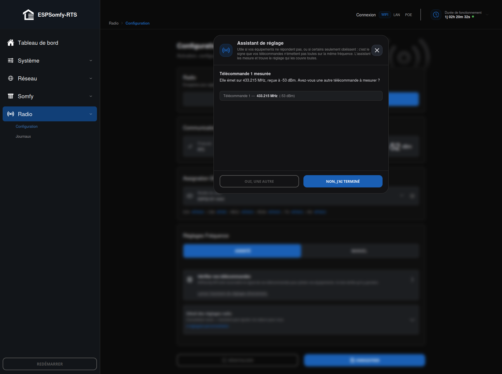

# Assistant de réglages radio

Mesure vos télécommandes une par une et calcule lui-même la fréquence de base et la largeur
de bande RX qui les couvre toutes — sans demander la moindre connaissance technique. Depuis
**Radio → Configuration → Assisté**, il s'ouvre automatiquement si le
[test de réception](index.md#mode-assisté) échoue, ou directement via le lien
« Lancer l'assistant de réglages directement ».

!!! note "Note"

    Utile si vos équipements ne répondent pas du tout, ou si certains seulement obéissent — ce
    dernier cas est le signe que vos télécommandes n'émettent pas toutes exactement sur la même
    fréquence.

## Déroulement

1. **Munissez-vous de vos télécommandes.** Elles seront mesurées une par une, à environ un
    mètre de l'appareil — ni plus loin, ni collé contre lui.
2. **Pour chaque télécommande** : maintenez n'importe quel bouton enfoncé. Une télécommande
    Somfy cesse d'émettre d'elle-même au bout d'une dizaine de secondes ; si rien n'apparaît,
    relâchez et réappuyez — deux ou trois pressions sont normales.
3. Une fois une mesure obtenue, choisissez **Oui, une autre** pour mesurer la télécommande
    suivante, ou **Non, j'ai terminé** pour passer au résultat.
4. L'assistant calcule et affiche la **fréquence de base** et la **largeur de bande RX**
    proposées. **Enregistrer** les applique et sauvegarde dans la foulée (inutile de repasser
    par le bouton Enregistrer de la page principale).

À tout moment, **Retour** ramène à l'écran « une autre ? » sans perdre les mesures déjà
prises ; fermer l'assistant en cours de route redemande confirmation dès qu'une mesure est en
mémoire, pour ne pas la perdre par mégarde.

## Comment la mesure est faite

L'assistant pilote le même balayage que l'outil manuel (toute la bande 433-434 MHz, par pas de
10 kHz), mais ne retient **ni** le pic brut ni la fréquence que le balayage met en avant tout
seul. Sur banc, répéter la mesure cinq fois sur une télécommande immobile donne :

| Méthode | Étalement sur 5 mesures |
|---|---|
| Sommet du pic (ce qu'affiche le balayage brut) | 40 kHz |
| **Milieu de la fenêtre de détection** (ce que retient l'assistant) | 10 kHz — son propre pas de quantification, pas du bruit |

Le filtre de réception fait ~100 kHz de large : son sommet est plat sur une bonne part de
cette largeur, ce qui rend le point le plus fort peu fiable d'une passe à l'autre. Les flancs,
eux, chutent nettement (environ 12 dB) dès le pas suivant — l'assistant détecte ces deux
flancs et retient leur milieu, une mesure bien plus répétable.

## Mesure isolée : garder ou exclure ?

Si une des mesures est très éloignée des autres, l'assistant le signale avant de conclure :
l'inclure obligerait à élargir la bande au point de dégrader la réception de **toutes** les
autres télécommandes, pour un signal qui est probablement un appareil tiers capté par erreur
plutôt qu'une vraie télécommande à vous. Vous choisissez de la retirer ou de tout annuler —
l'assistant ne décide jamais seul.

## Le calcul

Une fois les mesures retenues :

* **Fréquence de base** = milieu entre la mesure la plus basse et la plus haute (et non leur
    moyenne, qui se laisserait influencer par un groupe de mesures proches au détriment d'un
    cas isolé).
* **Largeur de bande RX** = l'écart entre la plus basse et la plus haute, plus une marge de
    sécurité de 10 kHz de chaque côté (la résolution de la mesure elle-même) — **sans jamais
    descendre sous la largeur d'usine (99,97 kHz)**. Si toutes vos télécommandes sont groupées
    (le cas le plus courant), l'assistant retrouve donc exactement la largeur de bande d'usine :
    il confirme plutôt que de bricoler, et n'élargit que quand les mesures l'exigent vraiment.

!!! note "Note"

    Élargir la bande n'est jamais gratuit : une fenêtre plus large capte aussi plus de bruit
    ambiant — voir [Configurer la Radio](index.md#mode-manuel). Si l'écart
    entre vos télécommandes dépasse ce que le CC1101 peut couvrir, l'assistant vous le signale
    plutôt que de proposer un réglage qui dégraderait toute la réception pour rien — dans ce cas
    rare, vérifiez qu'il ne s'agit pas en réalité de deux émetteurs différents.

