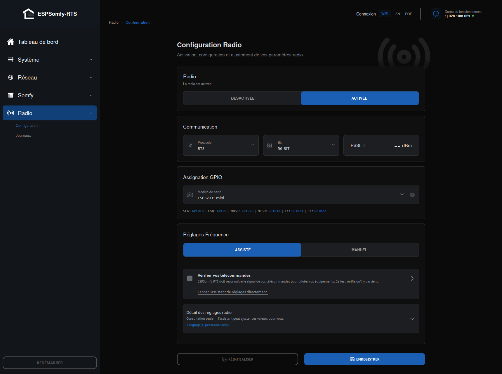

# Configurer la radio

[](../img/radio-configuration.png)

Cet onglet (`Radio`, avec ses deux sous-onglets **Configuration** et **Journaux**) pilote le
module CC1101 qui parle à vos télécommandes et moteurs Somfy. Quatre pages complètent
celle-ci : l'[Assistant de réglages](assistant-de-reglages.md) (réglage automatique à
partir de vos télécommandes), le
[balayage manuel](balayage-frequence.md) (relevé RSSI brut, à lire et
appliquer vous-même), le [Journal Radio](journal.md) (détail du sous-onglet Journaux), et
[Dépannage Radio](depannage.md) (diagnostic pas à pas si rien de tout ça ne suffit).

!!! note "Note"

    Sur un [boîtier officiel](../materiel/boitiers-officiels.md), la radio est déjà câblée et préréglée — le
    profil de carte correspondant (`ESP32-D1 mini` pour la variante Wi-Fi, `WT32-ETH01` pour la
    variante Ethernet & Wi-Fi) est sélectionné par défaut. Il reste pertinent de vérifier
    **Protocole**, **Bit** et la fréquence si vos équipements ne répondent pas d'emblée.

## Activer la radio

Désactivée par défaut à la première mise en service, pour vous laisser le temps de valider vos
branchements avant la mise en service réelle.

## Communication

* **Protocole** : **RTS** (standard Somfy), **RTW** ou **RTV** — le réglage appliqué par
    défaut à tout nouvel équipement ajouté (sans toucher à ceux déjà enregistrés).
* **Bit** : **56 bits** pour RTS classique, **80 bits** disponible selon vos équipements.
* Un compteur de trames et le RSSI de la dernière trame reçue s'affichent en direct à côté —
    un signe de vie simple, sans ouvrir les [Journaux](#journaux-logs).

## Assignation GPIO

Un sélecteur de modèle de carte remplit automatiquement les broches SPI (SCLK, CSN, MOSI,
MISO) et les deux broches radio (TX, RX) :

| Carte | SCK | CSN | MOSI | MISO | TX | RX |
|---|---|---|---|---|---|---|
| Par défaut (ESP32) | 18 | 5 | 23 | 19 | 13 | 12 |
| Par défaut (ESP32-S2) | 36 | 34 | 35 | 37 | 15 | 14 |
| Par défaut (ESP32-S3) | 12 | 10 | 11 | 13 | 15 | 14 |
| Par défaut (ESP32-C3) | 15 | 14 | 16 | 17 | 13 | 12 |
| ESP32-D1 mini | 18 | 5 | 23 | 19 | 21 | 22 |
| WT32-ETH01 | 14 | 12 | 15 | 4 | 2 | 35 |
| Olimex ESP32-PoE/EVB | 14 | 13 | 15 | 16 | 4 | 36 |
| LilyGO T-Internet POE | 14 | 12 | 15 | 16 | 4 | 35 |
| wESP POE | 18 | 5 | 13 | 32 | 4 | 39 |
| ESP-PoE-32 | 14 | 5 | 13 | 32 | 4 | 35 |
| ESP32-S3 Mini | 7 | 6 | 9 | 8 | 3 | 4 |
| XIAO-ESP32-C3 | 8 | 6 | 10 | 9 | 3 | 4 |
| XIAO-ESP32-C6 | 19 | 21 | 18 | 20 | 1 | 2 |

Les préréglages nommés (WT32-ETH01, Olimex, LilyGO, wESP, ESP-PoE-32) couvrent spécifiquement
des cartes qui embarquent aussi un contrôleur Ethernet : leurs broches sont choisies pour ne
jamais entrer en conflit avec lui. **Définir manuellement** affiche les six champs libres
(pour un câblage non standard), protégés par une case de confirmation *« Je comprends les
risques d'une mauvaise configuration des GPIO »* — aucune broche saisie à la main n'est
enregistrée sans elle.

!!! danger "Attention"

    Si vous êtes sur une carte Ethernet, assurez-vous qu'aucune broche radio n'est partagée avec
    le module Ethernet : contrairement aux broches de la radio entre elles (vérifiées par
    l'interface, qui refuse un doublon), rien ne détecte un conflit avec l'Ethernet — un mauvais
    réglage peut endommager physiquement les composants.

* **SCLK, CSN, MOSI, MISO** : l'interface SPI vers le module — doivent correspondre exactement
    au câblage physique. Un module qui ne répond pas du tout (voir
    [dépannage](depannage.md#1-vérifier-dabord-que-la-radio-tourne))
    vient presque toujours d'une erreur ici.
* **TX / RX (GDO0 / GDO2)** : le CC1101 ne peut **émettre** que via sa broche **GDO0** — la
    réception, elle, fonctionne indifféremment sur GDO0 ou GDO2. Une inversion des deux se
    traduit par une réception qui continue de fonctionner mais une émission totalement muette.
* **Mode multiplexé** : relier GDO0 seul et indiquer le **même GPIO** pour TX et RX économise
    une broche — l'appareil commute automatiquement entre émission et réception sur cette unique
    ligne. C'est la seule duplication de broche que l'interface accepte sans la signaler comme
    conflit.

## Réglages fréquence

Un commutateur **Assisté / Manuel** choisit comment aborder l'accordage — un réglage
d'affichage propre à votre navigateur (mémorisé, mais jamais envoyé à l'appareil). Les blocs
Activation/Communication/GPIO ci-dessus restent visibles quel que soit le mode choisi : câbler
sa carte reste possible même en Assisté.

### Mode Assisté

*Rien ne se règle tout seul ici : vous agissez à chaque étape — c'est pour ça qu'il s'appelle
Assisté et non Automatique.*

* **Vérifier vos télécommandes** : un test **passif** — aucun balayage, aucune écriture, la
    radio n'est pas touchée. Appuyez sur une touche ; l'appareil écoute 15 secondes l'événement
    qu'émet le firmware quand une trame est réellement **décodée** avec les réglages actuels.
    Un succès signifie « vos équipements répondront » — c'est la seule preuve de bout en bout,
    une mesure de fréquence seule ne peut pas l'affirmer. En cas d'échec,
    [l'assistant de réglages](assistant-de-reglages.md) prend le relais.
* **Détail des réglages radio** : un récapitulatif replié par défaut, qui répond à une seule
    question — mes trois réglages (fréquence, largeur de bande RX, puissance TX) sont-ils ceux
    d'usine, et sinon en quoi diffèrent-ils ? Il s'ouvre de lui-même dès qu'une modification non
    enregistrée apparaît. Aucune marge, aucun dBm, aucune aiguille ici : ces notions
    appartiennent au volet Manuel, pour qui a explicitement demandé à voir le détail.

### Mode Manuel

Expose directement les trois curseurs (sliders avec champ numérique, boutons `-`/`+`, et
maintien du doigt pour défiler plus vite) :

* **Fréquence de base** *(433,000 à 434,399 MHz, pas de 0,001)* — valeur d'usine **433,420
    MHz**. C'est la fréquence sur laquelle votre module radio, vos moteurs et vos télécommandes
    Somfy doivent être calés, comme émetteur et récepteur d'une même station. Elle convient à la
    quasi-totalité des installations ; ne la modifiez que par petits pas en cas de gros problème
    de réception, et revenez à la valeur d'usine en cas de doute.
* **Largeur de bande RX** *(58,03 à 812,50 kHz)* — valeur d'usine **99,97 kHz**. Elle définit
    la largeur de la « fenêtre » d'écoute du récepteur. Étroite, elle isole mieux des parasites
    et améliore la portée mais exige une fréquence très précise ; large, elle facilite la
    capture de télécommandes légèrement décalées mais capte aussi plus de bruit ambiant.
    Conservez la valeur d'origine, et ne l'élargissez que si vous peinez à capter vos
    télécommandes.
* **TX Puissance** *(en dBm)* — valeur d'usine **10 dBm**. Contrairement aux deux réglages
    précédents, ce n'est pas une valeur continue : le curseur ne parcourt que les **11 paliers
    réels** du CC1101 — `-30, -20, -15, -10, -6, 0, 5, 7, 10, 11, 12` dBm, aucune valeur
    intermédiaire n'existe matériellement. 10 dBm suffit largement à couvrir une maison ; ne
    passez à 12 dBm que si votre matériel est explicitement conçu pour cela, sous peine de
    dysfonctionnement ou de durée de vie réduite du module.

#### Comprendre la fenêtre de réception

Un graphique affiche ce que ces deux premiers curseurs dessinent ensemble, sur une échelle
fixe 433,000-434,399 MHz : un trait pointillé pour la fréquence de base, un rectangle pour la
fenêtre réellement écoutée. **ESPSomfy-RTS reçoit tout ce qui tombe dans cette tranche, et
émet sur la fréquence de base.** La formule est simple :

```
fenêtre de réception = [fréquence de base − largeur de bande / 2, fréquence de base + largeur de bande / 2]
```

**Exemples concrets**, à partir de la fréquence d'usine (433,420 MHz) :

| Largeur de bande RX | Fenêtre de réception | Effet |
|---|---|---|
| 99,97 kHz *(usine)* | 433,370 – 433,470 MHz | Couvre la quasi-totalité des télécommandes Somfy d'origine |
| 58,03 kHz *(minimum)* | 433,391 – 433,449 MHz | Fenêtre très étroite — n'importe quel écart de 29 kHz suffit à perdre le signal |
| 812,50 kHz *(maximum)* | 433,014 – 433,826 MHz | Couvre presque toute la plage réglable — capte beaucoup plus de bruit |

Et si vous décalez la fréquence de base à **433,220 MHz** (par exemple après un
[balayage](balayage-frequence.md)
ayant révélé qu'une télécommande émet là plutôt qu'à 433,420) avec la largeur d'usine, la
fenêtre devient 433,170 – 433,270 MHz : une télécommande d'usine à 433,420 MHz sortirait alors
**elle-même** de la fenêtre — d'où l'intérêt de
[l'assistant](assistant-de-reglages.md), qui calcule une fenêtre couvrant toutes vos
télécommandes à la fois plutôt que de simplement recentrer sur une seule.

!!! tip "Astuce"

    N'importe quel écart entre la fréquence d'émission réelle d'une télécommande et la fenêtre
    de réception se traduit exactement de la même façon : le RSSI peut s'agiter dans les
    [Journaux](#journaux-logs) (du bruit est bien capté) sans qu'aucune trame ne se décode — la
    porteuse elle-même n'entre jamais dans le filtre.

#### Pourquoi la Déviation de fréquence a disparu en v3.0.0

Le format d'origine (et les versions jusqu'à la v2.5.x) exposait un quatrième réglage,
**Déviation de fréquence**. Il a été retiré : mesuré sur banc, ce réglage n'a **aucun effet
sur la réception**, quelle que soit sa valeur.

La radio Somfy RTS utilise une modulation **ASK/OOK** (tout ou rien — porteuse présente ou
absente), pas du FSK (deux tons séparés par la déviation). Le CC1101 n'y est qu'un détecteur
d'enveloppe : c'est le firmware qui décode ensuite les durées d'impulsion en logiciel. La
déviation n'aurait de sens qu'en FSK, où le filtre doit contenir les deux tons `fréquence ±
déviation` — ici, elle ne gouverne tout simplement rien de ce qui est reçu.

Preuve directe : même télécommande maintenue, largeur de bande RX inchangée, seule la
déviation modifiée — **47,60 kHz** → 68 trames décodées sur 68 ; **380,85 kHz** (le maximum du
CC1101) → toujours 68 trames sur 68, RSSI identique. L'ancienne documentation laissait croire
qu'une valeur comme 11,92 kHz était « un bon compromis » : ce n'était vrai d'aucune mesure
réelle. Le réglage n'a pas été retiré d'une version publiée (seule la v25 a jamais été
distribuée), il n'a donc jamais figuré dans un fichier de sauvegarde en circulation — voir
[Anatomie du fichier de sauvegarde](../firmware/anatomie-sauvegarde.md#enregistrement-radio-transceiver)
pour le détail du format.

### Vos équipements ne répondent pas malgré tout ça ?

Un bouton dédié, en bas du volet Manuel, ouvre le
[balayage de fréquences](balayage-frequence.md) — voir cette page pour le
détail de l'outil, ou [Dépannage Radio](depannage.md) pour la suite du diagnostic.

## Enregistrement

**Réinitialiser** repose les trois réglages de fréquence sur leurs valeurs d'usine (rien n'est
écrit sur l'appareil tant que vous n'avez pas enregistré ensuite — une confirmation est
demandée avant d'agir, l'effet n'étant pas visible ailleurs qu'en regardant les curseurs).
**Enregistrer** valide l'ensemble du panneau — broches, type de carte, et les trois réglages
de fréquence.

## Journaux (Logs)

Le second sous-onglet affiche en direct chaque trame radio décodée, la plus récente en haut —
voir [Journal Radio](journal.md) pour le détail de chaque colonne, le code couleur du RSSI,
et l'usage des boutons **COPIER** / **EFFACER** / **Pause**. Pour l'utiliser dans un
diagnostic, voir [Dépannage Radio](depannage.md#5-lire-le-journal-pour-comprendre-ce-qui-se-passe).

