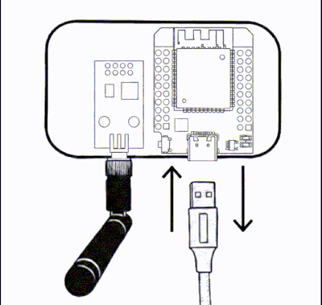

# Mode Récupération

## Pourquoi il existe

Le mode Récupération sert à réparer un appareil dont la configuration ou l'interface web
pose problème, **sans dépendre de rien de ce qui pourrait être cassé** : il ne touche ni
au réseau configuré, ni au système de fichiers de l'interface normale, ni au module radio.
C'est une porte de secours indépendante du reste du firmware.

Il est différent du **point d'accès de secours** habituel (celui qui s'ouvre quand
l'appareil n'a pas ou plus de Wi-Fi) — voir [la comparaison plus bas](#différence-avec-le-point-daccès-de-secours-habituel).

{ .on-glb }

## Comment le déclencher

Deux façons, une volontaire et une automatique :

- **Trois coupures d'alimentation délibérées**, chacune dans les 5 secondes qui suivent le
    démarrage précédent. C'est un geste physique, pas un bouton à maintenir : débranchez et
    rebranchez l'appareil trois fois de suite, rapidement.
- **Automatiquement**, si le système de fichiers de l'interface web est illisible au
    démarrage (mise à jour interrompue après une coupure de courant par exemple). Dans ce cas, aucune action de
    votre part n'est nécessaire — l'appareil bascule seul en mode Récupération plutôt que de
    démarrer une interface cassée.

  
   
  <em>Les trois coupures doivent s'enchaîner rapidement, chacune dans la fenêtre de 5 secondes qui suit le redémarrage précédent.</em>

### Signal visuel

Le voyant LED de l'appareil confirme la progression, dès le tout début de chaque fenêtre de
5 secondes (pas de délai avant que l'état ne s'affiche) :

| Démarrage | Comportement de la LED pendant les 5 secondes |
|---|---|
| 1er et 2e | **Allumée fixe** — rien ne distingue encore un cycle normal d'un début de séquence |
| 3e (seuil atteint) | **Clignotement rapide** (150 ms) — la coupure suivante, ou l'absence de coupure, décide de la suite |

Si vous laissez l'appareil alimenté plus de 5 secondes à n'importe quelle étape, le compteur
revient à zéro : il faut reprendre la séquence depuis le début. Une fois le mode Récupération
actif (à l'issue du 3e cycle), la LED **clignote lentement** en continu (~800 ms) tant que
vous y êtes.

Sur les [boîtiers officiels](materiel/boitiers-officiels.md), ce signal est **natif** : la LED est déjà
câblée et reconnue par le firmware, rien à faire. Sur une carte générique, si son ESP32
dispose d'une LED intégrée, vous pouvez l'activer vous-même — voir
[Témoin LED de statut](firmware/led-de-statut.md) : il suffit d'y indiquer la broche et sa
polarité pour que ce même signal s'affiche aussi chez vous.

## Comment s'y connecter

L'appareil ouvre un réseau Wi-Fi **ouvert, sans mot de passe**, nommé
**`ESPSomfy-RECOVERY`**, à l'adresse `192.168.4.1`. Un portail captif propose généralement
d'ouvrir la page automatiquement sur votre téléphone.

Ce nom est **volontairement différent** de celui du point d'accès de secours habituel
(qui porte le nom de votre appareil) : en scannant les réseaux Wi-Fi à proximité, il doit
être immédiatement clair qu'il s'agit d'un appareil à réparer, et non d'un simple problème
de connexion.

!!! note "Note"

    Le réseau est sans mot de passe par choix : le mot de passe du point d'accès normal fait
    justement partie de ce que vous pourriez avoir à récupérer. Le seul garde-fou est le
    geste physique des trois coupures — personne ne tombe en mode Récupération par accident.

## Ce qu'on peut y faire

La page servie est minimaliste et totalement indépendante du reste du firmware : ni le
module radio, ni MQTT, ni le serveur web normal ne tournent pendant ce temps. Des interrupteurs
permettent de choisir précisément quoi réinitialiser — **rien n'est effacé tant que
vous n'avez pas cliqué sur Appliquer**.

### Réinitialisation ciblée

| Interrupteur | Effet |
|---|---|
| Réseau | Wi-Fi, adresse IP, Ethernet, et le mot de passe du point d'accès |
| Sécurité | Code PIN, identifiant et mot de passe |
| Configuration système | Nom d'hôte, MQTT, NTP, préférences d'affichage |
| Équipements, groupes et pièces | Supprime les équipements déclarés et leur organisation |
| Plannings | Supprime toutes les programmations horaires |
| Packs de langue | Supprime les langues téléchargées (la langue d'origine est conservée) |

!!! note "Note"

    **Configuration système** remet aussi à zéro les réglages du **voyant d'état** (broche,
    polarité, type) : c'est la façon de revenir en arrière après une broche mal choisie, sans
    effacement complet. Et **Réseau** efface le mot de passe du
    [point d'accès](../commun/point-d-acces.md) : il redevient ouvert.

!!! note "Note"

    Activer **Équipements, groupes et pièces** active et verrouille automatiquement
    **Plannings** : un planning n'a pas de sens sans l'équipement ou le groupe auquel il est
    rattaché. L'inverse est libre — effacer les plannings seuls ne touche à rien d'autre.

### Opérations critiques

| Interrupteur | Effet |
|---|---|
| Codes tournants Somfy | Efface les compteurs de codes tournants. **Vos moteurs déjà appairés ignoreront l'appareil** tant qu'ils n'auront pas été ré-appairés physiquement. |
| Réinitialisation d'usine complète | Efface **toute** la configuration, codes tournants compris. Équivalent d'un appareil neuf. |

!!! tip "Astuce"

    Si l'appareil redémarre encore normalement par ailleurs, préférez une
    [sauvegarde](firmware/index.md#maintenance) avant d'activer l'un de ces deux interrupteurs — c'est le seul
    moyen de ne pas avoir à réappairer tous vos équipements ensuite.

### Diagnostic

Un interrupteur active les traces détaillées sur le port série et navigateur web, pour le dépannage.

### Interface Web

Si c'est l'interface elle-même qui est endommagée, vous pouvez téléverser le fichier
`filesystem.bin` officiel pour la réinstaller :

- vos réglages réseau, sécurité, MQTT et vos codes tournants Somfy sont **conservés** (ils
    vivent en dehors de cette partition) ;
- en revanche, **équipements, groupes, pièces et plannings sont stockés dans cette
    partition** : ils seront remplacés par le contenu de l'image et devront être restaurés
    depuis une sauvegarde après coup.

## Annuler

**Annuler** redémarre l'appareil sans rien modifier. Si personne ne se connecte pendant
10 minutes, l'appareil redémarre aussi de lui-même, sans qu'aucun interrupteur n'ait été
appliqué.

## Si vous veniez de la v2 : du Factory Reset au mode Récupération

Le mode Récupération est l'évolution du [Factory Reset](../v2/maintenance/factory-reset.md) de
la v2.x, qui faisait moins de chose **sans rien montrer ni choisir**.

| | v2.x : Factory Reset | v3.x : mode Récupération |
|---|---|---|
| Le geste | 3 ou 6 coupures d'alimentation | **3 coupures** d'alimentation |
| Après 3 coupures | Efface le réseau et la sécurité, **sans demander** | Ouvre une page où **vous choisissez** ce qu'il faut effacer |
| Retour à l'état d'usine | 6 coupures : effacement complet **à l'aveugle** | Un **interrupteur** parmi les autres, volontaire et annulable |
| Guidage | Aucun voyant : on compte les secondes | Le voyant de l'appareil confirme chaque étape (voir [Signal visuel](#signal-visuel)) |
| Pour tout laisser intact | Impossible une fois lancé | **Annuler** redémarre l'appareil sans rien modifier |

Le palier à six coupures, qui effaçait tout sans confirmation, **n'existe plus** : une
réinitialisation d'usine ne se déclenche désormais que si vous l'avez activée et appliquée.

## Différence avec le point d'accès de secours habituel

Voir aussi la page [Point d'accès de secours](../commun/point-d-acces.md).

| | Point d'accès de secours | Mode Récupération |
|---|---|---|
| SSID | Nom d'hôte de votre appareil (`ESPSomfyRTS` par défaut) | `ESPSomfy-RECOVERY`, toujours le même |
| Mot de passe | Celui que vous avez configuré | Aucun |
| Se déclenche quand | L'appareil ne peut pas rejoindre le Wi-Fi/Ethernet configuré | 3 coupures d'alimentation volontaires, ou système de fichiers illisible |
| Ce qui tourne | L'interface web complète, normale | Une page minimaliste et indépendante, seule |
| À quoi ça sert | Reconfigurer le réseau | Réparer une configuration ou une interface cassée |

