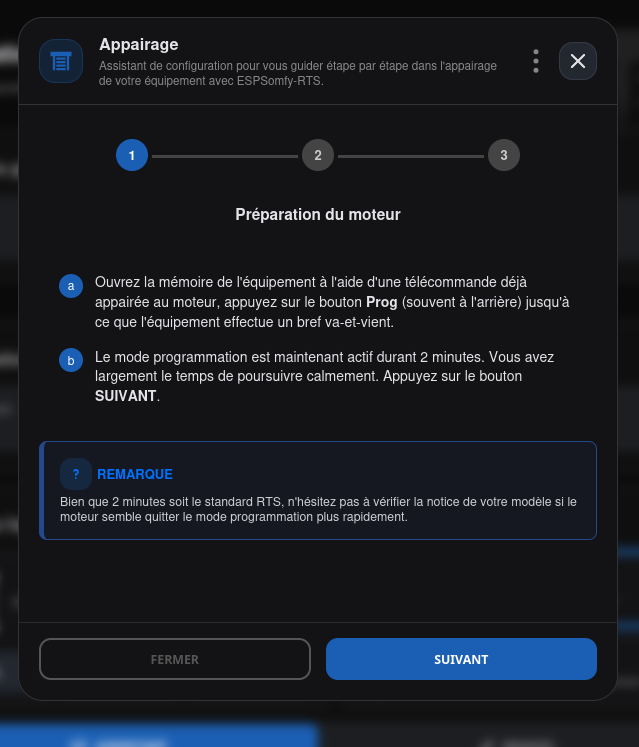
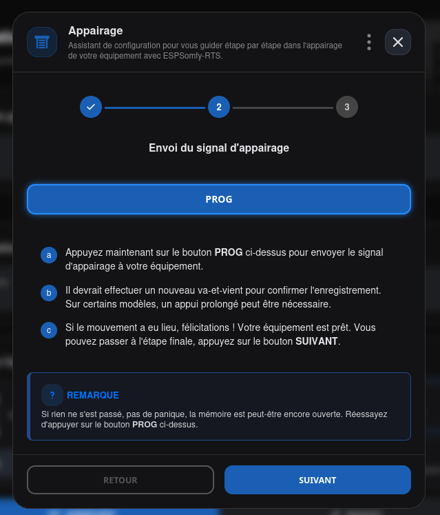
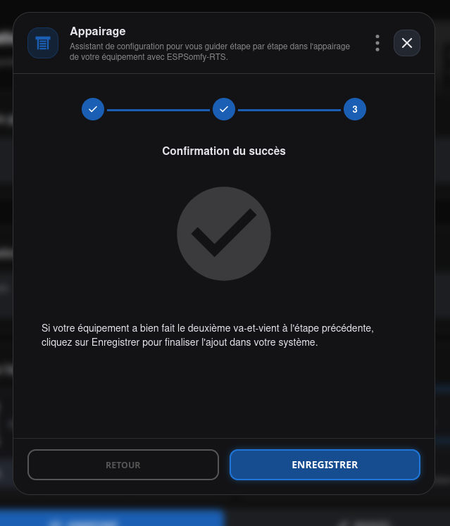
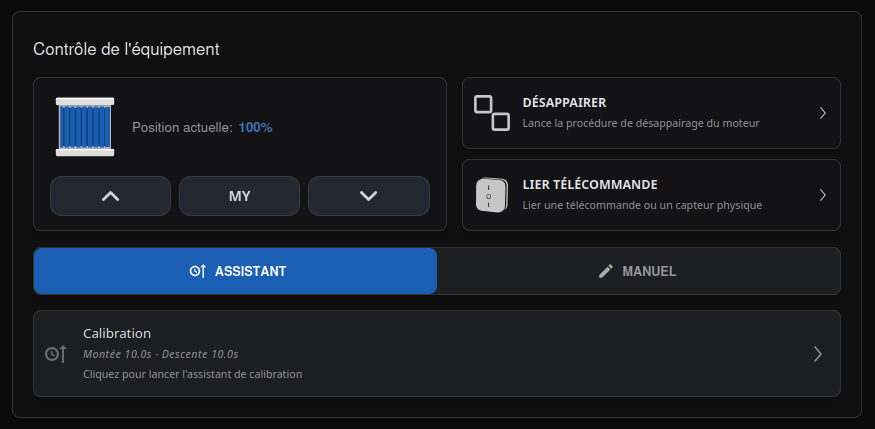
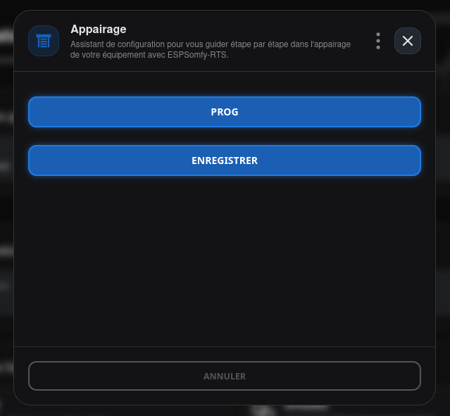

# Appairage (Pairing)

L'appairage consiste à enregistrer l'adresse de votre ESPSomfy-RTS dans la mémoire du moteur. Cette procédure est identique à l'ajout d'une nouvelle télécommande physique.

Le bouton **APPAIRER** apparaît dans la fiche équipement une fois celle-ci créée — voir [EQUIPEMENTS](index.md).

!!! important "Important"

    **Le "Jog" est votre seul indicateur :** Les moteurs ne renvoient aucune confirmation numérique. La seule façon de savoir si l'opération a réussi est d'observer l'équipement faire un bref mouvement de va-et-vient (le "jog").

**Procédure étape par étape :**

1.  **Ouvrir l'assistant** : Cliquer sur le bouton **APPAIRER**, l'assistant s'affichera et vous indiquera toutes les étapes à suivre.
2.  **Ouvrez la mémoire du moteur** : Prenez votre télécommande d'origine (déjà fonctionnelle) et appuyez sur le bouton **PROG** au dos jusqu'à ce que l'équipement fasse un "jog".
3.  **Enregistrement** : Cliquez sur le bouton **PROG** de l'assistant.
    * Si l'équipement fait à nouveau un "jog", l'appairage est réussi !
    * S'il ne bouge pas, ne validez pas. Réessayez l'étape 1.
4.  **Valider Enregistrement** : Cliquez sur le bouton **APPAIRAGE RÉUSSI**, l'assistant se fermera de lui-même.

Le bouton **APPAIRER** est devenu **DÉSAPPAIRER** :

## Le Mode Expert

Si vous avez de nombreux équipements à configurer et que vous maîtrisez le principe du "Jog", le suivi pas à pas de l'assistant classique peut s'avérer répétitif.

Un bouton à trois points, en haut de l'assistant, ouvre un petit menu à deux entrées :
**Mode Guidé** (l'assistant pas à pas par défaut) et **Mode Expert**, qui regroupe toutes les
commandes essentielles sur une seule page, sans étapes intermédiaires. Vous pouvez basculer de
l'un à l'autre à tout moment pendant l'appairage, sans perdre votre progression — le mode
choisi est mémorisé pour les fois suivantes.

!!! tip "Astuce"

    Ce mode est idéal pour les installations denses : il fait gagner un temps précieux en évitant les allers-retours dans les menus de l'assistant standard.

!!! warning "Avertissement"

    **Honnêteté logicielle :** L'application vous demandera de confirmer si l'équipement a bougé. Ne dites pas "Oui" s'il ne l'a pas fait, sinon vous devrez passer par une procédure de désappairage pour recommencer proprement.

!!! note "Note"

    **Désappairer** : suivre exactement le même processus que l'appairage.

    **Fonctionnement en "Bascule" (Toggle)** : L'appairage et le désappairage utilisent la même commande. Si l'équipement fait plus d'un va-et-vient, vous venez probablement de supprimer le lien au lieu de le créer.

    **Portée Radio** : la portée de l'ESPSomfy-RTS est impressionnante (150-200 mètres sans obstacles ni interférences électromagnétiques). Si l'appairage échoue, le problème est rarement la distance, mais plutôt le mode programmation du moteur qui s'est refermé trop vite.

