# Assistant de calibration

L'assistant de calibration chronomètre automatiquement les temps de montée, de descente et
d'inclinaison d'un équipement en le faisant réellement bouger pendant que vous l'observez,
plutôt que de vous demander de saisir des secondes au jugé.

!!! warning "Avertissement"

    **L'équipement va réellement bouger pendant toute la procédure.** Dégagez la zone de
    course avant de commencer.

## Quand l'utiliser

Il remplace la saisie manuelle des temps dans la section **Temps de course et Inclinaison**
de la fiche équipement (voir [EQUIPEMENTS](index.md)) : un commutateur **Assistant /
Manuel** bascule entre les deux, réglé sur **Assistant** par défaut. Comme tout le bloc
**Contrôle de l'équipement** qui le contient, ce commutateur reste masqué tant que
l'équipement n'a pas été créé une première fois — l'assistant a besoin d'un identifiant
déjà attribué pour pouvoir envoyer de vraies commandes radio.

Il n'est disponible que pour les équipements qui ont une notion de course ou d'inclinaison —
store enrouleur, volet, store vénitien, rideaux, store banne, garage, portail. Les
interrupteurs (1 ou 2 boutons), sans position mémorisable, n'ont pas accès à l'assistant : il
n'y a rien à chronométrer.

Les étapes diffèrent selon que votre équipement a ou non une **inclinaison** (store
vénitien, rideaux — voir la liste des [types d'équipement](index.md#types-déquipement-disponibles)) :

- Pas d'inclinaison (store enrouleur, volet, store banne, garage, portail) → section
    [Étapes pour un équipement sans inclinaison](#étapes-pour-un-équipement-sans-inclinaison),
    plus courte.
- Inclinaison → section
    [Étapes pour un équipement avec inclinaison](#étapes-pour-un-équipement-avec-inclinaison),
    qui inclut des étapes supplémentaires.

## Principe général

À chaque étape de mesure, le bouton **`Démarrer`** envoie la commande de mouvement réelle à
l'équipement et lance un chronomètre affiché en continu (dixièmes de seconde). Vous observez
l'équipement et cliquez au bon moment — le bouton **`Arrêter`** arrête à la fois le moteur et
le chronomètre. Pendant qu'un chronométrage est en cours, impossible de fermer l'assistant
ou de changer d'étape : on ne peut pas abandonner un moteur en plein mouvement par erreur.

Un bouton **`Annuler`**, en dessous de **`Arrêter`**, permet d'arrêter le moteur sans
enregistrer la mesure si vous vous êtes trompé de moment. Après toute tentative (valide ou
annulée), **`Démarrer`** devient **`Refaire`**.

Une mesure de moins de 0,5 seconde ou de plus de 180 secondes (3 minutes) est rejetée avec
un message d'erreur et **n'écrase jamais** une valeur déjà enregistrée — recommencez-la.

### Pourquoi deux repères, parfois ?

Un moteur Somfy ne sait pas « où » se trouve l'équipement : il tourne pendant un temps
donné, c'est tout. Un petit décalage peut donc exister entre ce que fait le moteur et ce que
vous voyez — c'est pour capturer ce décalage que deux repères sont proposés à la montée
comme à la descente, au lieu d'un seul.

- **À la montée, le décalage est au début.** Vous cliquez sur **`Démarrer`**, le moteur se
    met à tourner tout de suite, mais l'équipement, lui, peut mettre un court instant avant de
    bouger réellement — le temps de rattraper un peu de jeu mécanique dans la sangle, la
    chaîne ou l'axe. Si vous observez ce délai, cliquez sur **`L'équipement commence à
    bouger`** dès qu'il s'ébranle, puis continuez à observer jusqu'à ce qu'il soit
    complètement ouvert pour cliquer sur **`L'équipement est ouvert`**. S'il part sans délai
    perceptible, ignorez simplement le premier bouton : un seul clic sur **`L'équipement est
    ouvert`** suffit.

- **À la descente, le décalage est à la fin — et inversé.** L'équipement peut sembler arrivé
    en bas et immobile **avant** que le moteur, lui, ne finisse vraiment de tourner : il force
    encore quelques instants contre la butée de fin de course. Repérez d'abord l'instant où
    l'équipement **a l'air** fermé avec **`L'équipement est fermé`**, puis le moment où le
    moteur s'arrête **réellement** — le bruit cesse — avec le bouton principal, **`Le moteur
    s'est arrêté`**.

Dans les deux cas, cet écart — au début pour la montée, à la fin pour la descente — est la
**zone morte** : un temps de fonctionnement réel du moteur qui ne correspond à aucun
déplacement visible de l'équipement. Si vous ne cliquez jamais le repère intermédiaire, la
zone morte reste à 0 — c'est le cas le plus courant, pour un équipement sans jeu mécanique
perceptible. Une zone morte de plus de 0,5 seconde reste correctement prise en compte par
ESPSomfy-RTS, mais signale en général un jeu mécanique anormal (sangle, chaîne, coffre mal
réglé) qu'il vaut la peine de faire vérifier par votre installateur.

## Étapes pour un équipement sans inclinaison

Un indicateur d'étapes (1-2-3-4) s'affiche en haut de l'assistant tout au long de la
procédure.

### 1. Introduction

<a href="../../img/assistant-de-calibration-pos-1.png">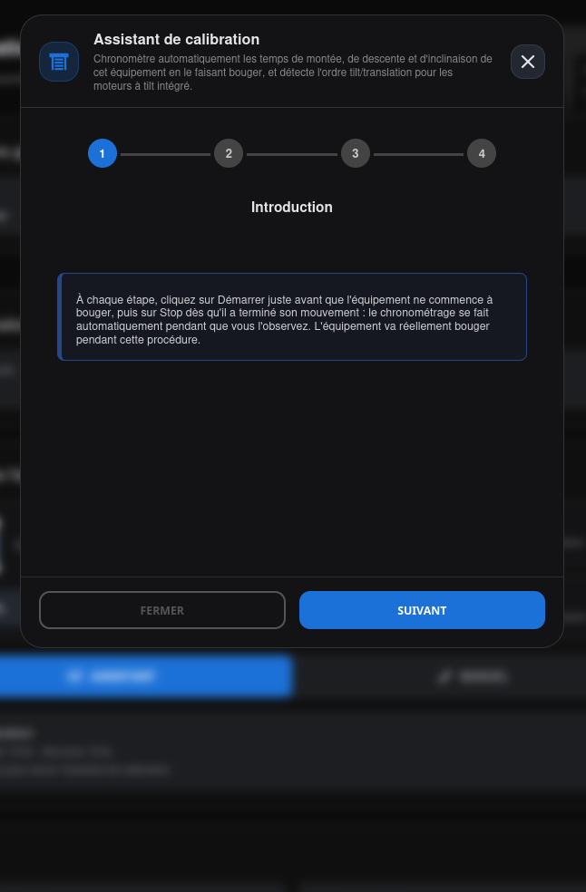</a>

Rappel du principe avant de commencer : cliquer sur **`Démarrer`** juste avant que
l'équipement ne commence à bouger, puis sur **`Arrêter`** dès qu'il a terminé son mouvement
— le chronométrage se fait automatiquement pendant que vous l'observez.

### 2. Temps de montée

<a href="../../img/assistant-de-calibration-pos-2.png">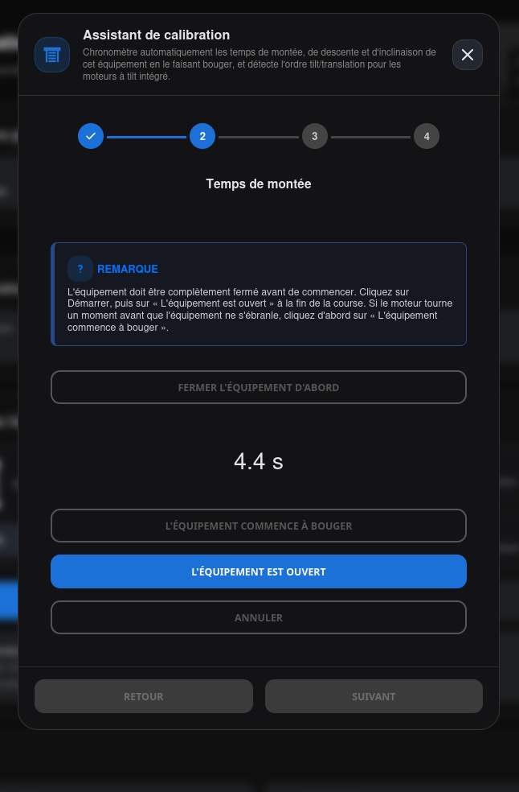</a>
<a href="../../img/assistant-de-calibration-pos-2-bis.png">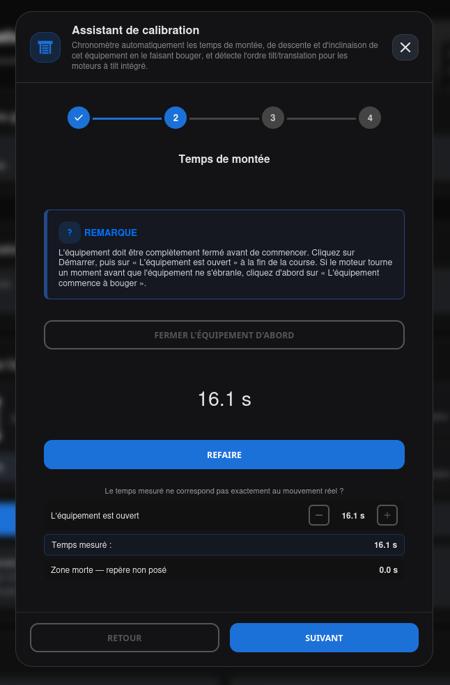</a>

Un encadré **Remarque** rappelle la marche à suivre : l'équipement doit être complètement
fermé avant de commencer. Un bouton de préparation optionnel, **`Fermer l'équipement
d'abord`**, remet l'équipement dans cet état si besoin.

Les deux repères **`L'équipement commence à bouger`** (optionnel) et **`L'équipement est
ouvert`** (bouton final) sont expliqués [plus haut](#pourquoi-deux-repères-parfois-).

Après un arrêt, un réglage fin apparaît en dessous : la liste des repères posés, chacun avec
un +/- pour corriger de 0,1 s sans refaire toute la mesure, ainsi que le **Temps mesuré** et
la **Zone morte** — voir [EQUIPEMENTS](index.md#assistant-ou-manuel) pour son usage dans
le calcul final.

### 3. Temps de descente

<a href="../../img/assistant-de-calibration-pos-3.png">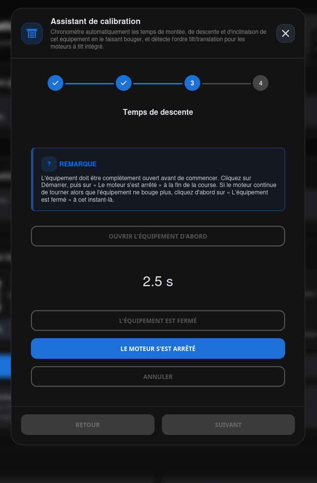</a>

Même principe que la montée, inversé : l'équipement doit être complètement ouvert avant de
commencer (bouton de préparation **`Ouvrir l'équipement d'abord`**). Les deux repères
**`L'équipement est fermé`** (optionnel) et **`Le moteur s'est arrêté`** (bouton final) sont
expliqués [plus haut](#pourquoi-deux-repères-parfois-).

### 4. Résumé

<a href="../../img/assistant-de-calibration-pos-4.png">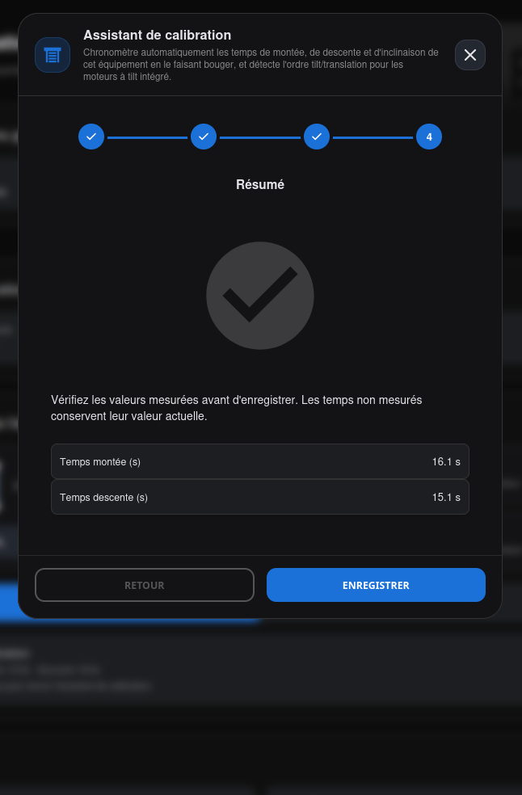</a>

Récapitule les temps mesurés avant d'enregistrer. Les temps que vous n'avez pas mesurés à
cette session gardent leur valeur actuelle — l'assistant ne les écrase pas à zéro. Si rien
n'a été mesuré du tout, un message le signale explicitement et rien n'est modifié.

## Étapes pour un équipement avec inclinaison

Un indicateur d'étapes s'affiche en haut de l'assistant tout au long de la procédure — leur
nombre dépend du type de mécanisme choisi à l'étape 1, voir le détail ci-dessous.

### 1. Introduction

<a href="../../img/assistant-de-calibration-incl-1.png">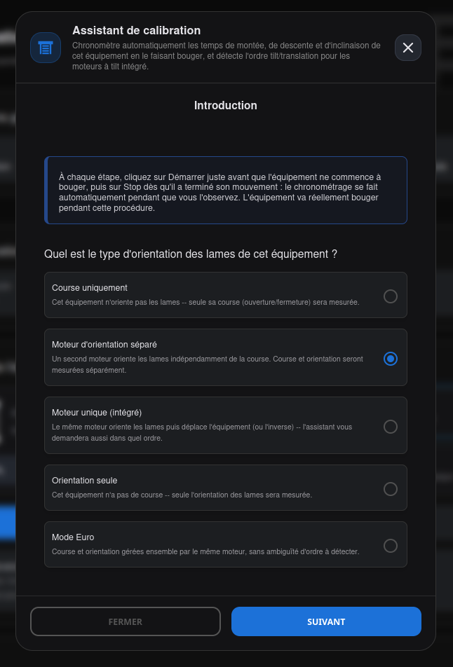</a>

Après le rappel du principe **`Démarrer`**/**`Arrêter`**, l'assistant demande le type de
mécanisme — la réponse détermine les étapes suivantes :

* **Course uniquement** (**4 étapes**) : cet équipement n'oriente pas les lames — seule sa
    course (ouverture/fermeture) sera mesurée. Ramène exactement au parcours
    [sans inclinaison](#étapes-pour-un-équipement-sans-inclinaison) ci-dessus : Introduction,
    Temps de montée, Temps de descente, Résumé — aucune étape de temps d'inclinaison.
* **Moteur d'orientation séparé** (**6 étapes**) : un second moteur oriente les lames
    indépendamment de la course — course et orientation seront mesurées séparément.
    Introduction, Temps de montée, Temps de descente, Temps d'inclinaison (montée), Temps
    d'inclinaison (descente), Résumé.
* **Moteur unique (intégré)** (**7 étapes**) : le même moteur oriente les lames puis déplace
    l'équipement (ou l'inverse) — l'assistant demandera aussi dans quel ordre. Les 6 étapes
    ci-dessus, plus **Ordre tilt/translation** juste avant le Résumé (voir plus bas).
* **Orientation seule** (**4 étapes**) : cet équipement n'a pas de course — seule
    l'orientation des lames sera mesurée. Introduction, Temps d'inclinaison (montée), Temps
    d'inclinaison (descente), Résumé — **pas d'étape Temps de montée/descente**, cet
    équipement ne se déplace pas.
* **Mode Euro** (**6 étapes**) : course et orientation gérées ensemble par le même moteur,
    sans ambiguïté d'ordre à détecter. Mêmes 6 étapes que « Moteur d'orientation séparé »
    ci-dessus.

!!! note "Note"

    Changer cette réponse réinitialise toutes les mesures déjà prises à cette session et
    reconstruit les étapes suivantes en conséquence.

### 2. Temps de montée

<a href="../../img/assistant-de-calibration-incl-2.png">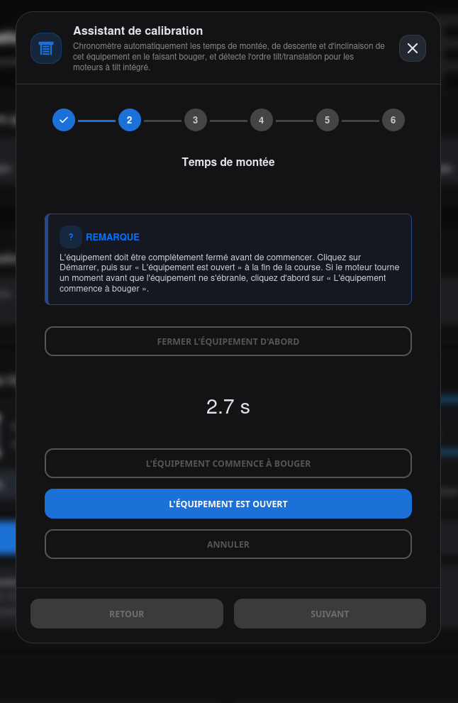</a>

Identique à l'étape équivalente du parcours sans inclinaison : les repères **`L'équipement
commence à bouger`** (optionnel) et **`L'équipement est ouvert`** (bouton final) sont
expliqués [plus haut](#pourquoi-deux-repères-parfois-).

### 3. Temps de descente

<a href="../../img/assistant-de-calibration-incl-3.png">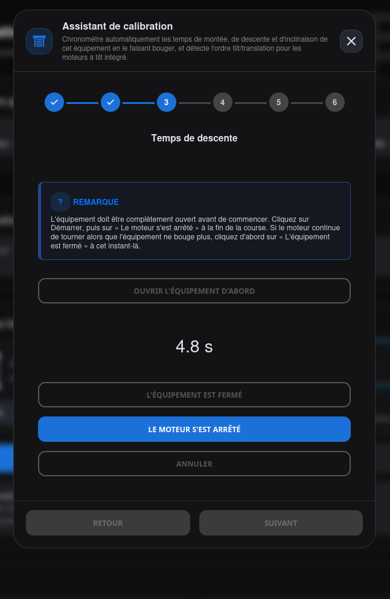</a>
<a href="../../img/assistant-de-calibration-incl-3-bis.png">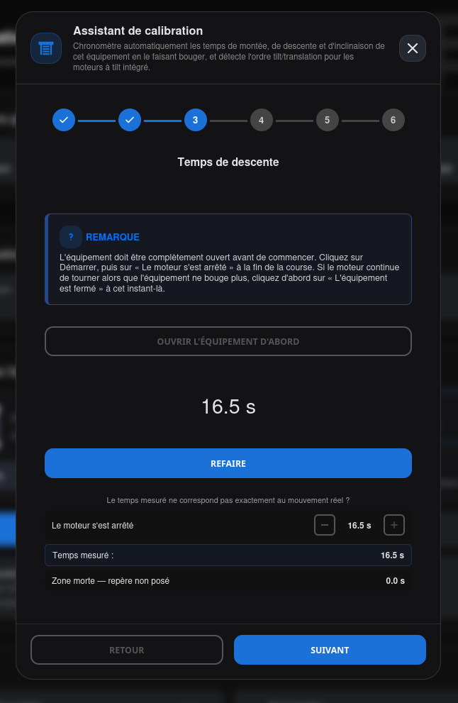</a>

Identique à l'étape équivalente du parcours sans inclinaison : les repères **`L'équipement
est fermé`** (optionnel) et **`Le moteur s'est arrêté`** (bouton final) sont expliqués
[plus haut](#pourquoi-deux-repères-parfois-).

### 4. Temps d'inclinaison (montée)

<a href="../../img/assistant-de-calibration-incl-4.png">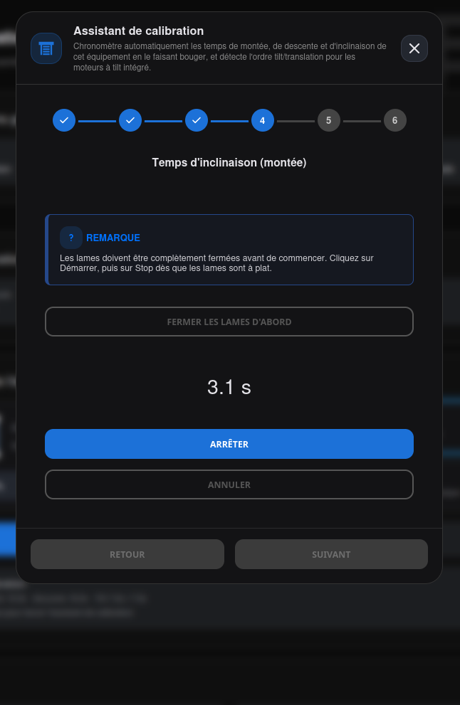</a>
<a href="../../img/assistant-de-calibration-incl-4-bis.png">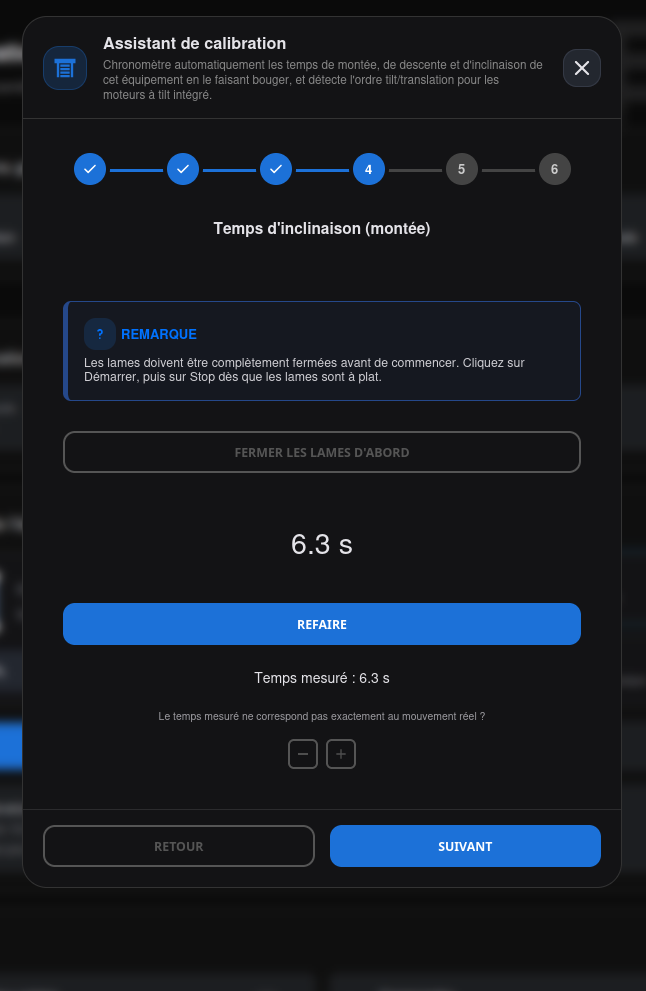</a>

Un seul bouton **`Arrêter`** (pas de repère intermédiaire ni de zone morte sur
l'inclinaison) : les lames doivent être complètement fermées avant de commencer (bouton de
préparation **`Fermer les lames d'abord`**), puis **`Arrêter`** dès qu'elles sont à plat.
Pour un mécanisme à **moteur unique (intégré)**, l'instruction change : vous cliquez
**`Arrêter`** dès que les lames s'arrêtent de s'incliner et que l'équipement commence à se
déplacer — c'est la frontière entre les deux phases d'un même mouvement moteur.

### 5. Temps d'inclinaison (descente)

<a href="../../img/assistant-de-calibration-incl-5.png">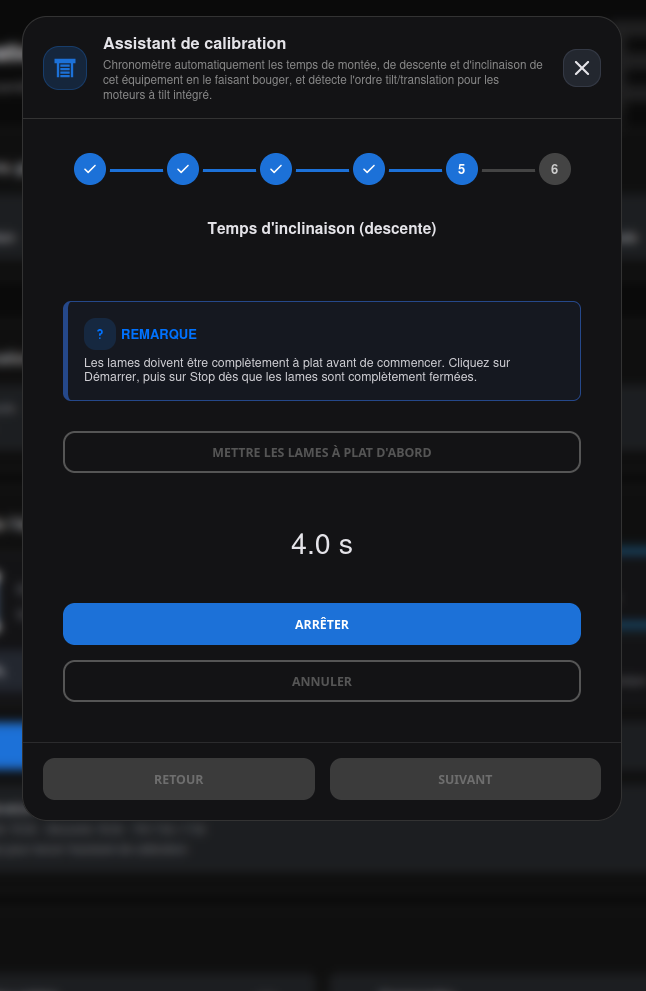</a>
<a href="../../img/assistant-de-calibration-incl-5-bis.png">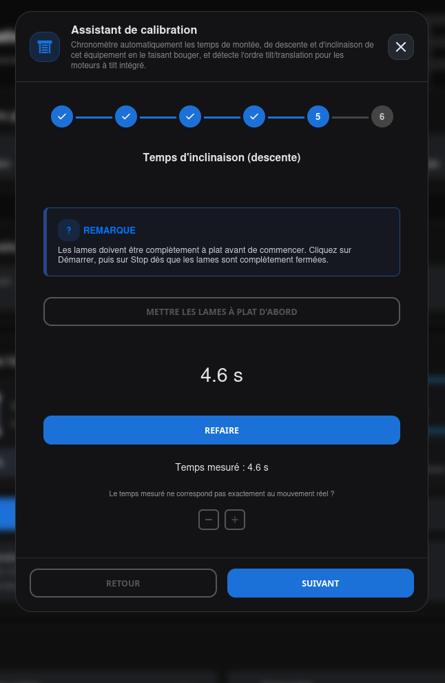</a>

Même principe, inversé : les lames doivent être complètement à plat avant de commencer
(bouton de préparation **`Mettre les lames à plat d'abord`**), puis **`Arrêter`** dès
qu'elles sont complètement fermées.

### 6. Ordre tilt/translation (moteurs intégrés uniquement)

<a href="../../img/assistant-de-calibration-incl-6-bis.png">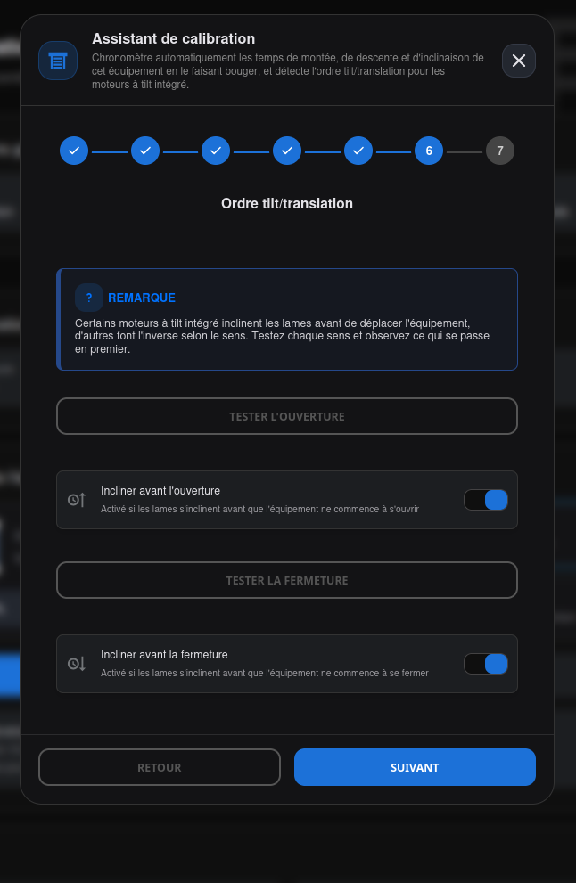</a>

Étape supplémentaire, propre aux mécanismes à moteur unique — elle décale le Résumé à
l'étape 7 lorsqu'elle est présente. Certains moteurs inclinent les lames avant de déplacer
l'équipement, d'autres font l'inverse selon le sens. Deux boutons de test — **`Tester
l'ouverture`** et **`Tester la fermeture`** — déclenchent un mouvement réel pendant que vous
observez ce qui se passe en premier ; réglez ensuite l'interrupteur correspondant selon ce
constat (*Incliner avant l'ouverture* / *Incliner avant la fermeture*).

### 6-7. Résumé

<a href="../../img/assistant-de-calibration-incl-6.png">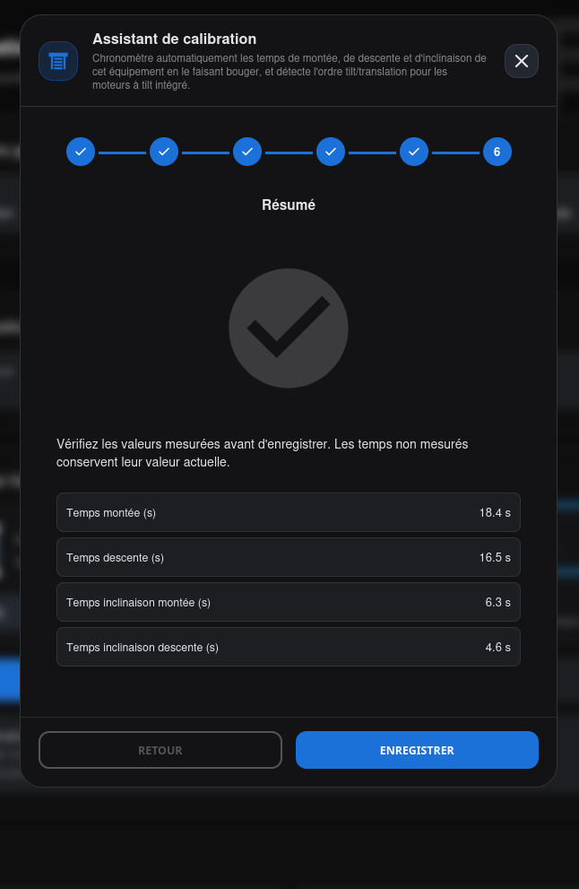</a>

Dernière étape (6 en général, 7 avec un moteur intégré). Récapitule les temps mesurés avant
d'enregistrer. Les temps que vous n'avez pas mesurés à cette session gardent leur valeur
actuelle — l'assistant ne les écrase pas à zéro. Si rien n'a été mesuré du tout, un message
le signale explicitement et rien n'est modifié.

## Calibration de l'inclinaison 80-bit (Step Size)

Le curseur **Pas (Step Size)**, pour les moteurs 80-bit, est un réglage manuel indépendant de
cet assistant — voir [EQUIPEMENTS](index.md#assistant-ou-manuel).

