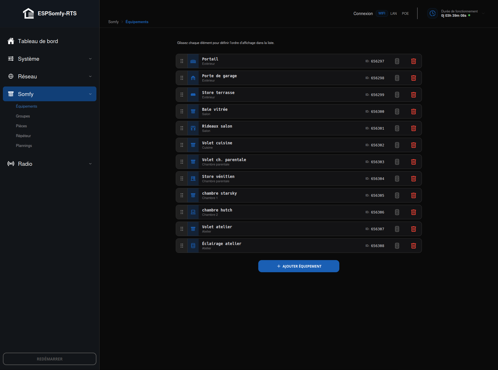
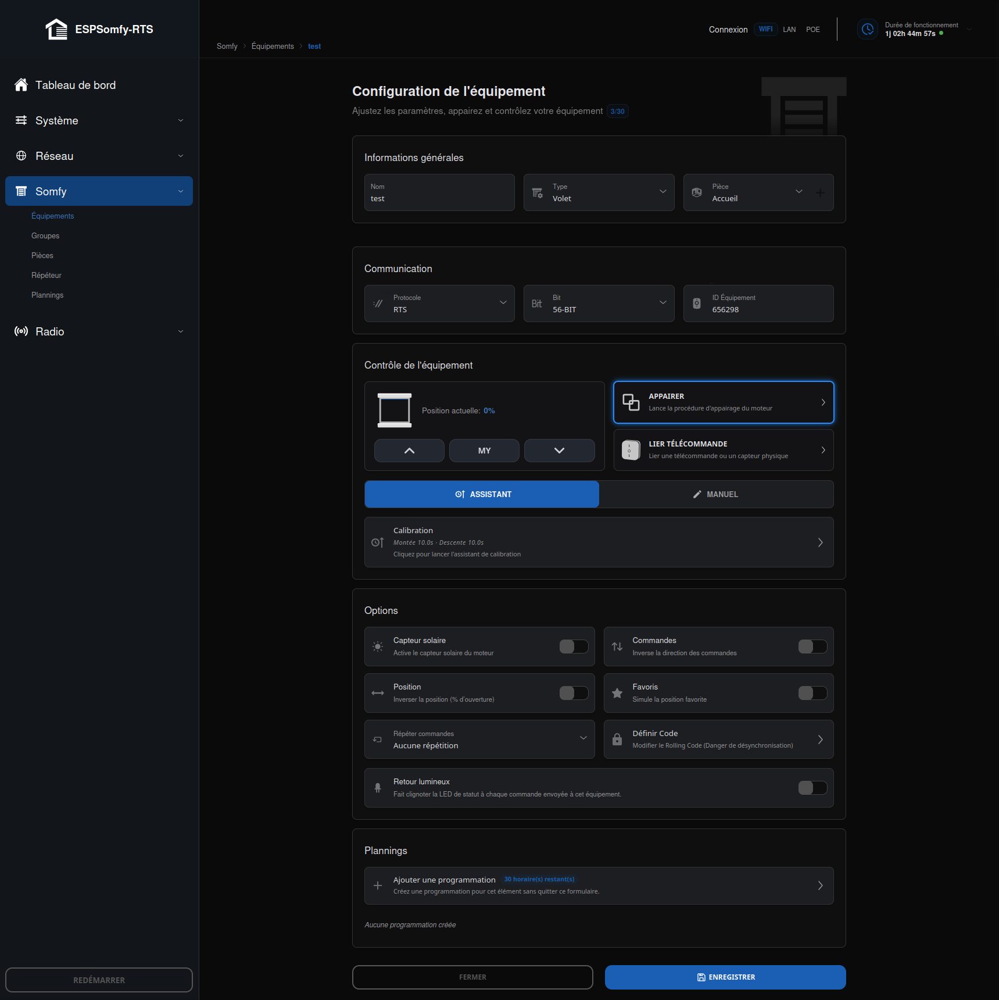

# Équipements

L'onglet **Somfy → Équipements** regroupe deux écrans distincts : la liste de vos
équipements, et la fiche qui sert à en créer ou en modifier un.

## Liste des équipements

Tant qu'aucun équipement n'existe, un message *« Aucun équipements n'a été configuré »*
invite à cliquer sur **AJOUTER ÉQUIPEMENT**. Une fois plusieurs créés, chacun s'affiche en
carte cliquable (ouvre sa fiche d'édition), composée de gauche à droite :

* une **poignée** ⠿ pour réordonner la liste par glisser-déposer (souris ou tactile) — le
    nouvel ordre est enregistré **immédiatement** au relâchement, sans bouton de validation
    séparé ;
* l'**icône du type** choisi ;
* le **nom**, avec la **pièce** assignée juste en dessous si elle est définie ;
* à droite : l'**ID** de l'équipement, une icône **télécommande** qui ouvre directement la
    [télécommande virtuelle](../telecommande-virtuelle.md)) de cet équipement, et
    une icône **poubelle** qui le supprime.

## Page d'édition

Cliquer sur **AJOUTER ÉQUIPEMENT**, ou sur une carte existante dans la liste, ouvre cette
fiche pour créer ou modifier l'« identité numérique » d'un moteur — nom, type, temps de
course, protocole… tout ce dont ESPSomfy-RTS a besoin pour rester synchronisé avec vos
télécommandes physiques. La fiche s'organise en blocs, dans cet ordre exact :

!!! note "Note"

    Deux blocs — **Contrôle de l'équipement** et **Plannings** — restent **masqués tant que
    l'équipement n'a pas été créé** : impossible d'appairer ou de
    programmer un équipement qui n'a pas encore d'identifiant. Une fois l'équipement créé ils apparaissent
    comme dans la capture ci-dessus (équipement déjà créé).

## Informations générales

* **Nom** : limité à **20 caractères**, n'importe quel caractère imprimable.
* **Type** : détermine l'icône, les boutons de contrôle disponibles et les champs qui
    apparaissent plus bas sur cette même fiche (inclinaison, GPIO, contact sec…). Valeur par
    défaut d'un nouvel équipement : **Volet**.
* **Pièce** : zone d'affichage (défaut : **Accueil**). Le bouton **+** juste à côté permet de créer si besoin une
    nouvelle pièce sans quitter cette fiche — voir [Pièces (Rooms)](../pieces.md)) pour leur
    gestion complète.

### Capacité

ESPSomfy-RTS gère jusqu'à **30 équipements** au total — identifiants 1 à 30, les deux
extrêmes de la plage interne (0 et 31) étant réservés en coulisses et jamais attribués.

### Types d'équipement disponibles

| Icône | Nom | Description | Fonctions |
| :---: | :--- | :--- | :--- |
| { width="60" } | **Store enrouleur** | Toile pleine qui s'élève ou s'abaisse via un tube rotatif supérieur. | Haut, Bas, My, Soleil |
|  | **Volet** | Tablier composé de lames articulées s'enroulant dans un coffre. | Haut, Bas, My, Soleil |
|  | **Store vénitien** | Lames reliées par des cordons. Seul type proposant un mécanisme d'inclinaison (Tilt). | Haut, Bas, My, Tilt, Soleil |
|  | **Rideau (gauche)** | Tringle coulissante qui s'ouvre de la droite vers la gauche (fixé à gauche). | Haut, Bas, My, Soleil |
|  | **Rideau (droit)** | Tringle coulissante qui s'ouvre de la gauche vers la droite (fixé à droite). | Haut, Bas, My, Soleil |
|  | **Rideau (centre)** | Rideau à deux panneaux s'ouvrant depuis le centre vers les côtés. | Haut, Bas, My, Soleil |
| { width="60" } | **Store banne** | Mécanisme horizontal qui se déploie pour couvrir une zone (terrasse). | Haut, Bas, My, Soleil |
|  | **Garage (1 bouton)** | Une seule fonction cyclique (Toggle), sans position mémorisable. | Cycle |
|  | **Garage (3 boutons)** | Commandes distinctes : Ouvrir, Fermer, Stop. | Haut, Bas, My |
|  | **Interrupteur (1 bouton)** | Contact sec : simple bascule On/Off sur une seule broche. | Cycle |
|  | **Interrupteur (2 boutons)** | Contact sec : une broche pour l'activation, une pour la désactivation. | Haut, Bas |
|  | **Portail (gauche)** | Trois commandes distinctes : Ouvrir, Fermer, Stop. | Haut, Bas, My |
|  | **Portail (centre)** | Trois commandes distinctes, portail à deux battants. | Haut, Bas, My |
|  | **Portail (droit)** | Trois commandes distinctes, vantail représenté à droite. | Haut, Bas, My |
|  | **Portail 1 bouton (gauche)** | Même principe que Garage (1 bouton), vantail gauche. | Cycle |
| { width="60" } | **Portail 1 bouton (centre)** | Même principe que Garage (1 bouton), deux battants. | Cycle |
|  | **Portail 1 bouton (droit)** | Même principe que Garage (1 bouton), vantail droit. | Cycle |

!!! tip "Astuce"

    **Portes de garage/portails :** même si votre télécommande physique n'a qu'un bouton,
    essayez d'abord la version « 3 boutons » / à commandes séparées — la plupart des moteurs
    récents la gèrent nativement, et c'est bien plus fiable pour l'automatisation.

## Communication

* **Protocole** : **RTS**, **RTW**, **RTV**, **IO-Relay** ou **IO_Remote**.
    * **RTS** : protocole radio Somfy standard.
    * **RTW** : apparu en Europe sous la marque ASA Motors.
    * **RTV** : variante marquée pour fonctionner à 433,92 MHz.
    * **IO-Relay** et **IO_Remote** : malgré leur nom, **rien à voir avec le protocole
        Somfy io-homecontrol** — ce sont les deux modes de pilotage par **contact sec /
        relais GPIO** (bistable pour l'un, boutons séparés pour l'autre). Les sélectionner
        remplace le champ **Bit** par trois menus **GPIO Montée/My/Descente** — voir
        [Contrôle des moteurs avec GPIO](../../materiel/controle-moteurs-gpio.md) pour le câblage et
        le détail complet.
  > Le protocole proposé par défaut à la création reprend celui actuellement configuré
  > dans **Radio → Configuration** — idem pour le nombre de bits.

* **Bit** : **56-bit** ou **80-bit** — masqué si le protocole est IO-Relay/IO_Remote. Les
    mécanismes d'inclinaison intégrés utilisent souvent le 80-bit.
* **ID Équipement** : adresse radio unique sur 24 bits, générée par défaut à partir de
    l'adresse MAC de votre ESP32. **Doit rester unique** parmi tous vos équipements et
    télécommandes à portée — l'appareil vérifie l'unicité à l'enregistrement.

  > [!CAUTION]
  > Ne modifiez jamais cet identifiant après avoir appairé l'équipement : le moteur ne
  > reconnaîtrait plus aucun ordre tant qu'il n'est pas réappairé.

## Contrôle de l'équipement

*Visible uniquement une fois l'équipement enregistré une première fois.*

La carte de gauche affiche la position actuelle et les boutons Haut/My/Bas — ou un unique
bouton Toggle pour les types à commande cyclique (garage/portail 1 bouton). À droite,
**Appairer** (ou **Désappairer** selon l'état) et **Lier Télécommande** ouvrent
respectivement [Appairage (Pairing)](appairage.md)) et
[Liaison Télécommande](liaison-telecommande.md)).

Sur un équipement **80-bit**, un curseur **Taille du pas** (1 à 1 000, défaut **100**)
règle le pas de la molette d'inclinaison — à ajuster par expérimentation pour trouver le
bon ratio levée/inclinaison. Masqué en 56-bit, en IO-Relay/IO_Remote, et pour les types
garage/portail 1 bouton.

### Assistant ou Manuel

Un commutateur choisit comment régler les temps de course :

* **Assistant** *(proposé par défaut sur un équipement existant)* : une carte résumée
    (« Montée X,Xs · Descente Y,Ys », complétée d'une mention Tilt si applicable) ouvre au
    clic l'assistant de chronométrage guidé — voir
    [Assistant de Calibration](calibration.md) pour le déroulé complet.
* **Manuel** *(seul mode disponible, et proposé par défaut, lors de la création — l'assistant
    ne peut rien chronométrer sur un équipement qui n'a pas encore d'identifiant)* :
    * **Temps montée / descente (s)** : de 0,1 à 180 s, pas de 0,1 s.
    * **Compenser une zone morte** : à cocher si le moteur continue de tourner à vide
        quelques secondes (jeu mécanique) sans que l'équipement bouge réellement — révèle
        **Zone morte montée/descente (s)**, mêmes bornes. Décochée, aucune zone morte n'est
        envoyée (un équipement sans jeu mécanique, le cas le plus courant, n'en a pas
        besoin). Absent si le type n'a pas de course (contact sec) ou si l'inclinaison est en
        mode « Inclinaison seule ».
    * **Type d'inclinaison** *(Store vénitien uniquement)* : **Aucun**, **Moteur
        inclinaison** (séparé, pressions longues sur la télécommande), **Intégré** (un seul
        moteur lève et incline — ferme l'inclinaison en fin de course avant de bouger),
        **Inclinaison seule**, ou **Inclinaison Euro** (pressions courtes/longues). Si un
        mode autre qu'Aucun est choisi, les champs **Temps inclinaison montée/descente (s)**
        apparaissent (mêmes bornes 0,1-180 s).
    * **Incliner avant l'ouverture / avant la fermeture** *(mode Intégré uniquement)* :
        deux cases cochées par défaut.

## Options

* **Déclenchement niveau bas** *(IO-Relay/IO_Remote uniquement)* — voir
    [Contrôle des moteurs avec GPIO](../../materiel/controle-moteurs-gpio.md).
* **Capteur solaire** : active la gestion du soleil pour les moteurs compatibles (un
    capteur physique doit être lié au moteur pour que cela fonctionne). Masqué pour
    garage/interrupteur/portail.
* **Commandes** : inverse le sens Haut/Bas envoyé — à n'utiliser que si l'équipement
    descend quand vous appuyez sur Monter ; la bonne pratique reste de corriger le sens
    directement sur le moteur.
* **Position** *(ou **État** pour un contact sec)* : par défaut **100 % = Fermé** (logique
    Somfy). Cochez pour inverser cette convention — ou, pour un contact sec, pour inverser
    le libellé Marche/Arrêt affiché.
* **Favoris** : simule la position « My » par calcul du temps de trajet, pour les moteurs
    qui ne la supportent pas nativement. Absent pour Garage 1 bouton, Interrupteur (1 et 2
    boutons) et Portail 1 bouton.
* **Mode de sortie** *(contact sec uniquement)* : **Bistable** ou **Impulsion**.
* **Temps d'impulsion** *(contact sec en mode Impulsion uniquement)* : 50 à 10 000 ms, pas
    de 10 ms, défaut **200 ms**.
* **Vocabulaire d'état** *(contact sec uniquement)* : **Marche/Arrêt** *(défaut)*,
    Allumé/Éteint, Ouvert/Fermé, ou Actif/Inactif.
* **Répéter commandes** : de **0** (« Aucune répétition », défaut) à **20** — chaque ordre
    radio est renvoyé ce nombre de fois en plus du premier.

  > [!TIP]
  > Utile pour les moteurs à pile qui « s'endorment » et répondent lentement — restez
  > raisonnable : chaque répétition retarde d'autant la commande suivante, l'appareil ne
  > pouvant pas écouter pendant qu'il émet.

* **Définir Code** : voir [ci-dessous](#définir-code-rolling-code).
* **Retour lumineux** : fait clignoter la LED de statut à chaque commande envoyée à cet
    équipement. N'apparaît que si une LED de statut est configurée sur votre appareil (voir
    [Témoin LED de statut](../../firmware/led-de-statut.md), ou nativement sur les
    [boîtiers officiels](../../materiel/boitiers-officiels.md)).

### Définir Code (Rolling Code)

Permet de modifier manuellement le code tournant (rolling code) d'un équipement — à
utiliser avec une extrême prudence.

!!! danger "Attention"

    Chaque commande envoyée incrémente ce code de 1 dans la mémoire du moteur. Si le code
    envoyé par ESPSomfy-RTS ne correspond pas à celui attendu (en dehors d'une petite
    fenêtre de tolérance), le moteur ignore la commande par sécurité.

!!! note "Note"

    Surtout utile en cas de restauration d'une configuration sur un nouveau module. Une
    désynchronisation oblige généralement à réinitialiser complètement la mémoire du moteur
    — une procédure fastidieuse. Vous pouvez ouvrir cette fenêtre uniquement pour consulter
    la valeur actuelle par curiosité, mais ne modifiez rien sans savoir exactement ce que
    vous faites.

## Plannings

*Visible uniquement une fois l'équipement enregistré une première fois.*

Le bouton **Ajouter une programmation** affiche un compteur d'horaires restants — voir
[Plannification](plannification.md) pour leur création et leur gestion.

!!! note "Note"

    30 plannings au total : ce quota est **global à l'appareil**, partagé entre tous les équipements et groupes
    — pas une allocation propre à cette fiche. Le même nombre
    s'affiche donc, à l'instant T, sur la fiche de n'importe quel autre équipement ou
    groupe.

## Procédures liées

Index des procédures déclenchables depuis cette page et documentées sur leur propre page :

- [Assistant de Calibration](calibration.md) — chronométrage guidé des temps de
    course, depuis le commutateur **Assistant** du bloc Contrôle de l'équipement ;
    uniquement accessible depuis cette fiche.
- [Appairage (Pairing)](appairage.md)) — enregistrer (ou retirer) l'adresse de
    l'ESPSomfy-RTS dans la mémoire du moteur, boutons **APPAIRER**/**DÉSAPPAIRER** ;
    uniquement accessible depuis cette fiche.
- [Liaison Télécommande (Link Remote)](liaison-telecommande.md)) — faire suivre
    une télécommande ou un capteur physique, bouton **LIER TÉLÉCOMMANDE** ; uniquement
    accessible depuis cette fiche.
- [Pièces (Rooms)](../pieces.md)) — créer une pièce à la volée via le bouton **+** du
    champ Pièce ; a aussi son propre onglet, indépendant de cette fiche.
- [Plannification](plannification.md) — programmer des déclenchements automatiques, bouton
    **Ajouter une programmation** ; a aussi son propre onglet **Plannings**.
- [Télécommande Virtuelle (Virtual Remote)](../telecommande-virtuelle.md)) —
    icône sur chaque carte de la [liste](#liste-des-équipements) ; le même bouton existe
    aussi sur les cartes de la liste des [groupes](../groupes/index.md)).

