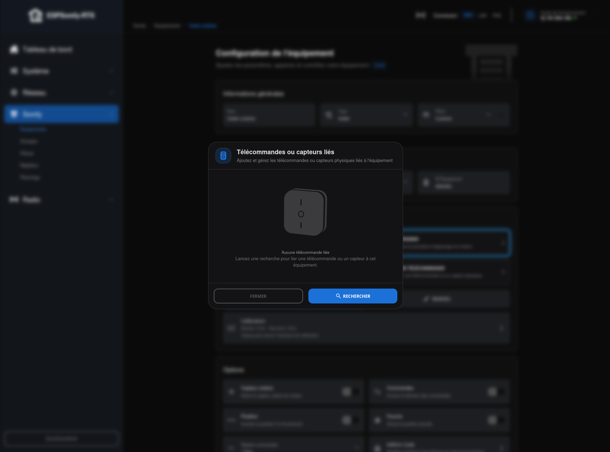
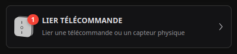
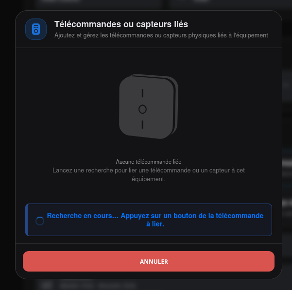
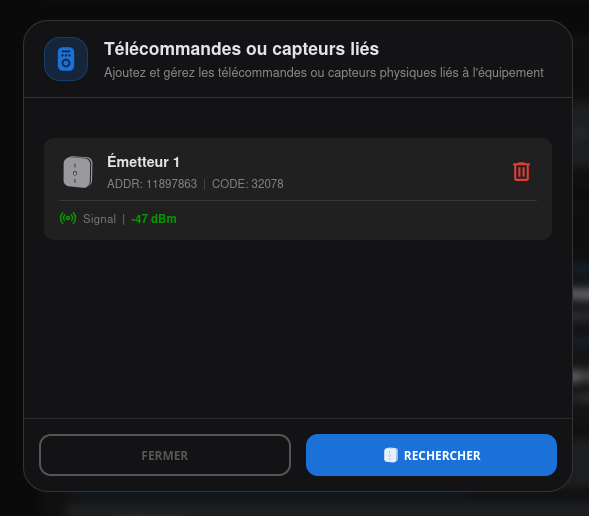

# Liaison télécommande (Link Remote)

Pour que l'ESPSomfy-RTS puisse suivre précisément la position de vos équipements, il doit
« écouter » vos télécommandes physiques. Si vous ne liez pas vos télécommandes, l'interface
affichera une position erronée dès que vous utiliserez un bouton réel.

Le bouton **Lier Télécommande** apparaît dans la fiche équipement une fois celle-ci créée —
voir [EQUIPEMENTS](index.md). Un badge rouge y affiche le nombre de télécommandes déjà
liées, dès qu'il y en a au moins une.

Vous pouvez lier jusqu'à **7 canaux** par équipement — c'est une limite réelle du firmware,
pas un choix d'interface.

!!! important "Important"

    **Cas des Groupes :** Si vous avez une télécommande (ex: Telis 4 canaux) qui commande
    plusieurs équipements en même temps, vous devez lier ce canal à **chaque équipement**
    défini dans l'interface.

## Procédure de liaison

1. **Ouvrez la fenêtre** : cliquez sur **Lier Télécommande**. La liste des télécommandes
    déjà liées s'affiche, avec un bouton **Rechercher** en bas pour en lier une nouvelle.
2. **Mise en écoute** : cliquez sur **Rechercher** — le bouton devient **Annuler** et un
    bandeau d'attente apparaît.
3. **Action physique** : appuyez simplement sur un bouton de votre télécommande réelle (le
    bouton **MONTER** est le plus simple).
4. **Détection automatique** : dès que l'ESPSomfy-RTS entend le signal, il capture
    l'adresse de la télécommande, l'ajoute à la liste, et la mise en écoute s'arrête
    d'elle-même.

## La liste des télécommandes liées

Chaque télécommande liée apparaît sous forme de carte (*« Émetteur 1 »*, *« Émetteur 2 »*…),
composée de :

* l'**ADDR** et le **CODE** : l'adresse radio de la télécommande et son dernier code
    tournant reçu ;
* une icône **poubelle**, qui retire la télécommande de la liste ;
* en dessous, séparée par un filet, la ligne **Signal** : la force du signal radio de cette
    télécommande précise, en dBm — **mise à jour à chaque appui** sur un bouton de cette
    télécommande, pratique pour repérer en direct une télécommande mal placée ou à portée
    limite, sans attendre un problème de commande. Cette valeur vit en mémoire côté appareil
    (remise à zéro à chaque redémarrage), mais reste affichée grâce à une sauvegarde locale
    dans le navigateur.

## Liaison des capteurs (Linking Sensors)

Si vous possédez des capteurs automatiques (comme le capteur de soleil/vent **Soliris** ou
le capteur de vent **Eolis**), vous devez également les lier à vos équipements, exactement
comme s'il s'agissait d'une télécommande manuelle.

Bien que ces capteurs n'envoient pas de commandes « bouton », l'ESPSomfy-RTS intercepte
leurs signaux radio et les traduit en actions (ex : « Le vent souffle trop fort, le store
remonte »). Sans cette liaison, votre interface ne saura pas que le store s'est replié par
sécurité.

**Procédure pour les capteurs :**

La méthode est identique à celle d'une télécommande (**Lier Télécommande**), mais vous
devez forcer le capteur à émettre un signal pendant que la fenêtre est en écoute.

* **Options pour déclencher le signal :**
    * Faire tourner l'anémomètre (le « moulinet ») rapidement (un sèche-cheveux ou un
        souffleur de feuilles font l'affaire).
    * Couvrir le capteur solaire pour simuler un changement de luminosité.
    * Appuyer brièvement sur le bouton **PROG** du capteur s'il en possède un.

Une fois que l'ESPSomfy-RTS entend le signal du capteur, la mise en écoute s'arrête
d'elle-même et le capteur apparaît dans la liste des appareils liés.

