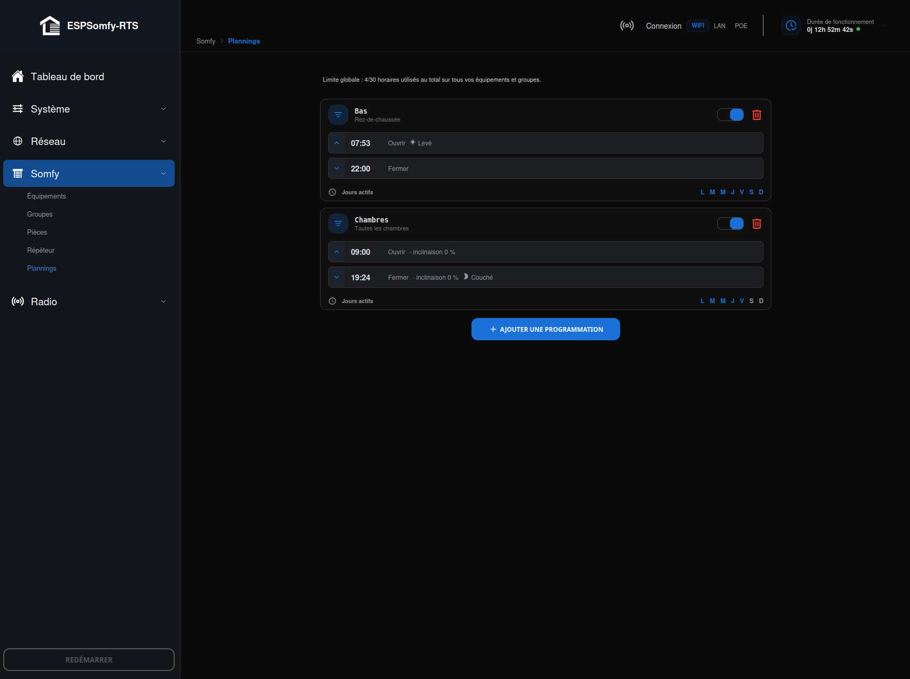
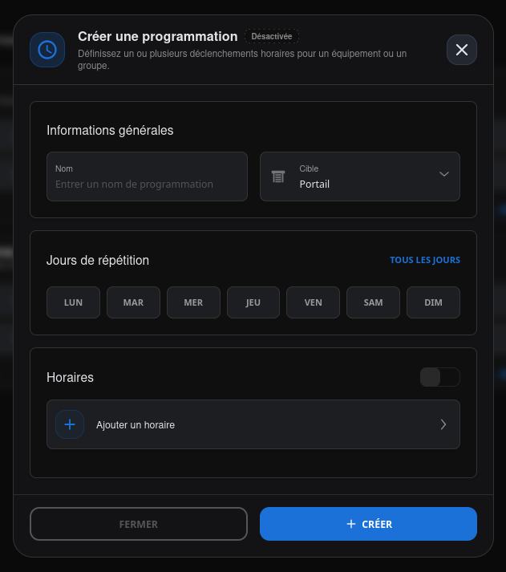
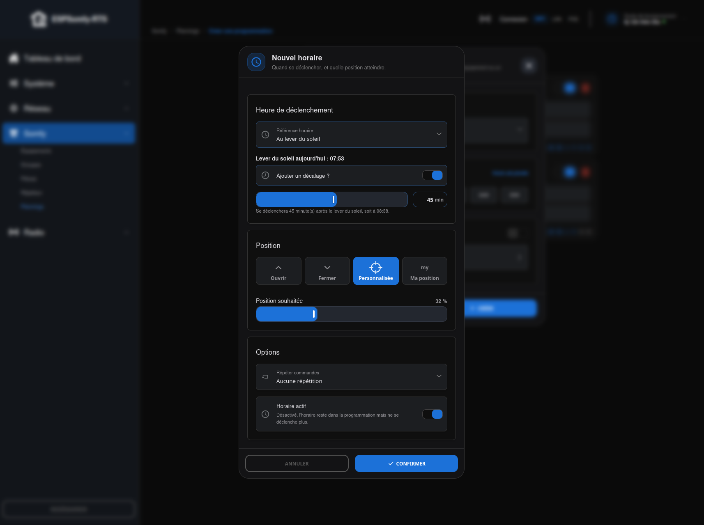

# Plannification

Une **programmation** (planning) déclenche automatiquement un mouvement sur un équipement ou
un groupe, à une heure fixe ou au lever/coucher du soleil, les jours de la semaine de votre
choix.

Depuis le [tableau de bord](../../tableau-de-bord.md), la carte **dépliée** d'un équipement ou d'un
groupe liste ses plannings et permet d'**en ajouter un rapidement**.

!!! tip "Astuce"

    Si vous disposez déjà d'un système domotique (Home Assistant via l'intégration
    **ESPSomfy-RTS Enhanced** — voir [Général](../../general/index.md#intégration-home-assistant) — ou
    équivalent), préférez-lui vos automatisations : il n'a aucune des limites décrites plus
    bas (30 horaires au total, pas de condition supplémentaire, pas de scène croisant plusieurs
    appareils) et ouvre des possibilités bien plus riches. Les programmations de cette page
    restent la solution la plus simple si vous n'avez pas un tel système, ou pour un
    déclenchement basique qui ne justifie pas d'en dépendre.

## Liste des programmations

Tant qu'aucune programmation n'existe, un message *« Aucune programmation créée »* invite à
cliquer sur **Ajouter une programmation**. Une fois plusieurs créées, chaque programmation
existante s'affiche sous forme de carte — sur la page Plannings comme dans le bloc inline
d'un équipement — cliquable pour rouvrir l'éditeur complet, sauf les zones suivantes qui
interceptent leur propre clic :

* **En-tête** : l'icône de la cible (celle du groupe, ou celle du type d'équipement visé),
    le **nom** de la programmation — ou, si aucun nom n'est défini, l'heure de son premier
    horaire — avec la **cible** (équipement ou groupe) en sous-titre sur la page Plannings
    globale ; un badge **Désactivée** si toute la programmation est coupée ; un
    **interrupteur** qui bascule l'état actif/inactif sans ouvrir l'éditeur ; une icône
    **poubelle** (confirmation demandée).
* **Corps** : une ligne par horaire — heure effective, action, suffixe d'inclinaison le cas
    échéant, indicateur lever/coucher du soleil si c'est le déclencheur, et son propre badge
    **Désactivée** si seul cet horaire précis est coupé au sein d'une programmation par
    ailleurs active.
* **Pied** : la liste des jours de la semaine, ceux actifs mis en évidence.

!!! note "Note"

    Contrairement aux listes Équipements/Groupes/Pièces, celle-ci ne se réordonne pas par
    glisser-déposer : l'ordre suit automatiquement l'**heure effective de déclenchement** de
    chaque programmation (lever/coucher du soleil résolu en heure locale) — une règle solaire
    sans [position géographique](../../general/position-geographique.md) configurée est reléguée en fin de liste.

## Éditeur de programmation

## Où créer une programmation

Deux chemins mènent au même éditeur :

- **Depuis l'onglet dédié Plannings**, dans la navigation principale : la liste complète de
    toutes vos programmations, tous équipements et groupes confondus, avec un bouton
    **Ajouter une programmation**.
- **Depuis la fiche d'un équipement ou d'un groupe déjà créé** — voir
    [EQUIPEMENTS](index.md) — un bloc dédié liste les programmations déjà associées à cet
    élément précis et propose son propre bouton **Ajouter une programmation**, qui ouvre
    l'éditeur directement par-dessus la fiche, sans la fermer. La cible est alors déjà
    présélectionnée.

## Ce qu'une programmation déclenche

Une programmation vise **un seul équipement ou un seul groupe** — jamais plusieurs cibles
différentes à la fois. Pour viser un groupe, déclarez le groupe en question (voir
[GROUPES (Groups)](../groupes/index.md))) : chaque membre du groupe recevra le mouvement.

Une même programmation peut contenir **plusieurs horaires** (étapes), par exemple "8h00 →
ouvrir" et "17h00 → fermer" dans la même fiche, chacun avec son propre déclencheur et sa
propre action.

## Déclencheur

Chaque horaire se déclenche selon l'un de ces trois modes :

- **Heure fixe** : une heure précise, tous les jours cochés.
- **Au lever du soleil**
- **Au coucher du soleil**

Pour les deux déclencheurs solaires, un curseur de **décalage** (de -12h à +12h) permet de se
déclencher un certain temps avant ou après l'événement — l'interface affiche directement le
résultat en clair : *« Se déclenchera X minute(s) avant le coucher du soleil, soit à
HH:MM. »*

!!! important "Important"

    Les déclencheurs solaires exigent que la position géographique de l'appareil soit
    configurée (latitude/longitude). Sans elle, l'interface affiche un avertissement et une
    mention *« non configuré »* à côté des options concernées — voir
    [Position Géographique](../../general/position-geographique.md). Un
    horaire solaire sans position configurée est tout simplement ignoré par le firmware à
    chaque vérification, sans erreur visible.

## Jours actifs

Un sélecteur de 7 boutons (lundi à dimanche) détermine les jours où l'horaire se déclenche,
avec un raccourci **Tout sélectionner**. Il n'existe pas de mode "une seule fois" ni de plage
de dates (pas de "mode vacances") : au moins un jour doit être coché pour pouvoir enregistrer.

## Action

Chaque horaire peut :

- déplacer l'équipement à une **position fixe** (0 à 100 %) ;
- l'envoyer à sa **position favorite (My)** — la vraie commande RTS "My", pas une position
    recalculée ;
- ou, pour les équipements à inclinaison, ajuster **seulement l'inclinaison** sans toucher à
    la hauteur.

Il n'y a pas de condition supplémentaire (pas de "seulement si ensoleillé", pas de "sauter si
déjà à cette position") : une programmation active se déclenche, point. Une valeur de
**répétitions** fiabilise l'envoi radio, comme pour une commande manuelle.

Chaque horaire peut aussi être **désactivé individuellement** sans être supprimé : il reste
dans la programmation mais ne se déclenche plus tant qu'il n'est pas réactivé.

## Limite

**30 horaires au total**, tous équipements et groupes confondus. La page Plannings affiche le quota global utilisé ; le bloc inline
dans la fiche équipement affiche le nombre d'emplacements restants. Au-delà, l'enregistrement
est refusé.

