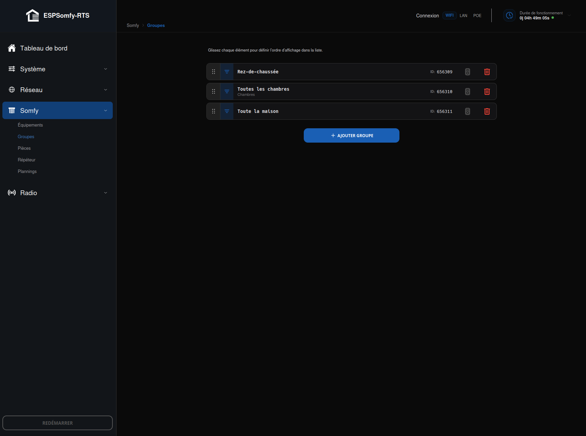
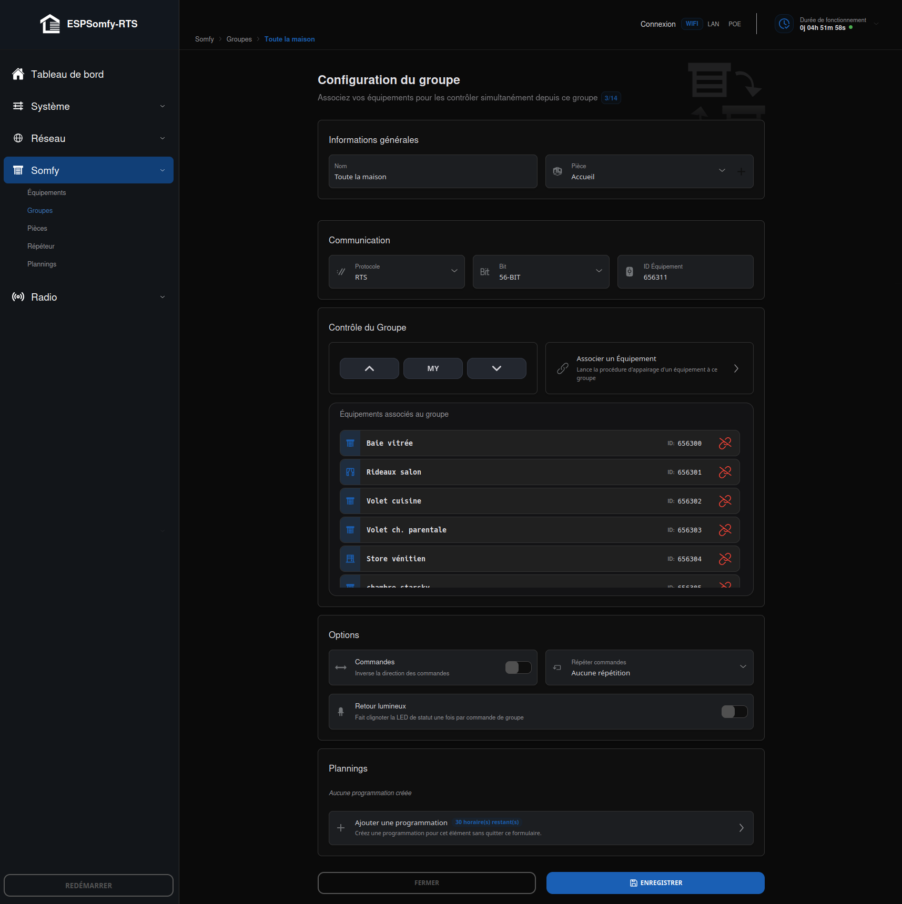

# Groupes (Groups)

ESPSomfy-RTS permet de créer des groupes d'équipements. Contrairement à une exécution
séquentielle (un équipement après l'autre), un groupe utilise une **adresse radio unique**
partagée : la commande Haut/Ma Position/Bas part en **une seule trame**, reçue
simultanément par tous les moteurs membres.

## Liste des groupes

Tant qu'aucun groupe n'existe, un message *« Il n'y a pas encore de groupe créé »*
invite à cliquer sur **AJOUTER GROUPE**. Une fois plusieurs créés, chacun s'affiche en
carte cliquable (ouvre sa fiche d'édition), composée de gauche à droite :

* une **poignée** ⠿ pour réordonner la liste par glisser-déposer (souris ou tactile) — le
    nouvel ordre est enregistré **immédiatement** au relâchement, sans bouton de validation
    séparé ;
* le **nom** du groupe, avec la **pièce** assignée juste en dessous si elle est définie ;
* à droite : l'**ID** du groupe, une icône **télécommande** qui ouvre directement la
    [télécommande virtuelle](../telecommande-virtuelle.md)) de ce groupe, et
    une icône **poubelle** qui le supprime.

!!! note "Note"

    Le nombre d'équipements membres ne s'affiche **pas** sur cette carte de liste.

## Caractéristiques techniques

* **Capacité** : jusqu'à **14 groupes**. Un groupe peut contenir au plus **30 équipements**
    — ce n'est pas un plafond propre au groupe, mais le nombre maximal d'équipements que
    l'appareil peut gérer au total (voir [EQUIPEMENTS](../equipements/index.md#capacité)) :
    un groupe ne peut jamais en contenir plus qu'il n'en existe.
* **Synchronisation native** : une seule commande radio est diffusée pour Haut/Ma
    Position/Bas. Tous les moteurs la reçoivent au même instant.
* **Performance radio** : réduit considérablement le trafic sur la fréquence 433,xx MHz,
    comparé à l'envoi d'une commande par équipement.
* **Positionnement en pourcentage** : le tableau de bord d'un groupe n'offre que Haut, Ma
    Position (My) et Bas — pas de curseur de position, les différences de timing entre moteurs ne
    permettant pas une seule trame de position valable pour tous. Un groupe reste néanmoins
    une **cible valide pour une [programmation](../equipements/plannification.md)** visant un pourcentage
    précis : dans ce cas, chaque équipement membre reçoit alors sa propre commande de
    positionnement et rejoint la cible indépendamment des autres — ce n'est plus une seule
    trame partagée, mais le résultat reste pratique à programmer.

## Page d'édition

Cliquer sur **Ajouter Groupe**, ou sur une carte existante dans la liste, ouvre cette
fiche. La fiche s'organise en blocs, dans cet ordre exact :

!!! note "Note"

    Deux blocs — **Contrôle du Groupe** et **Plannings** — restent **masqués tant que le
    groupe n'a pas été enregistré une première fois**. Le bloc **Options**, lui, reste
    visible dès la création — contrairement aux deux autres, il ne dépend pas d'un
    identifiant déjà attribué.

## Informations générales

* **Nom** : identifiant du groupe (ex : *Groupe Salon*). Limité à **20 caractères**.
* **Pièce** : assigne le groupe à une zone (par défaut : **Accueil**) — voir
    [Pièces (Rooms)](../pieces.md)). Le bouton **+** juste à côté du sélecteur permet d'en
    créer une nouvelle sans quitter cette fiche.

## Communication

* **Protocole** : `RTS`, `RTW` ou `RTV` — pas de protocole GPIO (`IO-Relay`/`IO_Remote`)
    pour un groupe, voir [EQUIPEMENTS](../equipements/index.md#communication) pour le détail de ces
    protocoles.
* **Bit** : **56-bit** ou **80-bit**, même logique de préréglage que pour un équipement.
* **ID Équipement** : identifiant unique de 24 bits, généré par défaut à partir de
    l'adresse MAC de votre ESP32. Ne le modifiez jamais après avoir associé des équipements.

## Contrôle du Groupe

*Visible uniquement une fois le groupe enregistré une première fois.*

Les boutons de contôle Haut/Ma Position(My)/Bas restent grisés et inactifs tant qu'aucun équipement n'est
associé. 
La carte **Lier l'équipement** lance la procédure décrite dans
[Lier un Équipement au Groupe](lier-un-equipement.md).
La liste **Équipements associés au groupe**
qui suit n'a pas d'état vide dédié — elle reste simplement masquée tant qu'elle est vide.
Chaque ligne de cette liste affiche :

* une **icône** représentant le type de l'équipement ;
* le **nom** de l'équipement ;
* son **ID** ;
* un bouton **délier** pour le retirer du groupe sans passer par l'assistant complet.

## Options

* **Commandes** : inverse le sens Haut/Bas envoyé — même logique que pour un équipement
    individuel.
* **Répéter commandes** : de **0** à **7** — une borne plus basse que pour un équipement
    seul (0 à 20), volontaire : un groupe de 8 membres répété plusieurs fois produirait
    autant d'éclats radio supplémentaires pour une seule action.
* **Retour lumineux** : fait clignoter la LED de statut **une fois par commande de
    groupe** envoyée, pas séparément pour chaque équipement membre. N'apparaît que si une
    LED de statut est configurée sur votre appareil — même condition que pour un équipement.

## Plannings

*Visible uniquement une fois le groupe enregistré une première fois.*

Comme pour un équipement, un bloc dédié liste les plannings déjà associés à ce groupe
avec un bouton **Ajouter une programmation** — voir [Plannification](../equipements/plannification.md).

## Procédures liées

Index des procédures déclenchables depuis cette page et documentées sur leur propre page :

- [Lier un Équipement au Groupe](lier-un-equipement.md) — lier ou délier un
    équipement via la carte **Lier l'équipement** ; uniquement accessible depuis cette
    fiche.
- [Pièces (Rooms)](../pieces.md)) — créer une pièce à la volée via le bouton **+** du
    champ Pièce ; a aussi son propre onglet, indépendant de cette fiche.
- [Plannification](../equipements/plannification.md) — programmer des déclenchements automatiques, bouton
    **Ajouter une programmation** ; a aussi son propre onglet **Plannings**.
- [Télécommande Virtuelle (Virtual Remote)](../telecommande-virtuelle.md)) —
    icône sur chaque carte de la [liste](#liste-des-groupes) ; **absente de cette fiche
    d'édition**, accessible uniquement depuis la liste et le tableau de bord.

