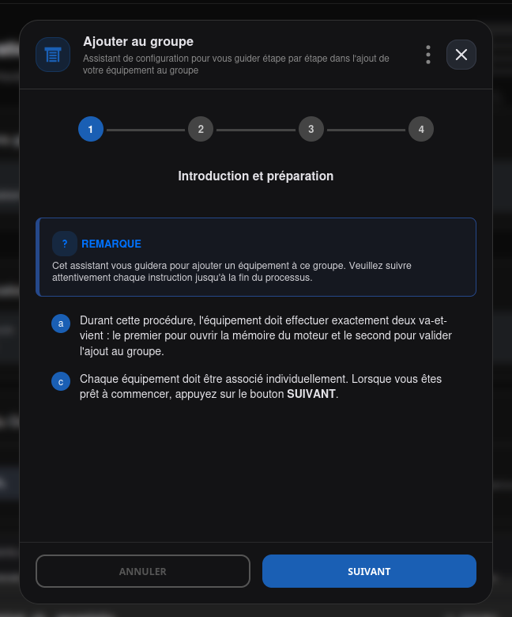
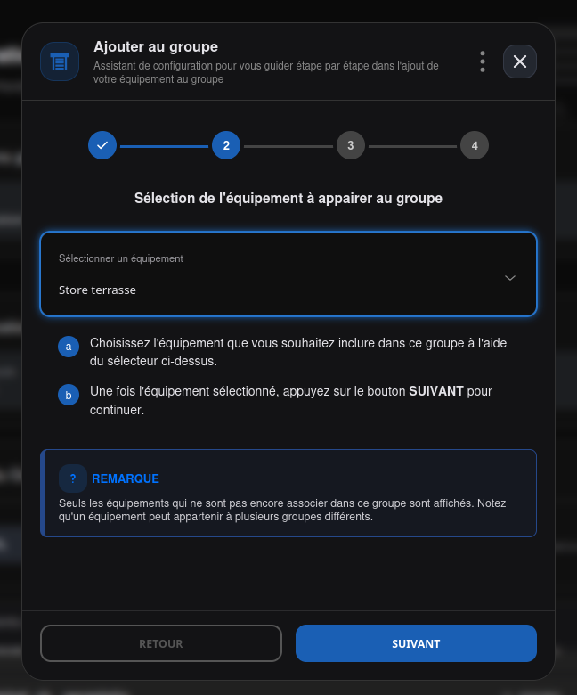
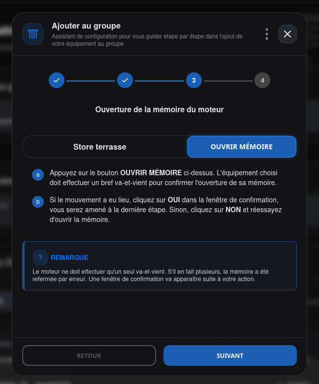
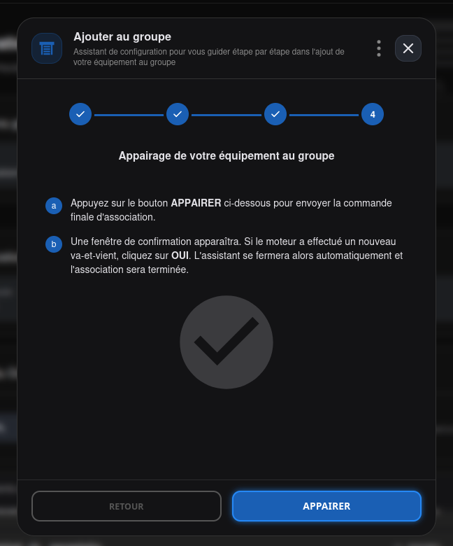
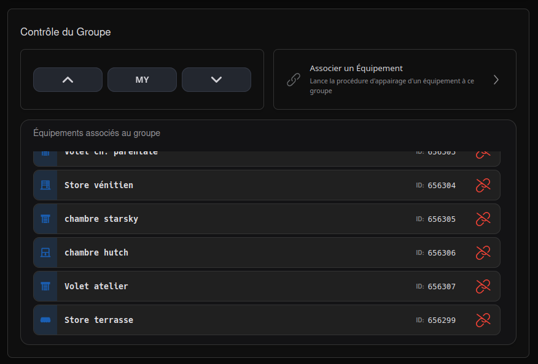

# Lier un équipement au groupe

Pour qu'un moteur réponde à une commande de groupe, il doit enregistrer l'**adresse du
groupe** dans sa mémoire, en plus de sa propre adresse individuelle. Cette liaison se fait
équipement par équipement : répétez la procédure pour chaque membre à ajouter.

Le bouton **Lier l'équipement** apparaît dans la fiche groupe une fois celle-ci créée —
voir [GROUPES (Groups)](index.md)#contrôle-du-groupe).

!!! note "Note"

    Les boutons portent les mêmes libellés courts que l'[appairage](../equipements/appairage.md)) d'un
    équipement seul (**Appairer**/**Désappairer**) par choix de vocabulaire, mais il s'agit
    d'une procédure **différente** en coulisses, avec son propre nombre d'étapes et ses
    propres appels réseau — ce n'est pas la même fonction qui s'exécute.

## Procédure de liaison

1. **Introduction** : l'équipement va devoir effectuer exactement **deux va-et-vient** — un
    pour ouvrir la mémoire du moteur, un second pour valider l'ajout au groupe.
2. **Sélection** : choisissez l'équipement à lier dans la liste déroulante — seuls les
    équipements pas encore membres de **ce** groupe apparaissent (un équipement peut
    appartenir à plusieurs groupes différents).
3. **Ouverture de la mémoire** : cliquez sur **Ouvrir Mémoire**. L'équipement doit faire un
    bref va-et-vient pour confirmer. S'il en fait plus d'un, la mémoire s'est refermée par
    erreur — recommencez.
4. **Association** : cliquez sur **Appairer**. Un nouveau va-et-vient du moteur confirme
    l'association — l'assistant se ferme alors de lui-même.

Une fois l'association confirmée, l'équipement apparaît dans la liste **Équipements
associés au groupe** :

## Délier un équipement

Icône lien brisé rouge sur chaque ligne de la liste **Équipements associés au groupe**.
Même principe en 3 étapes : introduction, ouverture de la mémoire, puis désappairage —
mêmes deux va-et-vient, dans le même esprit.

!!! important "Important"

    Délier n'est pas une simple suppression côté logiciel : l'étape de désappairage envoie
    une véritable commande radio au groupe, avec confirmation du mouvement moteur, avant de
    retirer le membre côté serveur. Si la procédure échoue, une télécommande physique du
    groupe peut aussi ouvrir la mémoire du moteur en maintenant le bouton **PROG** enfoncé.

