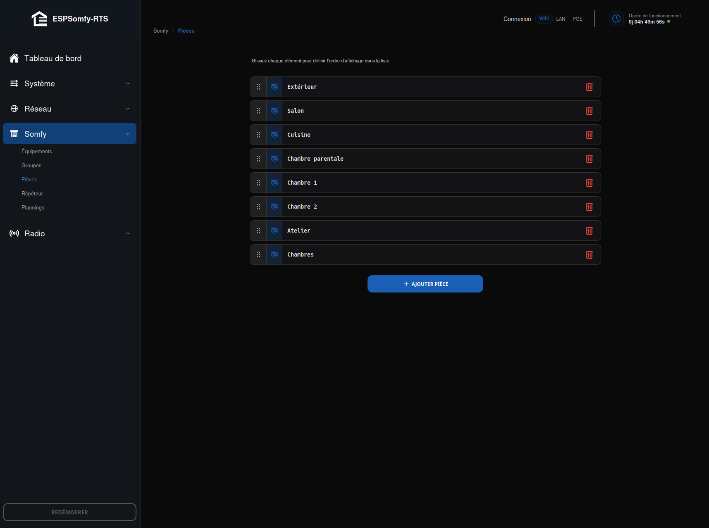
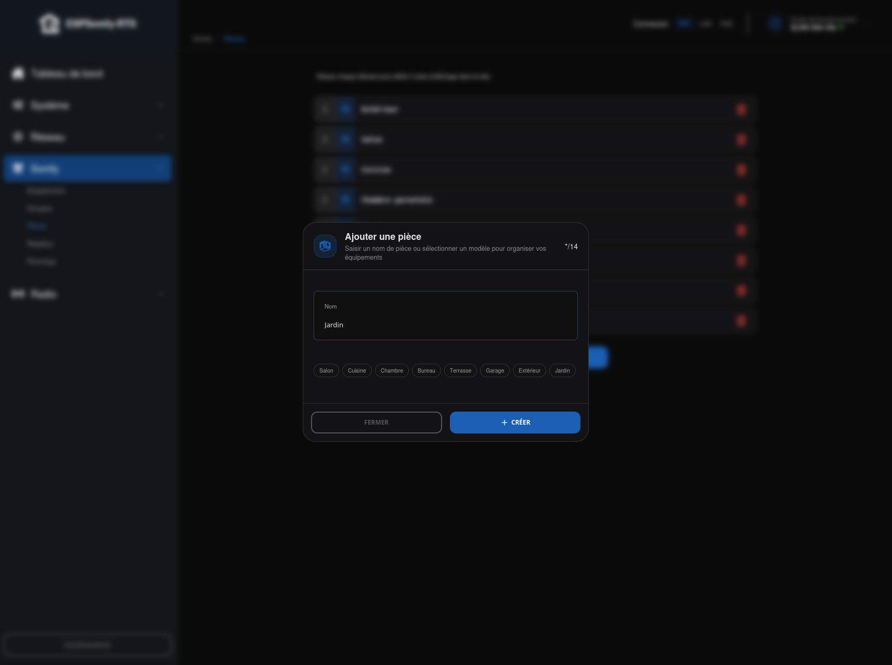

# Pièces (Rooms)

L'onglet **Pièces** est l'outil d'organisation principal de l'ESPSomfy-RTS. Il permet de
segmenter vos équipements par zones pour une navigation plus claire.

### Pourquoi organiser votre installation ?

Si vous possédez de nombreux équipements, l'affichage sur une seule page peut vite devenir
confus. Créer des pièces offre plusieurs avantages :

* **Clarté de l'interface** : Sur l'écran d'accueil, une barre de sélection des pièces
    apparaît. En choisissant "Cuisine", seuls les équipements de cette zone s'affichent.
* **Optimisation des noms** : Les noms des équipements sont limités à **20 caractères**.
    * *Exemple* : En assignant un équipement à la pièce `Cuisine`, vous pouvez simplement le
        nommer `Gauche` au lieu de `Volet Cuisine Gauche`.
* **Filtrage intelligent** : Les groupes peuvent également être assignés à des pièces pour
    simplifier la gestion — voir [GROUPES (Groups)](groupes/index.md)).

## Caractéristiques techniques

* **Capacité** : jusqu'à **14 pièces** personnalisées (la même logique de réserve que pour
    les [équipements](equipements/index.md#capacité) : 16 emplacements internes, 2 toujours
    soustraits).
* **Gestion de l'accueil** : Tous les équipements et groupes non assignés à une pièce
    spécifique sont regroupés par défaut dans la pièce principale **Accueil**, toujours
    présente et non supprimable.
* **Flexibilité** : Chaque nom de pièce accepte de **1 à 20 caractères**.

## Liste des pièces

Tant qu'aucune pièce personnalisée n'existe, un message *« Aucune pièce personnalisée n'a
été créée »* invite à cliquer sur **Ajouter Pièce**. Une fois créées, chaque pièce
s'affiche dans une carte plus simple que celle d'un équipement ou d'un groupe : une
**poignée** ⠿ pour la réordonner par glisser-déposer (souris ou tactile, ordre enregistré
immédiatement au relâchement), une icône fixe, puis seulement le **nom** — pas d'ID ni de
télécommande virtuelle, une pièce n'en a pas — et une icône **poubelle**.

!!! note "Note"

    Le nombre d'équipements/groupes qu'une pièce contient ne s'affiche pas sur cette carte :
    il apparaît en pastille chiffrée sur les sélecteurs de pièces en haut des pages
    Équipements et Groupes.

## Page d'édition

Cliquer sur **Ajouter Pièce**, ou sur une pièce existante dans la liste, ouvre cette
fenêtre — exactement le même composant dans les deux cas, seuls le titre, la description
et le libellé du bouton changent (**Ajouter une pièce** / **Créer** à la création,
**Modifier la pièce** / **Enregistrer** en édition).

Un seul champ réel : le **Nom** (1 à 20 caractères). Huit suggestions rapides apparaissent
en dessous — Salon, Cuisine, Chambre, Bureau, Terrasse, Garage, Extérieur, Jardin —
cliquer dessus remplit le nom directement, pratique pour une installation standard.

Une fois créées, ces pièces sont disponibles dans les menus déroulants lors de la
configuration de vos [équipements](equipements/index.md#informations-générales) ou de vos
[groupes](groupes/index.md)).

!!! tip "Astuce"

    **Créer une pièce sans quitter la fiche en cours :** un petit bouton **+** juste à côté du
    sélecteur **Pièce**, dans la fiche d'un équipement ou d'un groupe, ouvre directement
    l'écran "Ajouter une pièce" — exactement le même que celui de l'onglet Pièces. La fiche en
    cours d'édition reste ouverte derrière, vos modifications en attente ne sont pas perdues,
    et la pièce fraîchement créée se retrouve automatiquement sélectionnée dans le menu
    déroulant une fois l'opération terminée.

## Supprimer une pièce

Les équipements et groupes qui lui étaient assignés **ne disparaissent pas** : ils basculent
automatiquement dans la pièce **Accueil**. Un message vous le rappelle avant de confirmer la
suppression.

## Procédures liées

- [EQUIPEMENTS](equipements/index.md) et [GROUPES (Groups)](groupes/index.md)) — la pièce assignée à
    un équipement ou un groupe se change aussi directement depuis sa propre fiche, sans
    passer par cette page.

